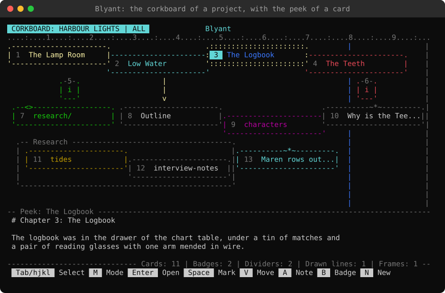

# Guide to the corkboard

The corkboard is a page where files are pinned as cards, like notes on a board, and placed where you want them: to plan a story by its chapters, or to keep the files you work on in view.

Each card shows the title of a file and a number, in a color you choose, and `Enter` opens the file. A card can also be a folder (research, scenes) or a note with a text you write.

You can keep several boards, and each [project](Guide-to-start-page.md#projects) can have a board, kept in the project folder.



Open it with `:board` (or `:corkboard`) from any command line (the start page, the file browser, the favorites, the history, the hotlist, the search results, the Jump menu and the editor), with **Corkboard** (`C`) on the Start tab of the start page, and with `:jump board` or the Blyant tab of the [Jump menu](Guide-to-jump-menu.md#jump-menu). It opens on top of the page you were on, and `Esc` takes you back there. `:board name` opens the board with that name (`:board main` the main board).

## Pinning files and folders
- `:pin` pins to the open board: in the editor the file being edited, and in the file browser, the favorites, the history, the hotlist and the search results the selected file or folder. The message gives the number of the card: `Pinned to the corkboard (4): Chapter one`. A file or folder can be pinned only once to a board; pin it again and you are told where the card is. A path with a tab or a line break in it (Linux and macOS allow them) cannot be pinned
- `N` (or `:new`) on the corkboard: pick a file in the file browser to pin
- `F` (or `:folder`) on the corkboard: pick a folder in the file browser to pin (go to it and press `S`)

The card of a file is edged in lines. The card of a folder has a tab (`<>`) on the top edge, and a `/` after the folder name, as in the file browser:

```
.----------------------.
| 3  Chapter one       |
'----------------------'
.--<>------------------.
| 4  research/         |
'----------------------'
```

`Enter` on a folder card opens the folder in the file browser (closing the file browser brings you back to the corkboard), the peek shows what is in the folder, and `I` gives information as `I` in the file browser does.

A new card goes in the first free place, row by row, with a column between the cards; on a full board it goes on top of the others, a step from the last one. It gets the lowest free number, and keeps it.

## Note cards
`A` (or `:note`) adds a note card: you write the text in the editor, and it is kept when you close the editor. The first line of the text is the title of the card, unless you give the card another title with `X`. `Enter` on a note opens the text in the editor again. A note card has a mark (`~*~`) in the middle of the top edge, to tell it from the card of a file:

```
.----------~*~---------.
| 5  Act two           |
'----------------------'
```

A new note left empty is not kept, even when you leave the editor by a jump. The text stays on the board it was written for, even when another board is opened from the editor (`:board name`).

### A note becomes a file
When a note has grown into more than a note, `W` (or `:tofile`) writes the text of the note to a new file, and the card becomes the card of that file: it stays where it is, with the same number, color and title. A box asks for the name and the folder, as _New file_ does:

- The name is the title of the note, or else the first line (without the `#` of a Markdown heading, and without the characters a file name cannot have). Without an extension the file is a Markdown file (`.md`)
- The folder is the project folder on the [board of a project](#project-boards), and otherwise the folder the file browser was in last. `Tab` in the box picks another
- The text is written as it is, with the line endings used for new files. An existing file is never written over: you are told, and can give another name
- `u` (or `:undo`) makes the card a note again, with the same text; the file stays on the disk. A badge cannot become a file, and an empty note has nothing to write

## Badges
`B` (or `:badge`) adds a badge: a small round mark with an `i`, to mark a place on the board, such as a group of cards that are to do, done or new. Like a note card, a badge has a note: you write it in the editor at once, the peek shows it when the badge is selected, and `Enter` edits it again. `C` colors the badge (the frame and the `i`), and `V` moves it beside the cards it is about:

```
.-3-.
| i |
'---'
```

A badge is as high as a card and 5 columns wide, with the number on the top edge and corners in the style of the boxes (`+` with Classic ASCII). You select, move, color, put on top or below, remove and put back a badge as you do a card, and `h` `j` `k` `l` reach it in the row or column of the cards (a badge under a card is in the column of that card).

Messages and questions call it a badge (`D` asks "Take badge 2 off the corkboard?"), and the line above the keys counts the badges apart from the cards (`Cards: 5 | Badges: 2`). A badge has no title, so `X` is refused, and it is kept even when the note is left empty.

`:arrange` leaves the badges where they are. Beside the list of projects, the badges of a project's board are shown among the cards, by number. Versions of Blyant before 1.4.1 show a badge as a note card.

## Dividers
`|` (or `:divider`) adds a divider: a line from the top of the board to the bottom, to divide the board when you plan, such as a column for each act. It goes in the column to the right of the selected card (between that card and the next, as the cards are placed a column apart), or in the middle of the board. Dividers are drawn first, so the cards and badges cover them.

A selected divider is highlighted, and so is its column on the ruler. `V` and `h` `l` move it left and right (`H` `L`: five steps), and the line above the keys shows the column while you move it (`Divider at 41`).

`C` colors a divider, `D` removes it (`u` puts it back), `I` shows its column, and `Space` marks it, so it can be moved with the cards in that column.

A divider has no number and no title, so the cards keep their numbers. `:arrange` and `/` leave the dividers as they are, and the line above the keys counts them (`Dividers: 3`). Each divider is a separate line in the file of the board; versions of Blyant before 1.4.2 leave it out.

## Lines
`\` (or `:line`) adds a line, to point from one card to another: it starts in the column to the right of the selected card, at the middle row of the card (or in the middle of the board), and goes to the right with an arrowhead at the end (`----->`). Like the dividers, the lines are drawn behind the cards; the selected line is drawn over them in `:`, so you see all of it.

A line has a start, a direction and a length. In `V` (Move), a line selected alone is changed with special keys, shown in the key hints:
- `h` `j` `k` `l` Move it (`H` `J` `K` `L`: five steps)
- `r` Turn it around the start: `-` to the right, `\` down to the right, `|` down, `/` down to the left, and round again (`R` turns it back)
- `+` `-` Make it longer/shorter (at least two long, and at most as long as fits on the board)
- `a` Arrowheads: at the end, at the start, at both ends, none. On a horizontal line they are `>` `<`, on a vertical line `v` `^`, and on a slanted line `*`

```
.------------------.
| 2  Low Water     |
'------------------'
          |
          v
.------------------.
| 8  Outline       |
'------------------'
```

While you move a line, the line above the keys shows where it starts and how long it is (`Line at 37,5, 3 long`). `C` colors it, `D` removes it (`u` puts it back), `I` shows the place, direction and length, and `Space` marks it, so it moves with the marked cards. A line has no number and no title. The line above the keys counts the lines (`Drawn lines: 2`).

## Frames
`O` (or `:frame`) adds a frame, to mark off an area of the board, such as the cards of an act: it goes around the selected and marked cards (with a column of room at the sides and a row above and below), or in the middle of the board, 30 columns by 8 rows. `X` gives the frame a title on the top edge:

```
.-- Act two ------------------------------------.
| .----------------------. .------------------. |
| | 4  The storm         | | 5  The lamp      | |
| '----------------------' '------------------' |
'-----------------------------------------------'
```

Frames are drawn first, behind the dividers, lines and cards; the selected frame is drawn over them in `:`.

In `V` (Move), `h` `j` `k` `l` move a frame selected alone, and `s` switches to resizing: then `h` `j` `k` `l` (`H` `J` `K` `L`: five steps) move the lower right corner, and `s` again switches back to moving. The line above the keys shows where the frame is (`Frame at 3,12`), or the size while you resize it (`Frame size: 51x6`).

To move a frame with the cards in it, mark them (`Space`) and move them together. `C` colors a frame, `D` removes it (`u` puts it back), and `I` shows the title, place and size. A frame has no number. The line above the keys counts the frames (`Frames: 1`).

Each line and frame is a separate line in the file of the board; versions of Blyant before 1.4.2 leave them out.

## Selecting cards, badges or lines
`M` (or `:mode`) changes what `h` `j` `k` `l` and `Tab` select, and the top bar shows the mode after the name of the board (when both do not fit, the name of the board is cut, not the mode):
- **Cards and badges**: the cards and the badges, skipping dividers, lines and frames
- **All** (the default): everything on the way, dividers, lines and frames too (as a divider runs from top to bottom, only `h` and `l` move to or from a divider; the cursor lands on the start of a line, or on the top left corner of a frame)
- **Cards**: the cards of files, folders and notes
- **Badges**: only the badges
- **Lines**: only the dividers, lines and frames

`:mode both` (`all`, `cards`, `badges`, `lines`) picks a mode, and `Tab` completes the names. The mode is remembered (setting `boardmode`). A number and `Enter` select any card or badge, whatever the mode.

What you add is selected. A new card, note or badge switches the mode to **Cards and badges** when the current mode does not include it, and so does what `/` finds and what `u` puts back (a divider, line or frame switches to **Lines**). A new divider, line or frame leaves the mode as it is: it is selected, and `V` moves it, even in a mode that does not include it.

## On an empty board
A board without cards shows the keys to start with in a box in the middle: pinning files and folders, adding notes, badges, dividers, lines and frames, selecting, the modes, marking and moving, `T` `E`, and `?` for all the keys. The box goes away when the first card is on the board.

## On the corkboard
- `Tab` `Shift+Tab` Select the next/previous card by number, among those the mode selects (the dividers, lines and frames come after the cards, from the left)
- `12` and `Enter` Select card 12 (the number is shown on the line above the keys while you type it; `Esc` drops it)
- `h` `j` `k` `l` (or the arrow keys) Select the next card in that direction. `h` and `l` first go along the row of the selected card (the cards that share at least two of the three rows of the selected card, so a card placed a little lower is in the row), and `j` and `k` along the column (the cards that share at least half its width). At the end of a row or column, the nearest card in that direction in another row or column is selected
- `Enter` Open the file of the selected card in the editor (for a note: edit the text). Closing the editor (`:q`, `:wq`) brings you back to the corkboard, with the same card selected and the cards still marked. Opening a card is a jump: after a further jump in the editor (`Ctrl+O`) you go on from there without coming back, and `Ctrl+K` and `Enter` in the editor take you back to the file you were in
- `Space` Mark the card, to move, color, order or remove several together (see [Several cards at a time](#several-cards-at-a-time))
- `V` Move the selected card: `h` `j` `k` `l` (or the arrow keys) move it one step, `H` `J` `K` `L` five steps, and `Esc` (or `Enter`, `V`) stops moving. A line can also be turned (`r`), made longer or shorter (`+` `-`) and given arrowheads (`a`), and a frame resized (`s`): see [Lines](#lines) and [Frames](#frames)
- `T` (or `:top`) Put the card on top of the others, `E` (or `:bottom`) below them. Where cards overlap, the one on top covers the others
- `C` (or `:color`) Pick a color for the card (the frame and title) from the 16 colors
- `X` (or `:rename title`) Give the card a title (the file keeps its name). Without a title, the card shows the file name without the extension, or the first line of a note. The box shows the name the card has now: `Enter` on the name the card would have anyway keeps it without a title, so the card goes on following the file, and typing that name takes a title away
- `D` (or `:remove`) Take the card off the board, after asking. The file stays where it is. `u` (or `:undo`) puts it back
- `:clear` Take all the cards off the board, after asking in a box where `No` is selected and a key typed by mistake does not answer. The files stay where they are, and `u` puts the cards back (a card added since then keeps its number, and a card put back whose number was taken gets a new one)
- `I` (or `:info`) Information about the card: for a file, the same as `I` in the file browser (size, when it was changed ...), and for a note or a badge, the number of words and lines
- `P` (or `:peek`) Turn the peek on or off: the first lines of the selected card's file (or the text of a note or badge) below the board. It is on by default, and stays as you set it (setting `boardpeek`)
- `/` Filter the cards: the cards that do not match are dimmed, and `Tab` goes through the matches. The topmost card found is selected (of those the mode selects), and frames are found by their titles (frames that do not match are dimmed too). `Esc` shows all again
- `:missing` List the cards whose file is gone, to select one. `:prune` Remove those cards, after asking (cards on a drive that is not connected stay)
- `Ctrl+O` (or `:jump`) the Jump menu, `Ctrl+K` (or `:recent`) the latest files, `?` (or `:help`) the keys, `:log` the [log](Guide-to-start-page.md#log), `:favorites`, `:history`, `:hotlist` and `:browse` the lists of the file browser alone, or the file browser (they leave the board), `Esc` (or `Q`) close, `:exit` (or `:qa`) exit Blyant (asks first), `:shell` go on in the [shell](Guide-to-shell.md#between-the-full-screen-and-the-shell)
- [`:colorscheme name`](Guide-to-jump-menu.md#changing-the-scheme-by-command) Use another color scheme (`Tab` completes the names)

The line below the top bar is a ruler of the board's columns, as above the logo in the logo editor: a dot for each column, `:` for every 5th and the tens as digits, to line the cards up when you move them.

A card being moved (`V`) shows its place at the right end of the top edge: the column on the ruler and the row on the board (`.--------------- 26,4 -.`). A badge has no room for this, so a badge being moved shows its place on the line above the keys (`Badge at 26,4`).

The selected card is drawn on top of the others while it is selected, with edges of `:` (a folder keeps the tab) and the number highlighted, so it stands out among cards of many colors; this does not change the order of the cards. A selected badge is edged in `:` too (`.:5:.`).

```
.::::::::::::::::::::::.
: 5  Chapter five      :
'::::::::::::::::::::::'
```

A card whose file is gone is dimmed and marked _(missing)_.

## Several cards at a time
`Space` marks the selected card (or badge), and pressed again unmarks it: select another card with `h` `j` `k` `l`, `Tab` or a number, and mark it too. A marked card has a `*` at the top left corner, and the line above the keys shows how many are marked. These keys then work on the marked cards and the selected card together:

- `V` Move them together: they keep their places relative to each other, and when one reaches the edge of the board, they all stop
- `C` Give them all the color picked
- `T` and `E` Put them on top of the others or below them, in the order they had among themselves
- `D` Take them all off the board, after asking. `u` puts them all back where they were (a card whose number was taken by a card added since then gets a new number)

`Enter`, `X` and `I` work on the selected card only. `Esc` unmarks them all (before it closes the board). The marks are not saved: they are cleared when another board is opened or the corkboard is closed.

## Arranging the cards
`:arrange` puts the cards in rows from the top left, with a column between them, in the order you choose (the badges stay where they are):
- `:arrange number` by number
- `:arrange name` by title, ignoring case, with numbers sorted by value: _Chapter 2_ comes before _Chapter 10_
- `:arrange color` by color, in the order of the color picker, with the cards without a color last

`Tab` completes the orders. The order in which the cards are drawn (which one is on top) stays the same, and `u` (or `:undo`) puts the cards back where they were.

## Several boards
`:list` on the corkboard shows the boards, with the cards of the selected board beside the list: `Enter` opens a board, `N` adds one, `R` renames one and `D` deletes one (to the trash, after asking; the files on the cards stay where they are). The main board is always there; it cannot be renamed or deleted. `:list name` (or `:board name`) opens a board at once, and `Tab` completes the names. `:board` alone shows the boards too.

The open board is shown in the top bar and remembered (setting `boardname`), so the corkboard opens on it next time and `:pin` pins to it. A name has at most 20 characters.

## Project boards
`B` (or `:board`) in the list of projects opens the board of the selected project: plan a manuscript by chapters and scenes, with the research folders beside them. The board is kept in the project folder, in the file `.blyant-board.txt`, which is made when the first card is put on the board. To the right of the list of projects, the cards of the selected project's board are shown stacked in order of number, as many as there is room for, with the total count:

```
Corkboard (5)
.----------------------.
| 1  one               |
'-.----------------------.
  | 2  two               |
  '-.--<>------------------.
    | 3  research/         |
    '----------------------'
```

The paths of the files and folders in the project are kept relative to the project folder (`chapters/one.md`, with `/` on all systems), so the board goes with the project when it is moved, renamed, copied or synced to another computer. A file outside the project is kept with its full path.

Project boards are listed in the `:list` box after the other boards, with the name of the project and _(project)_; `:board name` opens one by the project name.

A project board is named after the project folder, so `R` does not rename it, and `D` deletes only the file of the board. When the project folder is gone, the main board is opened.

## Where the cards are kept
The cards of the main board are kept in `board.txt` in the data directory, the cards of other boards in files named after the boards, in the directory `boards` next to it, and the cards of a project board in `.blyant-board.txt` in the project folder.

Each card is one line: the number, the place (column and row), the color, the title given with `X`, and the path of the file or folder (a folder ends with a separator), with a tab character between them.

A note card has no path, and its text is on the line after it. The cards are drawn in the order of the lines, so the last one is on top.

A card's place is saved as you place it. In a smaller window, a card that would fall outside the window is drawn at the edge, and goes back to its place when the window is larger again. When a file or folder is renamed or moved in Blyant (in the file browser or with `:rename` in the editor), the cards follow it on all the boards, including project boards. What `u` can put back is kept while you visit another page, unless the board was changed there.
