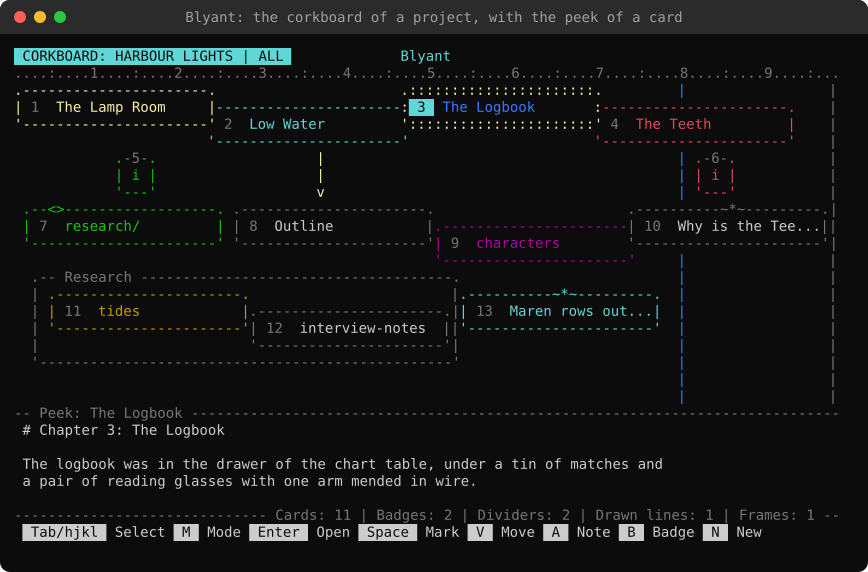

# Guide to the corkboard

The corkboard is a page where files are pinned as cards, like notes on a board, and placed where you want them: to plan a story by its chapters, or to keep the files you work on in view.

Each card shows the title of its file and a number, in a color you give it, and `Enter` opens the file. A card can also be a folder (research, scenes) or a note of its own, with a text you write.

You can keep several boards, and each [project](Guide-to-start-page.md#projects) can have a board of its own, kept in its folder.



It is opened with `:board` (or `:corkboard`) from every command line (the start page, the file browser, the favorites, the history, the hotlist, the search results, the Jump menu and the editor), with **Corkboard** (`C`) on the Start tab of the start page, and with `:jump board` or the Blyant tab of the [Jump menu](Guide-to-jump-menu.md#jump-menu). It opens on top of the page you were on, and `Esc` takes you back there. `:board name` opens the board with that name (`:board main` the main board).

## Pinning files and folders
- `:pin` in the editor pins the file being edited, and in the file browser, the favorites, the history, the hotlist and the search results the selected file or folder, to the board that is open. The message tells the number of its card: `Pinned to the corkboard (4): Chapter one`. A file or folder is pinned once to a board; pinned again, you are told where it is. One whose path has a tab or a line break in it (Linux and macOS allow them) cannot be pinned
- `N` (or `:new`) on the corkboard: pick a file in the file browser to pin
- `F` (or `:folder`) on the corkboard: pick a folder in the file browser to pin (go to it and press `S`)

The card of a file is edged in lines, and the card of a folder has a tab (`<>`) on its top edge, and its name with a `/` after it, as in the file browser:

```
.----------------------.
| 3  Chapter one       |
'----------------------'
.--<>------------------.
| 4  research/         |
'----------------------'
```

`Enter` on it opens the folder in the file browser (closing the file browser brings you back to the corkboard), the peek shows what it holds, and `I` tells about it as `I` in the file browser does.

A new card is placed at the first free place, row by row, with a column between the cards; on a full board it is put on top of the others, a step from the last one. Its number is the lowest one that is free, and it keeps it.

## Note cards
`A` (or `:note`) adds a note card: its text is written in the editor, and kept when the editor is closed. The first line of the text is the title of the card, unless you give it a title of its own with `X`. `Enter` on a note opens its text in the editor again. A note card has a mark (`~*~`) in the middle of its top edge, to tell it from the card of a file:

```
.----------~*~---------.
| 5  Act two           |
'----------------------'
```

A new note left without text is not kept, also when the editor is left by a jump. The text is kept on the board it was written for, also when another board is opened from the editor (`:board name`).

### A note becomes a file
When a note has grown into more than a note, `W` (or `:tofile`) on it writes its text to a new file, and the card becomes the card of that file: it stays where it is, with its number, its color and its title. A box asks for the name and the folder, as _New file_ does:

- The name is the title of the note, or else its first line (without the `#` of a Markdown heading, and without the characters a file name cannot have). Without an extension the file is a Markdown file (`.md`)
- The folder is the folder of the project on the [board of a project](#project-boards), and else the folder the file browser was in last. `Tab` in the box picks another
- The text is written as it is, with the line endings of new files. A file that is there already is never written over: you are told, and can give another name
- `u` (or `:undo`) makes the card a note again, with its text; the file stays on the disk. A badge stays a note, and an empty note has nothing to write

## Badges
`B` (or `:badge`) adds a badge: a small round mark with an `i`, to mark a place on the board, such as a group of cards that are to do, done or new. Like a note card it has a note, written in the editor at once and read in the peek when the badge is selected, and `Enter` edits it again. Give it a color with `C` (its frame and the `i`), and move it with `V` beside the cards it is about:

```
.-3-.
| i |
'---'
```

A badge is as high as a card and 5 columns wide, with its number on its top edge, and its corners in the style of the boxes (`+` with Classic ASCII). It is selected, moved, colored, put on top or below, removed and put back as a card is, and `h` `j` `k` `l` go to it in the row or column of the cards (a badge under a card shares its column).

What is said about it names it a badge (`D` asks "Take badge 2 off the corkboard?"), and the line above the keys counts the badges apart from the cards (`Cards: 5 | Badges: 2`). It has no title, so `X` is refused, and it is kept also when its note is left empty.

`:arrange` leaves the badges where they are. Beside the list of projects, the badges of a project's board are shown among its cards, by their numbers. A version of Blyant before 1.4.1 shows a badge as a note card.

## Dividers
`|` (or `:divider`) adds a divider: a line from the top of the board to the bottom, to tile the board when you plan, such as a column for each act. It is put in the column right of the selected card (between it and the next, as the cards are laid a column apart), or in the middle of the board. The dividers are drawn first, so the cards and badges are on top of them.

A selected divider is highlighted, and its column on the ruler too. `V` and `h` `l` move it left and right (`H` `L`: five steps), and the line above the keys tells its column while it is moved (`Divider at 41`).

`C` colors it, `D` removes it (`u` puts it back), `I` tells its column and `Space` marks it, so it can be moved with the cards of its column.

A divider has no number and no title: the numbers stay those of the cards. `:arrange` and `/` leave the dividers as they are, and the line above the keys counts them (`Dividers: 3`). A divider is a line of its own in the file of the board; a version of Blyant before 1.4.2 leaves it out.

## Lines
`\` (or `:line`) adds a line, to point from one card to another: it starts in the column right of the selected card, at its middle row (or in the middle of the board), and goes to the right with an arrowhead at its end (`----->`). Like the dividers, the lines are drawn behind the cards; the selected one is drawn over them, of `:`, so it is seen whole.

A line has a start, a way it goes and a length. In `V` (Move) the line selected alone is changed with keys of its own, and the key hints show them:
- `h` `j` `k` `l` Move it (`H` `J` `K` `L`: five steps)
- `r` Turn it around its start: `-` to the right, `\` down to the right, `|` down, `/` down to the left, and round again (`R` turns it back)
- `+` `-` Make it longer/shorter (at least two, and as long as fits on the board)
- `a` Arrowheads: at its end, at its start, at both ends, none. On a line across they are `>` `<`, on one down `v` `^`, and `*` on a slanted one

```
.------------------.
| 2  Low Water     |
'------------------'
          |
          v
.------------------.
| 8  Outline       |
'------------------'
```

The line above the keys tells where it starts and how long it is while it is moved (`Line at 37,5, 3 long`). `C` colors it, `D` removes it (`u` puts it back), `I` tells its place, the way it goes and its length, and `Space` marks it, so it moves with the marked cards. A line has no number and no title. The line above the keys counts them (`Drawn lines: 2`).

## Frames
`O` (or `:frame`) adds a frame, to mark off an area of the board, such as the cards of an act: it is put around the selected card and the marked ones (with a column of room at their sides and a row above and below them), or in the middle of the board, 30 columns by 8 rows. `X` gives it a title on its top edge:

```
.-- Act two ------------------------------------.
| .----------------------. .------------------. |
| | 4  The storm         | | 5  The lamp      | |
| '----------------------' '------------------' |
'-----------------------------------------------'
```

The frames are drawn first, behind the dividers, lines and cards; the selected one is drawn over them, of `:`.

In `V` (Move) the frame selected alone is moved with `h` `j` `k` `l`, and `s` changes to sizing it: then `h` `j` `k` `l` (`H` `J` `K` `L`: five steps) move its lower right corner, and `s` again moves it. The line above the keys tells where it is (`Frame at 3,12`), or its size while it is sized (`Frame size: 51x6`).

To move a frame with the cards in it, mark them (`Space`) and move them together. `C` colors it, `D` removes it (`u` puts it back), and `I` tells its title, place and size. A frame has no number. The line above the keys counts them (`Frames: 1`).

The lines and frames are lines of their own in the file of the board; a version of Blyant before 1.4.2 leaves them out.

## Selecting cards, badges or lines
`M` (or `:mode`) changes what `h` `j` `k` `l` and `Tab` select, and the top bar shows it after the name of the board (where they do not fit, the name of the board is cut, not the mode):
- **Cards and badges**: the cards and the badges, past the dividers, lines and frames
- **All** (at first): everything they pass, the dividers, lines and frames too (as a divider goes from top to bottom, only `h` and `l` go to a divider or from it; a line is gone to by its start, a frame by its top left corner)
- **Cards**: the cards of files, folders and notes
- **Badges**: only the badges
- **Lines**: only the dividers, lines and frames

`:mode both` (`all`, `cards`, `badges`, `lines`) picks one, and `Tab` completes them. The mode is kept (setting `boardmode`). A number and `Enter` select any card or badge, whatever the mode.

What you add is selected. A new card, note or badge changes the mode to **Cards and badges** when the mode does not take it, and so does what `/` finds and what `u` puts back (a divider, line or frame: to **Lines**). A new divider, line or frame leaves the mode as it is: it is selected, and `V` moves it, also in a mode that does not take it.

## On an empty board
A board without cards shows the keys to start with in a box in its middle: pinning files and folders, adding notes, badges, dividers, lines and frames, selecting, the modes, marking and moving, `T` `E`, and `?` for all the keys. The box is gone when the first card is on the board.

## On the corkboard
- `Tab` `Shift+Tab` Select the next/previous card, by number (the dividers, lines and frames after the cards, from the left), of those the mode selects
- `12` and `Enter` Select card 12 (the number is shown on the line above the keys while you type it; `Esc` drops it)
- `h` `j` `k` `l` (or the arrow keys) Select the next card that way. `h` and `l` go along the row of the selected card first (the cards that share at least two of its three rows, so a card laid a little lower is in it), and `j` and `k` along its column (the cards that share at least half its width). At the end of a row or column, the nearest card that way in another one is selected
- `Enter` Open the file of the selected card in the editor (a note: edit its text). Closing the editor (`:q`, `:wq`) brings you back to the corkboard, with the same card selected and the cards still marked. It is a jump: a jump made in the editor (`Ctrl+O`) goes on from there without coming back, and `Ctrl+K` and `Enter` in the editor take you back to the file you were in
- `Space` Mark the card, to move, color, order or remove several together (see [Several cards at a time](#several-cards-at-a-time))
- `V` Move the selected card: `h` `j` `k` `l` (or the arrow keys) move it one step, `H` `J` `K` `L` five steps, and `Esc` (or `Enter`, `V`) ends the moving. A line is also turned (`r`), made longer and shorter (`+` `-`) and given arrowheads (`a`), and a frame sized (`s`): see [Lines](#lines) and [Frames](#frames)
- `T` (or `:top`) Put the card on top of the others, `E` (or `:bottom`) below them. Where cards overlap, the one on top covers the others
- `C` (or `:color`) Pick the color of the card, its frame and title, from the 16 colors
- `X` (or `:rename title`) Give the card a title of its own (the file keeps its name). Without one, the card shows the name of its file without the extension, or the first line of a note. The box shows the name the card has: `Enter` on its own name keeps it without a title, so it goes on following its file, and typing its own name takes a title away
- `D` (or `:remove`) Take the card off the board, after asking. The file stays where it is. `u` (or `:undo`) puts it back
- `:clear` Take all the cards off the board, after asking in a box where `No` is selected and a key typed by mistake does not answer. The files stay where they are, and `u` puts the cards back (a card added since keeps its number, and a card put back that had it gets a new one)
- `I` (or `:info`) Information about the card: for a file, as `I` in the file browser shows it (its size, when it was changed ...), and for a note or a badge, its words and lines
- `P` (or `:peek`) The peek on or off: the first lines of the selected card's file (or the text of a note or badge) below the board. It is on at first, and stays as you set it (setting `boardpeek`)
- `/` Filter the cards: the others are dimmed, and `Tab` goes through those that are left. The card found on top is selected (of those the mode takes), and frames are found by their titles (the others are dimmed too). `Esc` shows all again
- `:missing` The cards whose file is not there any more, in a list to select one. `:prune` Remove them, after asking (those on a drive that is not connected stay)
- `Ctrl+O` (or `:jump`) the Jump menu, `Ctrl+K` (or `:recent`) the latest files, `?` (or `:help`) the keys, `:log` the [log](Guide-to-start-page.md#log), `:favorites`, `:history`, `:hotlist` and `:browse` the lists of the file browser alone, or the file browser (they leave the board), `Esc` (or `Q`) close, `:exit` (or `:qa`) exit Blyant (asks first)
- [`:colorscheme name`](Guide-to-jump-menu.md#changing-the-scheme-by-command) Use another color scheme (`Tab` completes the names)

The line below the top bar is a ruler of the columns of the board, as above the logo in the logo editor: a dot for each column, `:` for every 5th and the tens as digits, to line the cards up when you move them.

A card being moved (`V`) shows its place at the right end of its top edge: its column on the ruler and its row on the board (`.--------------- 26,4 -.`), and a badge being moved shows it on the line above the keys (`Badge at 26,4`), as it has no room for it.

The selected card is drawn on top of the others while it is selected, with its edges of `:` (a folder keeps its tab) and its number highlighted, so it is seen among cards of many colors; that does not change the order of the cards. A selected badge is edged in `:` too (`.:5:.`).

```
.::::::::::::::::::::::.
: 5  Chapter five      :
'::::::::::::::::::::::'
```

A card whose file is gone is dimmed and marked _(missing)_.

## Several cards at a time
`Space` marks the selected card (or badge), and again unmarks it: select another with `h` `j` `k` `l`, `Tab` or its number, and mark it too. A marked card has a `*` at its top left corner, and the line above the keys tells how many are marked. These keys then work on the marked cards and the selected one together:

- `V` Move them together: they keep their places to each other, and when one reaches the edge of the board, they all stop
- `C` Give them all the color picked
- `T` and `E` Put them on top of the others or below them, in the order they had among themselves
- `D` Take them all off the board, after asking. `u` puts them all back where they were (one whose number a card added since has, gets a new number)

`Enter`, `X` and `I` work on the selected card only. `Esc` unmarks them all (before it closes the board). The marks are not kept: they go when another board is opened or the corkboard is closed.

## Arranging the cards
`:arrange` puts the cards in rows from the top left, with a column between them, in an order (the badges stay where they are):
- `:arrange number` by their numbers
- `:arrange name` by their titles, upper and lower case alike, and numbers by their value: _Chapter 2_ comes before _Chapter 10_
- `:arrange color` by their colors, in the order of the color picker, and the cards without a color last

`Tab` completes the orders. The order the cards are drawn in stays, and `u` (or `:undo`) puts the cards back where they were.

## Several boards
`:list` on the corkboard shows the boards, with what is on the selected one beside them: `Enter` opens a board, `N` adds one, `R` renames one and `D` deletes one (to the trash, after asking; the files of its cards stay where they are). The main board is always there; it cannot be renamed or deleted. `:list name` (or `:board name`) opens a board at once, and `Tab` completes the names. `:board` alone shows the boards too.

The board that is open is shown in the top bar and remembered (setting `boardname`), so the corkboard opens on it again and `:pin` pins to it. A name has at most 20 characters.

## Project boards
`B` (or `:board`) in the list of projects opens the board of the selected project: plan a manuscript by its chapters and scenes, with its research folders beside them. It is kept in the project folder, in the file `.blyant-board.txt`, made when the first card is put on it. To the right of the list of projects, the cards of the selected project's board are shown laid on each other by their numbers, as many as there is room for, with how many there are:

```
Corkboard (5)
.----------------------.
| 1  one               |
'-.----------------------.
  | 2  two               |
  '-.--<>------------------.
    | 3  research/         |
    '----------------------'
```

The paths of the files and folders in the project are kept from the project folder (`chapters/one.md`, with `/` on all systems), so the board goes with the project when it is moved, renamed, copied or synced to another computer. A file outside the project is kept with its full path.

The boards of the projects are in the box of `:list` after the others, with the name of the project and _(project)_; `:board name` opens one by the name of its project.

Such a board has the name of its folder, so `R` does not rename it, and `D` deletes only the file of the board. When the project folder is gone, the main board is opened.

## Where the cards are kept
The cards of the main board are kept in `board.txt` in the data directory, those of the other boards in files with their names in the directory `boards` next to it, and the board of a project in `.blyant-board.txt` in its folder.

Each card is one line: its number, its place (column and row), its color, its own title and the path of its file or folder (a folder ends with a separator), with a tab character between them.

A note card has no path, and its text is on the line after it. The cards are drawn in the order of the lines, so the last one is on top.

A card's place is kept as it is placed. In a smaller window, a card that would be outside it is drawn at its edge, and it is back in its place in the larger window. When a file or folder is renamed or moved in Blyant (in the file browser or with `:rename` in the editor), its cards follow it, on all the boards, also those of the projects. What `u` puts back is kept while you visit another page, unless the board was changed there.
