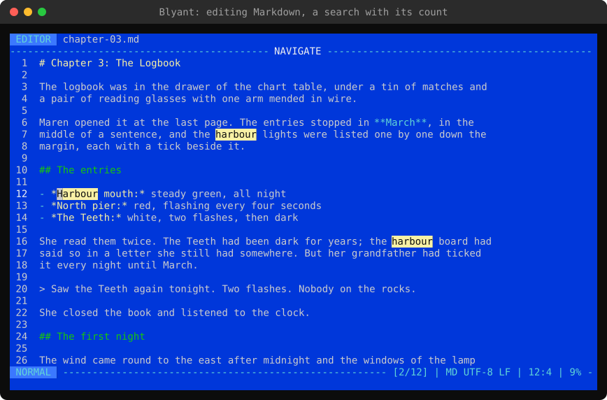
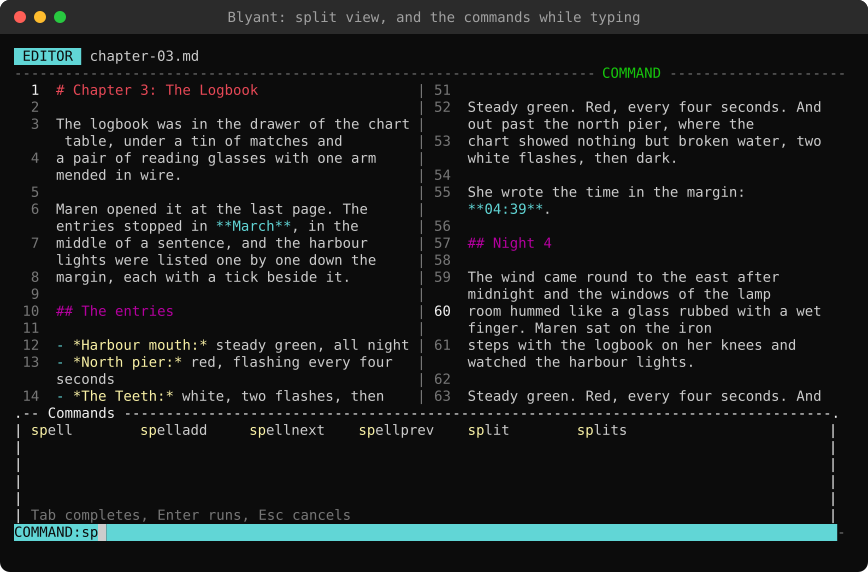
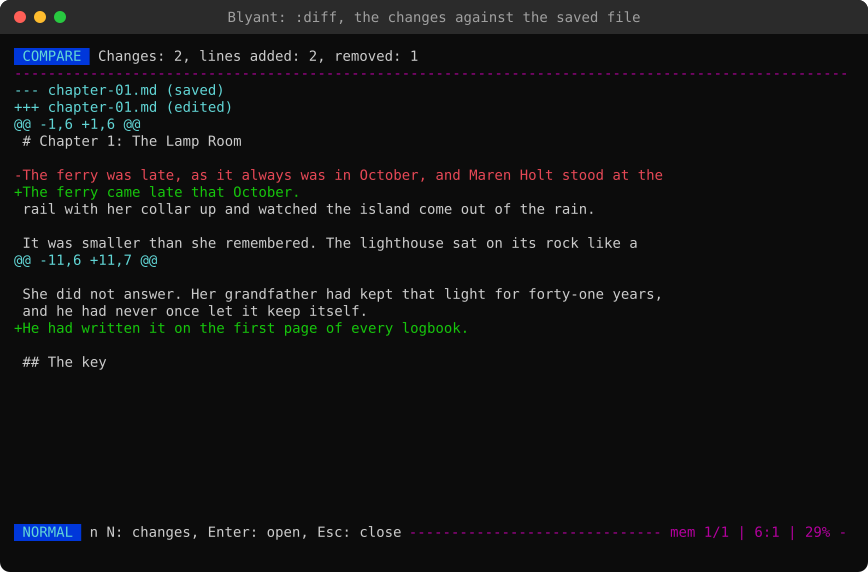

# Guide to the editor


The editor works in the style of Vim. It is always in one of these modes, shown at the left of the bottom line:

- **NORMAL**: keys move the cursor and give commands. This is where you start when opening a file with text.
- **INSERT**: keys type text. An empty file starts here. Press `Esc` to return to Normal mode.
- **VISUAL**, **V-LINE** and **V-BLOCK**: movements select text (whole lines, or a block of columns) for a command.

The line above the text also tells what the keys do: **NAVIGATE** in Normal mode, **EDIT** in Insert mode, **SELECT** in the Visual modes and **COMMAND** while a command or search is typed (these words follow the language of Blyant; the names of the modes at the bottom are always in English). The top row shows _EDITOR_ at the left, followed by the name of the file, and the label _Unsaved_ (or _Read only_) at the right; the line of the mode is right below it, so the text has all the rows down to the bottom line. A long name is cut short. When the editor opens, the bottom line says that `:help` shows the keys of the editor (until the first key).

When a text file is edited (from the file browser), the bottom line shows its type, encoding and line endings, like `HTML UTF-8 (BOM) CRLF` or `TXT Windows-1252 LF` (a file in another encoding than UTF-8 becomes UTF-8 when it is saved; the line endings are kept: `CRLF` as used by Windows, `LF` as used by Linux and macOS; `:lineendings lf` or `:lineendings crlf` changes them, see [Line endings](#line-endings)). The bottom line also shows messages, the current memory string, the cursor position as `line:column` and how far into the text the cursor is. Inside Blyant, `:help` shows the list of keys.

## Save and close


Typed on the command line: press `:`, type the command and press `Enter`. A box above the command line lists the commands while you type, narrowed to those that start with what is typed, and tells what the one typed whole does (see the [guide to the Jump menu](Guide-to-jump-menu.md), at the top). `Tab` completes the command you are typing (`:spelln` and `Tab` gives `:spellnext`), `Tab` again gives the next command that starts the same and `Shift+Tab` the previous. With nothing typed, `Tab` goes through all the commands of the editor. Lines typed in front of a command are kept (`:%d` and `Tab` gives `:%delete`). `Up` and `Down` bring back the commands given in the editor before, the newest first (with the start of a command typed: only those that start with it). They are kept in memory only and forgotten at logout; a macro being recorded gets each command line as it was given (also one brought back with `Up` or completed with `Tab`), not the keys.

- `:w` Save (a [blank page](Guide-to-start-page.md#start) asks for its name and folder first; `:w name` with the name filled in)
- `:w name` Save a copy of the text (as it is, with changes not saved) as a new file in the same directory as the file, for example `:w notes-v2.md`. A name without an extension gets the extension of the file (`:w draft` of `notes.txt` is `draft.txt`), the copy has the encoding and line endings of the file, and a name with a directory in it is refused. If a file of that name is there, you are asked before it is replaced. The file you edit stays open, as it was on the disk
- `:saveas name` The same, but the new file is the one you edit from then on (the file you came from keeps what was saved last). `:saveas` alone asks for the name
- With both: if the file is a [favorite](Guide-to-start-page.md#favorites), you are asked whether the new file goes below it in the favorites. Copies made one after another from the same favorite go below it in the order they were made, and a copy of a copy (after `:saveas`) goes below the copy. When the editor is closed, the file browser (or the favorites, when it is one) has the last file written selected (a filter of the file browser that would hide it is taken away)
- `:wq` or `:x` or `ZZ` Save and close the editor
- `:q` or `Esc` in Normal mode: Close the editor (asks what to do with unsaved changes)
- `:q!` or `ZQ` Close the editor without saving
- `:e` (or `:reload`) Text files: read the file from disk again, when it has been changed by another program. If you have changes that are not saved it is not done; `:e!` reads the file anyway and drops your changes. What was done before cannot be undone afterwards
- `:help` Show the list of keys
- `Ctrl+C` does not close the editor (so text that is not saved is not lost): it tells how to close it. Where the terminal has a selection, `Ctrl+C` still copies it

`Esc` first leaves what you are in the middle of: Insert or Visual mode, a command that is half typed, or the highlighting of search matches. When there is nothing to leave, it closes the editor.

### Recovery copies
While a file has changes that are not saved, Blyant keeps a copy of the text, so it is not lost if Blyant is stopped: the terminal window closed, the computer turned off or out of power. The copy is written when you stop typing for 2 seconds, and at least every 30 seconds while you type on. When the terminal window is closed (or the computer is shut down or you log off), the last changes are copied before Blyant stops. The copy is removed when the text is saved, and when you close the editor and give up the changes, so after a normal session there are none.

When you open a file that has a recovery copy, you are asked what to do with it:

- `R` **Open the recovered text**: the editor opens with the text of the copy, as changes that are not saved yet. Look it over and save it with `:w`
- `D` **Show the differences**: the file and the copy compared, with the changes highlighted (as `:diff`). `Esc` goes back to the question
- `K` **Keep the file as it is**: the copy is deleted (you are asked first)
- `Esc` **Decide later**: the file is opened as it is, and the copy is kept and offered the next time. If you change the file now, its new changes get a copy of their own beside the kept one (the kept copy is never written over); the newest is offered when the file is opened, and both are in **Recover unsaved text** on the start page

The question tells when the copy was written, and if the file was changed after that (by another program, or on another computer through a synced folder). Nothing is asked if the copy has the same text as the file (it is removed), or if another Blyant that is running is editing the file.

The copies are kept in the directory `recovery` in the data directory, named after the file and a code made from its path (`chapter 1.md.3f2a9c1d.txt`). Each starts with a few lines telling which file it is a copy of and when it was written, then a line `---`, and then the text, so a copy can also be opened and read like any file. `:recovery` in the file browser goes there. A blank page (`B` on the start page) has a copy of its own (`untitled-` and the time it was opened), until it is saved as a file. _Recover unsaved text_ on the start page, shown while there are copies, lists them all and opens the one you pick. Copies are made of the files opened from the file browser (and of the snippets, the completions and the notes of projects), not of the settings file. _Recovery copies of unsaved text_ on the Editor page of Configuration (setting `recovery`, on from the start) turns them off.

## Entering Insert mode
- `i` / `a` Insert before/after the cursor
- `I` / `A` Insert at the start/end of the line
- `o` / `O` Insert on a new line below/above

In Insert mode: `Tab` inserts 4 blank spaces (or completes a word, see [Completing words](#completing-words)), `CTRL+W` deletes the word before the cursor, `CTRL+U` deletes the line before the cursor, `CTRL+R` pastes the current memory string, and `CTRL+K` shows the snippets (see [Snippets](#snippets)). Text can be pasted from the clipboard with the paste function of your terminal.

## Moving the cursor (Normal and Visual mode)
- `h` `j` `k` `l` Left/Down/Up/Right (as the arrow keys). `j` and `k` move by rows as shown on screen
- `w` `b` `e` Next word/Previous word/End of word (`W` `B` `E`: words separated by blank space)
- `0` `_` `$` Start of line/First character/End of line (as `Home` and `End`)
- `gg` `G` Top/End of the text
- `ma` Set mark `a` at the cursor, and `` `a `` jump back to it (`'a`: to the start of its line). See [Marks](#marks)
- `5G` or `:5` Go to line 5
- `{` `}` Previous/Next blank line
- `f.` `t.` To/Before the next `.`, on the line or on a line below (`F` `T`: backwards, on the line or above), repeated with `;` and `,`. `t` before a `.` that starts a line goes to the end of the line above (`T` after one that ends a line: to the start of the line below). With an operator it reaches the other lines too (`dfx`, `ct.`). Every `.` in the text is highlighted until you press a key other than `;`, `,`, a count or another `f` `t` `F` `T`; `Esc` only takes the highlight away (the next `Esc` closes the editor). Also with an emoji: `f😀`
- `Enter` Jump to a word on the screen. Each word that starts on the rows shown gets a label of one or two letters, written over its first characters (the second letter dimmer), and the divider above the text shows JUMP. Type the letters at the word you want, and the cursor goes there: a letter that several words share leaves only those, each with its next letter. The letters are spread over the words from the top, so with up to 26 words on the screen one letter is enough, and with more two. `Enter` again goes to the first word left, `Esc` cancels, and other keys do nothing. In Visual mode the jump extends the selection. With a count (`3` `Enter`) or after an operator (`d` `Enter`), `Enter` goes down to the first character of a line, as in Vim. The jump is to the pane with the cursor, and it is not made while a macro is recorded (the labels depend on what is on the screen)
- `PgUp` `PgDn` One page up/down, `CTRL+U` `CTRL+D` Half a page up/down
- `gm` `gM` Half the width of the screen to the right/left on the line
- `zt` `zz` `zb` Scroll the row of the cursor to the top/center/bottom

A number before a movement or command repeats it: `5j` moves 5 rows down and `3w` three words forward.

## Editing (Normal mode)
- `x` `X` Delete the character under/before the cursor
- `r.` Replace the character with `.`
- `d` `c` `y` Delete/Change/Yank (copy), followed by a movement:
  - `dw` `d$` `dG` Delete a word/to the end of the line/to the end of the text
  - `cw` `ciw` `ci"` Change a word/the whole word/the text in quotes
  - `yiw` `yip` `dip` Yank the word/yank the paragraph/delete the paragraph (see the text objects below)
  - `yy` `dd` `cc` Yank/Delete/Change the line (`3dd`: 3 lines)
- `D` `C` `Y` Delete/Change to the end of the line, Yank the line
- `p` `P` Paste after/before the cursor. With a count (`3p`) it is pasted that many times; more than 10 million characters at once is refused
- `J` Join the line with the next
- `>>` `<<` Indent/Unindent the line
- `~` Switch the case of the character, `gUU` `guu` Line to UPPERCASE/lowercase, `gUw` `guw` Word to UPPERCASE/lowercase
- `u` Undo (500 steps), `U` or `CTRL+R` Redo
- `.` Repeat the last change

## Visual mode
Press `v` (text), `V` (whole lines) or `Q` (a block, see below) and select with the movement keys. The commands `:vsel`, `:vline` and `:block` do the same. Then:

- `d` `y` `c` Delete/Yank/Change the selection
- `p` Replace the selection with pasted text
- `U` `u` `~` UPPERCASE/lowercase/Switch case
- `>` `<` Indent/Unindent the selected lines
- `J` `K` In V-LINE: move the selected lines down/up (`3J` moves them 3 lines). The lines stay selected
- `J` In VISUAL: join the selected lines
- **Text objects** (after `v`, or after `d` `c` `y` and the other operators): `i` takes the inside, `a` takes it with what surrounds it
  - `iw` `aw` The word (`aw`: with the blank space after it), `iW` `aW` the same for words separated by blank space
  - `i"` `a"` `i'` `a'` The text in quotes (`a`: with the quotes), on the line
  - `ib` (or `i(`) `iB` (or `i{`), and `i[` `i<`: the text in brackets, also over several lines. For a block whose brackets are on lines of their own, `iB` takes the lines between them (`viB` selects them as lines, and `diB` leaves `{` and `}` on lines of their own); `aB` takes the brackets too
  - `ip` `ap` The paragraph: the lines around the cursor that are not blank (`ap`: with the blank lines after it). `vip` selects them in Visual Line mode
- `o` Move the cursor to the other end of the selection
- `v` `V` `Q` Switch to selecting text/lines/a block. The key of the mode you are in leaves it
- `gv` (in Normal mode) Select again what was selected last, in the same kind of selection, also after the selection was used by a command (like `:ol` or `y`). In Visual mode, `gv` changes places between the selection shown and the last one
- `Esc` Leave Visual mode

### Visual block
`Q` selects a block: the same columns on each of the lines, like a rectangle (V-BLOCK is shown at the bottom left). Move the cursor to the opposite corner with the movement keys. The columns are counted as the text is shown, so a character that takes two columns (like 中) is taken whole when the block cuts through it.

- `$` The block goes to the end of each line, however long the lines are (until you move the cursor sideways)
- `I` Type text in front of the block, and `A` after it. You type on the first line, and when you press `Esc` the text is put on all the lines of the block. With `I` a line that ends before the block is left as it is; with `A` it gets blank spaces up to the block. After `$`, `A` adds the text at the end of each line
- `d` (or `x`) Delete the block: the text to the right of it moves left. `D` (or `X`) deletes to the end of each line
- `y` Yank (copy) the block. `Y` yanks to the end of each line
- `c` Change the block: it is deleted and you type the new text, which is put on all the lines when you press `Esc`. `C` changes to the end of each line
- `p` Replace the block with the current memory string
- `r` and a character: Replace each character of the block with it
- `U` `u` `~` UPPERCASE/lowercase/Switch case
- `>` `<` Indent/Unindent the lines of the block
- `O` Move the cursor to the other corner on the same line, `o` to the opposite corner

A yanked or deleted block is pasted as a block with `p` (after the cursor) or `P` (before it): its lines go in at the same column on the lines from the cursor down, the text to the right of it stays in line, and lines are added at the end of the text if there are not enough. `2p` pastes it twice, side by side. A change made on a block is undone with one `u`, and `.` makes it again at the cursor.

## Search
- `/text` `?text` Search forwards/backwards, `n` `N` Next/Previous match
- `*` Search for the word under the cursor
- `Esc` or `:noh` Remove the highlighting of the matches (press `Esc` again to close the editor)

While the matches are highlighted, the status line shows which match the cursor is on and how many there are: `[2/12]`, or `[-/12]` when the cursor is not at the start of a match. The matches are counted again when the text changes, up to 9999 (`[>9999]` above that); when counting them takes too long, the count is not shown.

The text you search for is a regular expression: `/\d+` finds numbers and `/cat|dog` finds either word. A search that takes too long is stopped (2 seconds on a line, 10 seconds in all); a `:s` that is stopped changes nothing. A search in lowercase ignores case; with an uppercase letter in it the search matches case. A letter after a backslash does not count: `/\Sfoo` still ignores case, as `\S`, `\W` and `\D` are classes.

## Replace
The easy way is `:replace`, which shows a box to fill in:

- **Find** and **Replace with**: the box opens in the _Find_ field. Type the text and press `Enter` to continue to the next field
- If a word (or other text within one line) is selected in VISUAL mode when you type `:replace`, it is filled in as the text to find, and the box opens in the _Replace with_ field
- **Match case**: off by default, so `cat` also finds `Cat`
- **Regular expression**: off by default, so the text is found exactly as written. When on, _Find_ is a regular expression and `&`, `\1` and `\n` can be used in _Replace with_ (see below)
- **Where**: the whole text or the current line. With lines selected in V-LINE mode before typing `:replace`, also the selected lines
- **Replace all**: press `Enter` here to replace

`j` `k` select a row, `Enter` or `Space` edit a field or change an option, and `Esc` closes the box (in a field: leaves the text as it was). The box remembers what you entered. The replacement is one change: `u` undoes it.

The same can be written as a command:

- `:s/old/new/` Replace the first `old` on the line with `new`
- `:s/old/new/g` Replace all on the line
- `:%s/old/new/g` Replace all in the text
- `:2,9s/old/new/g` Replace all on line 2 to 9
- `V` (select lines) then `:s/old/new/g` Replace all on the selected lines

`old` is a regular expression as when searching. In `new`, `&` is the matched text, `\1` the first group and `\n` a line break. Add `i` to ignore case or `I` to match case: `:%s/old/new/gi`.

## Spell checking
Spell checking is off until you ask for it. It uses the spell files of Vim and Neovim (see below).

- `:spell` Check the text and mark the misspelled words. The bottom line tells how many were found. When the words are marked already, `:spell` removes the marks (as `:nospell`). `:set spell` only turns checking on
- `:spell da,en` As above, with Danish and English. The languages are remembered (`spelllang` in the settings file)
- `:nospell` Remove the marks
- `]s` `[s` (or `gs` `gS`, or `:spellnext` `:spellprev`) Go to the next/previous misspelled word. `gs` and `gS` are for keyboards where `[` and `]` take more than one key (Danish, German ...)
- `z=` (or `:suggest`) Show suggestions for the word under the cursor. Press the number of a suggestion (or select it with `j` `k` and press `Enter`) to replace the word, `a` to add the word to your word list, or `Esc` to close
- `zg` (or `:spelladd`) Add the word under the cursor to your word list

The marks follow the text while you edit, until you use `:nospell` or close the editor. The word you are writing is not marked until you leave it. Single letters, words with digits, and web and e-mail addresses are not checked.

### Spell files
Blyant reads spell files from a directory named `spell`, next to the `data` directory. A language needs one file, named like `en.utf-8.spl` or `da.utf-8.spl`. These are the files Vim and Neovim use, so you can copy them from there (the directory `spell` of the Vim runtime or of your Neovim configuration), or download them from the [Vim spell file archive](https://ftp.nluug.nl/pub/vim/runtime/spell/). Only UTF-8 files can be used.

The words you add are saved as plain text, one word per line, in `spell/<language>.utf-8.add` (for the first of the languages). This is the format of Neovim's word list, so an existing list can be copied to the directory as well.

## Comparing


`:diff` compares the text you are editing with the file as it is saved on disk, so you can see what you have changed before you save it. Two files are compared in the [file browser](Guide-to-start-page.md#file-browser), with `:diff` there.

The comparison is shown read only, as a unified diff (as `git diff` shows one): the lines that differ, with three unchanged lines around them. A line removed starts with `-` (colored as heading 1, red in the Default scheme), a line added with `+` (heading 5, green), and each part of the comparison starts with a line like `@@ -12,7 +12,8 @@`: where it is in the old text (line 12, 7 lines) and in the new one. The line at the top tells how many changes there are, and how many lines were added and removed.

- `n` `N` Go to the next/previous change (the first line of it). After a search with `/`, `n` `N` go to what was found; `Esc` removes the highlighting, and they go to the changes again
- `]c` `[c` Go to the next/previous change (also after a search)
- `Enter` Open the file at the line of the cursor (in the editor: go to the line in the text). A line removed opens the old file there
- `Esc` (or `:q`) Close the comparison. The keys for moving and searching are those of the editor; the text cannot be changed
- `:w name.diff` Save the comparison as a file, in the directory of the file (a file that is there is replaced if you want that). A `.diff` or `.patch` file is colored as a comparison when it is opened in the editor
- `:diff -w` Compare without counting blank space: lines that differ only in their indentation or spaces are the same

If too many lines differ (more than 2000), the comparison is not shown.

## Marks
A mark keeps a place in the text to come back to while you work: set it, move away, and jump back with two keys. There are 26 marks in each file, `a` to `z`.

- `ma` Set mark `a` at the cursor (any letter `a` to `z`; a mark that is set already moves here). The bottom line tells it: _Mark a: line 120_
- `` `a `` Jump to the place of mark `a`, and `'a` to the start of its line
- ``` `` ``` (or `''`) Jump back to where the cursor was before the last jump, and again to go forth. A jump is a jump to a mark, `G`, `gg`, `5G` or `:5`, a search (`/`, `?`, `n`, `N`, `*`, `#`) and a bookmark in the same file
- `:mark a` (or `:k a`) Set mark `a`, as `ma`
- `:marks` The marks of the text in a list, each with its line number and text, and the lines below it under the list. `Enter` jumps to the one selected, `D` deletes it, and `/` filters the list
- `:delmarks a b` Delete marks `a` and `b` (`:delmarks a-d` the marks `a` to `d`, `:delmarks!` all of them)

With line numbers on, a line with a mark shows the letter of the mark in place of its number.

The marks follow the text: lines put in above a mark move it down with its line, lines taken out above it move it up, and a mark in text that is deleted stays where the text was. Undo and redo move them too. They are kept while Blyant runs: a file closed and opened again in the same session has its marks still, but they are not saved (a [bookmark](Guide-to-jump-menu.md#bookmarks) is the place to keep, and is reached from anywhere).

**A keyboard where ` is hard to type:** on many keyboards outside the US (Danish, Norwegian, Swedish, German, French, Spanish ...) the backtick is a dead key, which waits for a letter to put an accent on (`` ` `` and `a` make `à`), so `` `a `` does not reach the mark. Turn on **Marks: ' jumps to the exact place** on the Editor page of Configuration (setting `marksapostrophe`): `'a` then jumps to the place of mark `a`, and `''` back. The jump to the start of the line is then `'a` followed by `0` or `^`. `` ` `` still works where it can be typed.

## Line numbers
- `:number` (or `:nu`) Show or hide line numbers (they are off until turned on). `:set number` and `:set nonumber` do one of the two

The numbers are shown to the left of the text, with a small gap. A long line that continues on the next row has its number on the first row only, so the numbers are the ones used by `:5` and shown as `line:column` on the bottom line. The number of the line the cursor is on stands out. Line numbers are on from the start. The choice is remembered (`linenumbers` in the settings file) and is used for all your files alike. It can also be set on the Configuration page of the start page, and with `:number` on page 2 of the main menu.

When text is copied from the terminal window with the mouse, the line numbers are copied too: turn them off first (`:nu`). Text yanked in the editor never has them.

## Snippets
Snippets are pieces of text (a tag, a block of CSS, a whole page) with a title, kept for inserting again. They are kept in `snippets.txt` in the data directory, for all your files alike.

- `:snip` (or `:sn`) Show the snippets in a box. The first time, the box asks to make the file (with two examples)
- `CTRL+K` in Insert mode: the same, and the snippet is inserted at the cursor (between the characters, where you are typing). The editor stays in Insert mode, with the cursor at `$0` or after the snippet, and one `u` (after `Esc`) undoes the snippet, apart from what was typed before it
- `:snip add` (or `:sn add`) Keep the selected text as a snippet (select it and type `:snip add`), or the line without a selection. The title is asked for
- `:snip edit` (or `:sn edit`) Open the file of snippets in the editor. Changes to the text being edited are asked about (saved or not) first, and when the file of snippets is closed, the text is opened again where the cursor was

In the box:

- `j` `k` `gg` `G` Select a snippet. The first lines of it are shown below the list
- `Enter` Insert the snippet after the cursor (as `p`), as one change (one `u` undoes it). The lines after the first are indented as the line of the cursor
- `Enter` with a selection (`:snip` typed with text selected, or with lines as `:2,5snip`): a snippet with `$0` is put around the selected text, which goes in at the mark. Text selected with `v` is taken out and the snippet put in its place. Lines selected with `V` are replaced by the lines of the snippet, indented as the lines were, and the selected lines get the indent the mark has in the snippet (with `<div>`, `    $0` and `</div>`, the lines end up one step in, inside the `div`). The cursor goes to the start of the snippet, in Normal mode, and one `u` undoes it all. A snippet without `$0` is inserted after the selection, which stays as it is. A block (`Q`) is not put in a snippet
- `/` Filter the titles: type, and `Enter` keeps the filter (`Esc` takes it away). While typing, `Tab` (or the down arrow) selects the next title that matches, and `Shift+Tab` (or the up arrow) the one before
- `S` The order: as in the file, by title, or the last used first (in this session). The order is remembered (`snipsort` in the settings file)
- `A` Add a snippet: the selected text (if `:snip` was typed with a selection), or a new one, which is then written in the file
- `R` Rename, `D` Delete (asks first)
- `E` Open the file of snippets at the selected one (as `:snip edit`)
- `Esc` `q` Close

In the file, a line starting with `===` starts a snippet, and the rest of the line is its title. The lines after it, up to the next title, are the snippet:

```
=== Card (html)
<div class="card">
    $0
</div>

=== Center (css)
display: flex;
justify-content: center;
```

- `$0` marks where the cursor goes when the snippet is inserted: the editor is then in Insert mode, ready to type there. With a selection, the selected text goes there
- A tag at the end of the title, like `(html)`, `(css)`, `(js)`, `(json)`, `(xml)`, `(cs)`, `(php)` or `(md)`, shows the snippet first in the list when that kind of text is edited
- Blank lines at the end of a snippet are not part of it. A line of a snippet that starts with `===` is written with a `\` in front of it (`\===`)
- The text above the first title is not used (the file starts with a short explanation)

## Macros
A macro is what you do in the editor, recorded so it can be done again: in the same text, or in another file.

- `:record` Start recording. `REC` is shown on the bottom line while you record. Everything you do in the editor is recorded: moving, typing, deleting, searching, commands
- `Esc` in NORMAL mode, when it would close the editor (and `:q`, `:wq`, `ZZ`), stops recording instead and asks what to do: **Resume recording** (go on), **Stop and save** (you are asked for a name), **Stop and edit** (`E`: the steps recorded, in the box of a macro, to change before saving; see below), or **Stop and discard**. (`Esc` that leaves INSERT mode, or takes away a selection or the highlight of a search, works as usual and is recorded)
- `:play name` Play the macro named _name_; `:play name 3` plays it three times. `Tab` after `:play ` completes the names of the macros. All that a macro does is undone as one step with `u`
- `:macro` The macros in a list, with the text of the selected one below it: `Enter` plays it, `E` edits it (see below), `/` filters the list. `:macro name` plays it, as `:play name`

**Editing a macro in its box:** `E` in the list of `:macro` shows the selected macro in a box on top of the text, with the keys of the editor: move, change and undo as in the editor (`dd`, `cw`, `u` ...). `:w` saves it, but only when every line is understood: if one is not, you are told which (`Line 5 of the macro is not understood: ...`) and nothing is saved. `Esc` (or `:q`) closes the box and goes back to the list, asking first about changes that are not saved; `:wq` saves and closes. Long lines are not wrapped (`h` `l` `0` `$` move along them). What would leave the text or open another page (`Ctrl+O`, `:e`, `:record` ...) is not done in the box. While a macro is being recorded, `E` in the list is not used: stop recording with **Stop and edit** instead, which shows the steps recorded so far in the same box. The first `:w` there asks for the name and stops recording (the next ones save under that name); closing the box without saving goes back to the question, and recording goes on. A macro whose file cannot be read (it is gone, or another program keeps it) is not opened in the box: you are told so in the list.

A macro works on the text being edited only: it cannot save, close or leave the text, and what would do that (`:w`, `:q`, `Ctrl+O` ...) stops the macro with a message telling the line. While you record, the Jump menu (`Ctrl+O`, `:jump`) and `:book` are not opened (stop recording with `Esc` first), so the recording is not lost. A `command` or `find` line longer than the command line (64 characters) is not understood. So does a line that is not understood, a search that finds nothing, and a macro that plays itself (or plays macros more than eight deep). What opens a box (the snippets, the string memory, find-and-replace, spelling suggestions) is not recorded: you are told so on the bottom line. Words are not completed while recording (what `Tab` would complete to depends on the lists), and a macro cannot add a word to your word list (`zg`). A name of a macro cannot end with a number (`:play copy 2` plays _copy_ twice).

**The macro files:** each macro is a file in the folder `macros` of the data directory, named after the macro (`Bullet list.macro`). It can be opened in the file browser and edited like any text file. The lines are written so they can be read and changed by hand, one step on each line (the words stay English in all languages, as the commands of the editor):

```
# Macro: Bullet list
line start
insert "- "
down
```

- `insert "text"`, `append "text"`, `insert at line start "text"`, `append at line end "text"`, `new line below "text"`, `new line above "text"`: type a text (as `i`, `a`, `I`, `A`, `o`, `O`). In the text, `\n` is a new line (Enter), `\t` the Tab key (blank spaces, as Tab inserts), `\"` a quote and `\\` a `\`
- `left`, `right`, `up`, `down`, `word left`, `word right`, `word end`, with a count or not (`down 3`); `line start`, `line end`, `first character`, `top`, `bottom`, `go to line 12`
- `delete character`, `delete word`, `delete line` (with a count or not), `delete to line end`, `copy line`, `paste`, `paste before`, `join lines`, `undo`, `redo`
- `find "text"`, `find back "text"`, `find next`, `find previous`
- `command s/old/new/g`: a command of the editor, as typed after `:`
- `play other 2`: another macro (twice)
- `keys ciwnew<Esc>`: keys as typed, for what has no name of its own: `<Esc>`, `<CR>` (Enter), `<BS>`, `<Tab>`, `<Del>`, `<Up>` `<Down>` `<Left>` `<Right>`, `<Home>` `<End>`, `<C-r>` (Ctrl+R), `<Space>`, `<lt>` for `<`
- `#` starts a comment; empty lines are left out

A macro file is colored, and with completing on (`:complete`), the words of the steps are completed while you type, as other completions (`Tab`).

## Completing words
With completing turned on, the word you type in Insert mode is looked up in lists of words, and what it can be completed to is shown on the line above the text (where the mode is shown otherwise). Nothing is guessed from the text, and the text is not changed until you use a completion. It is off from the start: turn it on with `:complete`, or with **Complete words while typing** on the Editor page of Configuration (the setting `autocomplete`). Turning it on the first time makes the file of completions, `completions.txt` (see below), with the lists to start with.

- The words of the Markdown list and of the list for all text start with `/`, so they are not offered while you write: a word of a sentence does not start so (`co` in "company" does not offer `/code`). A word of your own can start with `/` too
- The Markdown list a new file starts with:
  - Headings: `/h1` to `/h6` (`# ` to `###### `)
  - Text: `/bold` (`**...**`), `/italic` (`*...*`; `_..._` is italic too, and colored as such), `/bolditalic` (`***...***`), `/strike` (`~~...~~`) and `/inline` (`` `...` ``, code in a line)
  - Blocks: `/quote` (`> `), `/list` (`- `), `/numbered` (`1. `), `/task` (`- [ ] `), `/done` (`- [x] `), `/code` (a block of code between ```` ``` ```` lines), `/table` (a table of two columns) and `/hr` (`---`, a line across)
  - Links and notes: `/link` (`[...]()`), `/image` (``), `/url` (`<...>`), `/footnote` (`[^...]`, in the text) and `/footdef` (`[^...]: `, the text of the footnote, at the end)
  - For a piece of writing: `/frontmatter` (a block with the title at the top of the file, between `---` lines), `/comment` (`<!-- ... -->`, a note that is not shown), and `/note` and `/warning` (a quote marked `[!NOTE]` or `[!WARNING]`, shown as a box by GitHub)
- A completion is shown by the first line of its text, with `...` where the cursor goes: `/bold` in Markdown is shown as `**...**`, and `<div` in HTML as `<div>...</div>`
- `Tab` When one completion is shown: complete the word with it
- `Tab` When more are shown: choose the first, and the next with each `Tab` (`Shift+Tab` goes back). When the whole word of one of them is typed (`/bold`, while `/bolditalic` is shown too), `Tab` completes with it at once. The one chosen is highlighted, and `Enter` uses it. Before a completion is chosen, `Enter` starts a new line as usual
- Typing on, or `Backspace`, looks up the word again. `Esc` closes the list, and the next `Esc` leaves Insert mode
- Without completions shown, `Tab` inserts blank space as usual
- A completion with `$0` can also be put around text you select: `:surround /bold` (see [Other commands](#other-commands))
- A completion is one change: `u` undoes it, and leaves the word that was typed. The lines after the first are indented as the line of the cursor, and the cursor goes to `$0` in the completion (or after it)
- `:complete` Turn completing on or off (`:complete on`, `:complete off`). It is remembered
- `:complete edit` Open the file of completions in the editor, as `:snip edit` (changes to the text being edited are asked about first)

A word is looked up when it has 2 characters or more and the cursor is at its end. It can start with `<`, `</`, `<!`, `/`, `&`, `@`, `#`, `.` or `:`, so `<d` finds the HTML tags starting so, `/bo` the Markdown `/bold`, and `console.lo` the JavaScript `console.log`. At most 8 completions are shown, those for the kind of text first.

The lists are kept in `completions.txt` in the data directory. Completing is on from the start, and the file is made at startup when there is none (also when completing is turned on, or the file is opened); a file that is there is never written over. It is made with lists of HTML tags, CSS properties, JavaScript, Markdown (see below) and a few for all text (`/todo`, `/lorem`), and a short explanation at the top. Until it is made, the lists it starts with are used. It is also opened from the Configuration tab of the start page (**Completions editor**), the command `:completions` there, and the Jump menu. A changed file is used as soon as it is saved:

```
=== HTML tags (html)
<div = <div>$0</div>
<ul = <ul>\n    <li>$0</li>\n</ul>

=== Markdown (md)
/bold = **$0**
/link = [$0]()

=== All text
/lorem = Lorem ipsum dolor sit amet
Blyant
```

- A line starting with `===` starts a list, and the rest of the line is its title. A tag at the end of the title, like `(html)`, `(css)`, `(js)`, `(json)`, `(xml)`, `(cs)`, `(php)` or `(md)`, uses the list when that kind of text is edited (the colors used, or the kind of the file); a list without a tag is used for all text
- Each line of a list is a word, or `word = text`: the word is what you type, and the text what it is completed to. A word alone is completed to itself (a list of words you use often)
- In the text, `$0` marks where the cursor goes, `\n` starts a new line and `\\` is a `\`
- Blank lines are not used, and neither is the text above the first title

## Emoji and wide characters
An emoji, a character with an accent written as two (`é`) or a flag is one character to the editor: the cursor is never inside it, `x` deletes all of it, and `w` `b` `e` go over it as one (also ❤️ ✔️ ⚠️, made of a symbol and a variation selector). Characters that terminals show two columns wide take two columns here too: Chinese, Japanese and Korean, emoji, and the symbols shown as emoji (✅ ❌ ⭐ ⚡ ☕ 1️⃣). `r`, `f` and `t` work with an emoji as with any character. (Some terminals on Linux show a symbol with a variation selector one column wide; the cursor can then be one column off on that line.)

## Long lines
Lines wider than the editor are wrapped onto the next rows (at a blank space when possible). With wrapping turned off, each line is one row, and the view scrolls sideways to follow the cursor. A `<` at the left side or a `>` at the right side tells that the line goes on there.

- `:wrap` Wrapping on or off. `:set wrap` and `:set nowrap` (or `:nowrap`) do one of the two. The choice is remembered (`wrap` in the settings file, and _Wrap long lines in the editor_ on the Configuration page)
- `zh` `zl` Scroll the view one column left/right (`5zl`: five columns), `zH` `zL` half the width of the editor
- `zs` `ze` Scroll the view so the cursor is at the left/right side
- The cursor stays in the view: if the view is scrolled past it, it is moved into the view

When the terminal window is resized, the editor follows it once the size has stayed the same for a moment (with _Automatic size_ on): the text is wrapped in the new width, a split keeps half the width for each pane, and the cursor stays in view. With a fixed size, a window made smaller than that size asks whether to follow the window; the question goes away by itself when the window is made large enough again

## Scrolling
A number of lines (12 from the start) are kept above and below the cursor: the text scrolls when the cursor comes within 12 lines of the edge, so you see what comes next while moving through it (_scrolloff_, as in Vim and Neovim). At most half the height of the editor is kept, so on a small screen the line of the cursor stays in the middle. At the start and the end of the text the cursor goes on to the edge. With _scrolloff_ off, the text scrolls when the cursor reaches the top or the bottom of the editor.

- `:scrolloff` On or off (with the last number set)
- `:scrolloff 8` (or `:set scrolloff=8`, `:set so=8`) Keep 8 lines, and turn it on. `0` turns it off
- `:scrolloff 999` Keep the cursor in the middle (at most half the height of the editor is kept, so a number larger than that keeps the line of the cursor in the middle)
- The choice is remembered (`scrolloff` and `scrolllines` in the settings file), and it can be turned on and off on the Configuration page of the start page

## Colors
The editor can color the parts of a text by what they are, for Markdown, HTML, CSS, JavaScript, JSON, XML, C#, PHP, settings files (INI), C and C++, Rust, Python, PowerShell, batch files and shell scripts. The text itself is shown as it is written: it is coloring, not a preview, and nothing is checked for errors.

- Files named `.md`, `.html`/`.htm`, `.css`, `.js`/`.mjs`, `.json`, `.cs`, `.php` and `.xml` (also `.svg`, `.xsd`, `.xsl`, `.xaml`, `.rss`, `.csproj` and other XML files), `.ini`, `.cfg`, `.conf` and `.editorconfig` (settings files), `.c`, `.h`, `.cpp`, `.cc`, `.cxx`, `.hpp`, `.hh` and `.hxx` (C and C++), `.rs` (Rust), `.py`, `.pyw` and `.pyi` (Python), `.ps1`, `.psm1` and `.psd1` (PowerShell), `.bat` and `.cmd` (batch files), and `.sh`, `.bash`, `.zsh` and `.bashrc` (shell scripts) are colored when they are opened from the file browser. A file whose name has no extension is colored by its first line, when that tells the program that runs it: `#!/bin/bash` or `#!/bin/sh` (a shell script), `#!/usr/bin/env python3` (Python) or `#!/usr/bin/env pwsh` (PowerShell). Blyant's own `settings.ini` is colored too, also when it is edited from the System page of Configuration
- `:syntax` Turn the colors on or off (`:syntax on` and `:syntax off` do one of the two). When you turn them off in one of these files, that is remembered (`syntaxcolors` in the settings file), so files are opened without colors until you turn them on again
- `:syntax md`, `:syntax html`, `:syntax css`, `:syntax js`, `:syntax json`, `:syntax xml`, `:syntax cs`, `:syntax php`, `:syntax ini`, `:syntax cpp` (also `:syntax c`), `:syntax rust`, `:syntax py`, `:syntax ps`, `:syntax bat`, `:syntax sh`, `:syntax diff` Color the text as that kind, whatever the name of the file is. (for this time: the next time the file is colored by its name again). `:syntax off` removes it

Selected text, search matches and misspelled words are shown on top of the colors. With _Black and white_ on, the colored parts are shown brighter than the text.

### Markdown

| | |
|---|---|
| `# Heading 1` to `###### Heading 6` | Red, magenta, yellow, cyan, green and blue |
| `**bold**` `__bold__` and list markers (`-` `*` `+` `1.` `[x]`) | The color of the logo and labels in your color scheme |
| `*italic*` `_italic_` | The color of the preview title |
| `` `code` `` and blocks of code between lines starting with ```` ``` ```` or `~~~` (a block ends at a fence of the same kind, at least as long) | The color of favorites |
| `[link text]` | The color of the editor title |
| `(address)` of a link, web addresses, `> quotes` and rules (`---`) | The color of dividers |

The reading of Markdown is simple: emphasis inside emphasis is shown as the outer one, emphasis that continues on the next line is not found, and tables are not colored.

### HTML, CSS, JavaScript, JSON, XML, C#, PHP, C/C++, Rust, Python and scripts

| | |
|---|---|
| Comments | The color of dividers |
| Strings (text in quotes), and the values of attributes in HTML | The color of favorites |
| The words of JavaScript, C#, PHP, C/C++, Rust, Python, PowerShell, batch files and shell scripts (`const`, `function`, `class`, `return` ...), macros in Rust (`println!`, `vec!`), operators in PowerShell (`-eq`, `-and`), the marks `<?php` and `?>`, HTML tags, CSS selectors and words like `@media` and `!important` | The color of the logo and labels |
| The names of attributes in HTML, of properties in CSS and of values in JSON, the lines of the preprocessor in C# and C/C++ (`#region`, `#include` ...), `$variables` and `#[attributes]` in PHP, `#[attributes]` and lifetimes (`'a`) in Rust, `@decorators` in Python, variables in PowerShell, batch files and shell scripts (`$name`, `%name%`, `${name}`), and labels in batch files (`:loop`) | The color of the preview title |
| Numbers (also with units, like `12px`), CSS colors like `#fff`, and character entities like `&amp;` | Magenta |

In an HTML file, what is between `<style>` and `</style>` is colored as CSS, and what is between `<script>` and `</script>` as JavaScript. XML is colored like HTML (tags, attributes, comments and entities), without the CSS and JavaScript, and the text of a `<![CDATA[ ... ]]>` section is left uncolored.

### Settings files (INI)

| | |
|---|---|
| Comments: lines starting with `;` or `#` | The color of dividers |
| `[sections]`, and the values `true`, `false`, `yes`, `no`, `on` and `off` | The color of the logo and labels |
| The names before `=` | The color of the preview title |
| Other values (text, paths) | The color of favorites |
| Values that are numbers | Magenta |

This too is a simple reading. Regular expressions written between slashes in JavaScript are not recognized (and can be colored wrongly if they contain quotes), the code inside `${...}` in a template string is shown as part of the string, and CSS or JavaScript written in the attributes of an HTML tag is shown as an ordinary value.

C# is read the same way as JavaScript, with the words of C#: strings in quotes, `@"verbatim strings"` and `"""raw strings"""` (also over several lines), and `$"..."` strings, where the code inside `{...}` is shown as part of the string. A name written with `@` in front (`@class`) is not a word of the language. Names of your own (classes, methods) are not colored.

PHP is colored as it is in a PHP file: the HTML as HTML, and the code from `<?php` (or `<?=`) to `?>` as PHP, also over several lines; a file that starts with `<?php` and has no `?>` is PHP to its end (and text before `<?php` is read as HTML). The words of PHP are colored in any letter case (`IF`, `Function`), but not after `->` (`$a->list`). Strings in quotes can go over several lines, and so can heredoc and nowdoc text (`<<<EOT`): it ends at the line that starts with its own marker (as `EOT;` or `EOT, $x);`). A block of PHP inside the value of an attribute or in a `<script>` or `<style>` is colored when it ends on the same line.

C and C++ are colored alike, with the words of both. A `'` between the digits of a number (`1'000'000`) does not start a string, and raw strings (`R"(text)"`) can go over several lines, to `)"`.

In Rust, `'x'` is a character, but `'a` is a lifetime (or a label, `'outer:`) and is colored as a name. Strings can go over several lines, and so can raw strings (`r"..."` and `r#"..."#`). A word followed by `!` is a macro, and is colored as a word of the language. A comment inside a block comment is not looked for: the comment ends at the first `*/`.

In Python, `#` starts a comment, and strings can have a prefix (`r"..."`, `f"..."`, `b'...'`), which is colored with the string; strings in three quotes (`"""..."""` and `'''...'''`) go on over several lines. The code inside `{...}` in an f-string is shown as part of the string.

In PowerShell, `#` starts a comment and `<# ... #>` is a comment over several lines. Strings in `'...'` and `"..."` can go over several lines, and here-strings (`@"` to a line that starts with `"@`, and `@'` to `'@`) are colored to their end. The words of the language and the operators (`-eq`, `-like`) are colored in any letter case; the names of commands (`Get-ChildItem`) and their parameters (`-Path`) are not. A variable inside a string is shown as part of the string.

In a batch file, `REM` and `::` start a comment, a line starting with `:` is a label, and `%name%`, `%1`, `%%i`, `%~dp0` and `!name!` are variables (also inside a string). The words are colored in any letter case. Each line is read by itself.

In a shell script, `#` starts a comment where it starts a word (not in `a#b` or `${#x}`). Strings in `'...'` and `"..."` can go over several lines, and a here-document (`<<EOF`, `<<-EOF`, `<<'EOF'`) is colored from the next line to the line that is its marker. A word of the language is colored only as a word by itself (not in `/usr/bin/test` or `--if`). The commands inside `$(...)` are colored as code, but a variable inside a string is shown as part of the string.

## String memory
Text that is yanked, and lines that are deleted, are kept in the string memory (up to 64 strings). The memory is kept until Blyant is closed, so text can be copied from one file to another. The status line shows `mem 3/11`: the selected string (the one `p` and `P` put) and how many strings there are. A new string is added last and selected, so the two numbers are the same until another is selected with `CTRL+P` `CTRL+N`.

- `p` `P` Paste the current memory string. `:path` and `:name` in the file browser put a path or a name there too, as the current string, so it can be pasted in the editor
- `CTRL+P` `CTRL+N` Select the previous/next memory string
- `:reg` (or `:registers`) Show the current memory string on the bottom line
- `:reglist` Show all the strings of the memory in a box, the newest first (with its number, as `CTRL+N` and `CTRL+P` show it), and the current one selected. The title of the box tells how many strings there are, of how many can be kept: _String memory (11 of 64)_. Line breaks are shown as `|`, and a string of whole lines starts with _(lines)_; the first lines of the selected string are shown below the list. `j` `k` `gg` `G` select, `/` filters the strings (type, `Tab` and `Shift+Tab` select among those that match, `Enter` keeps the filter, `Esc` takes it away), and `Enter` inserts the string as `p` does (whole lines below the line of the cursor) and makes it the current one. `Esc` or `q` closes the box
- `:putall` Insert all memory strings
- `:regclear` Clear the string memory

## System clipboard and paste bin
What is yanked (`y`, `yy`, `Y`, `:y` ...) is kept in the string memory of Blyant. It can also be sent out of Blyant, to be used in other programs:

- **The system clipboard** through the terminal (OSC 52). This works in Windows Terminal, iTerm2, kitty, WezTerm and tmux, also over SSH (the text lands on the clipboard of the computer you sit at). It does not work in the console of a Raspberry Pi, in terminals made with VTE (LXTerminal, GNOME Terminal) or in the Terminal of macOS; there nothing happens, and a yank says so ("This terminal may not take the clipboard"), so you can turn on the paste bin. A yank of more than about 75 KB is not sent (most terminals drop it): the message tells, and the paste bin still gets it when it is on.
- **The paste bin**, a text file (`paste-bin.txt` in the data directory, with the settings and the snippets, unless set otherwise: a name or a path that is not a full path is in the data directory) that other programs can read. Use it where OSC 52 does not work.

Only yanks go out, never text that is deleted. By default every yank goes out. It can be set so that a yank only goes out when `"+` is typed in front of it: `"+yy` (the line), `"+yw`, or select text and type `"+y` (`"*` works as `"+`).

- `:pb` Write the selection (select and type `:`, as for `:dup`), or else the whole text, to the paste bin. It replaces the text of the paste bin, or is added to its end, as set
- `:pbappend` Add the selection (or the whole text) to the end of the paste bin, on lines of its own
- `:pbread` Insert the text of the paste bin at the cursor (text written to the file by other programs comes in this way)
- `:pbclear` Empty the paste bin
- `Ctrl+O` or `:jump` (`:ju`, `:jmp`) Open the [Jump menu](Guide-to-jump-menu.md#jump-menu), to go to another file, a directory or a page of Blyant. If the text has changes that are not saved, you are asked whether to save them first. Pages such as Color schemes and Help open on top of the editor
- `Ctrl+K` in Normal mode (or `:recent`) The latest files you opened, to switch to one: a small box with the 9 newest of the [file history](Guide-to-start-page.md#file-history), newest first, each with the folder it is in. The file you are editing is left out, so the file before it comes first: `Ctrl+K` and `Enter` take you to the file you were in before, and again back. `j` `k` select, `Enter` opens the selected file and `1` to `9` the file of that number, `Esc` closes. The file opens where you left it, and changes that are not saved are asked about first, as with a jump. A file that is gone is dimmed. `:recent` also works in the file browser and on the start page
- `:rename` Rename the file being edited, in its directory: type the new name in the box (the current name is filled in), or give it after the command, `:rename notes.md`. Changes that are not saved stay so: `:w` saves them to the file by its new name. The favorites, the file history and the jumps follow the file, and the colors follow the kind of file the new name tells (`.txt` to `.md`). A name that is taken, or that a file cannot have, is refused. `settings.ini` and `snippets.txt` keep their names, as Blyant uses them
- `:info` Show information about the text being edited in a box: for a file its name, the number of characters, words and lines, the dates it was created and changed, and its full path. The numbers are of the text as it is now, with the changes that are not saved; the dates are those of the file on disk. Any key closes the box
- `:path` Copy the full path of the file being edited (opened from the file browser) to the system clipboard and/or the paste bin, as set, and to the string memory (so `p` puts it in). Also in the file browser, for the selected file or directory
- `:clipboard` The clipboard settings (also on the start page, and on its Configuration tab): the system clipboard (OSC 52) on or off, the paste bin on or off, every yank or only with `"+`, the paste bin file, and whether text is added to it or replaces it. The paste bin file cannot be a directory, or one of Blyant's own files in the data directory (the settings, the lists): every yank would replace it. `h` `l` change the choice of a row, `Enter` or `Space` change a setting. The settings are `osc52`, `pastebin`, `clipboardyank` (`all`, the default, or `plus`), `pastebinappend` and `pastebinfile` in the settings file

The paste bin is a plain text file: what is written to it can be read by anyone with access to the file. Empty it with `:pbclear` when it is not needed any more.

## Line endings
A line of a text file ends with a line ending: `CRLF` on Windows, `LF` on Linux and macOS (the `CR` of the Macs before 2001 is read, and kept). The bottom line of the editor shows the line endings of the file, and the file is saved with them.

- `:lineendings lf` or `:lineendings crlf` Save the file with other line endings: the text has changes (_Unsaved_), and the line endings are written when you save it. `:lineendings` alone tells which the file has
- A file with more than one kind of line endings (lines from Windows and from Linux) is saved with the kind found most: when it is opened, the bottom line tells which (`Mixed line endings: saved as CRLF`)
- New files and blank pages get the line endings set in _Line endings of new files_ on the General page of Configuration: those of the system (from the start), `LF` or `CRLF`. When the same files are edited on Windows and on Linux (in a folder that is synced, or in Git), `LF` on both keeps them alike

## Other commands
- `:ts` Insert an ISO timestamp (YYYY-MM-DD HH:MM:SS)
- `:trim` Remove the blank space (spaces and tabs) at the end of the lines: of the selected lines (select them and type `:trim`), or all the lines without a selection, or `:2,9trim` lines 2 to 9. The indentation at the start of the lines is kept. In a Markdown file (and a blank page), two spaces or more at the end of a line of text with another line of text after it are a line break: they are kept, and the message tells how many. `:trim!` removes them too. One `u` undoes it
- `:whitespace` Show blank space, or hide it again: a space as `.`, a tab as `>` and the end of a line as `$`, in the color of the line numbers, and the blank space at the end of a line highlighted (in a Markdown file, the two spaces of a line break that `:trim` keeps are only dimmed). Each mark takes the place of the character it marks, so nothing moves. Kept as the setting `whitespace` (_Show blank space as . > $_ on the Editor page of Configuration). Not in a peek or a comparison
- `:ol` Make the selected lines a numbered list (`1. `, `2. ` ...), and `:ul` a bulleted list (`- `). Select the lines with `V` (or `v`, `Q`) and type the command: the command line then starts with `'<,'>`, which stands for the selected lines. Without a selection the command works on the line of the cursor, and `:2,5ol` on lines 2 to 5. Lines that are a list of the other kind are changed to this kind, and when all the lines already are a list of the kind asked for, the list marks are removed again. Blank lines are left as they are, the indentation is kept, and indented lines are numbered as a list of their own (1, 2 ... again under each item). One `u` undoes it
- `:sort` Sort the selected lines (select them and type `:sort`), or all the lines without a selection, or `:2,9sort` lines 2 to 9. `:sort!` sorts them the other way, and `:sort i` (or `:sort! i`) does not tell upper and lower case apart. The lines are sorted by the values of their characters (uppercase before lowercase, æøå after z). One `u` undoes it
- `:dup` (or `:duplicate`) Duplicate the selection: select the text and type `:dup` (the command line starts with `'<,'>`). Text selected with `v` is copied right after itself, the lines selected with `V` are copied below the last of them, and a block selected with `Q` is copied to the right of the block (the text to the right of it stays in line). Without a selection the line of the cursor is duplicated, and `:2,5dup` copies lines 2 to 5 below line 5. A number after the command makes that many copies (at most 500): `:dup 5` makes five copies of the line (or the selection), to fill out a list of HTML elements afterwards. The cursor goes to the start of the (first) copy, and one `u` undoes it
- `:surround /bold` (or `:sur`) Put a completion around the selection: select the text, type `:` and `surround /bold`. Any completion with `$0` in it (where the cursor goes when it is typed, see [Completing words](#completing-words)) can surround text: the text goes in place of `$0`, so `/bold` (`**$0**`) makes it bold, `/link` (`[$0]()`) a link and `/code` a block of code. `Tab` after `:surround ` goes through the ones there are for the kind of text, and your own in `completions.txt` are among them. Text selected with `v` is surrounded as it is. With lines selected with `V`, each line is surrounded by itself (`/h2` makes each a heading, `/done` each a checked item; empty lines are left out), and a completion of several lines (`/code`, `/frontmatter`) goes around all of them at once. A block selected with `Q` is surrounded on each line. Without a selection the line of the cursor is surrounded, and `:2,5surround /task` makes lines 2 to 5 tasks. One `u` undoes it
- `:diff` Compare the text with the file on disk (see [Comparing](#comparing))
- `:projects` (or `:pro`, `:proj`) Show the projects in a list: the one picked is shown in the file browser, as a jump (changes that are not saved are asked about first)
- `:book 3` Jump to bookmark 3 of the [Jump menu](Guide-to-jump-menu.md#bookmarks) (changes that are not saved are asked about first); `:book` alone shows the bookmarks
- `:new name` Make a new, empty file in the same directory as the file being edited, and open it in its place. Without a name, it is asked for; a name without an extension gets the extension of the kind set for new files (Markdown from the start: `:new chapter 2` makes `chapter 2.md`). Only a plain name is used (not a path), and not one that is there already. If the text being edited has changes, you are asked about them first. Closing the new file goes back to the file browser, and the file before it is in the file history. Not in the settings, snippets or completions files, in a peek, or while a macro is recorded
- `:split` Show the text in two panes side by side, to see two parts of it at once; `:split` again goes back to one pane, as `:only`. Both panes show the same text: a change made in one is seen in the other at once, and the other pane keeps showing the place it was at (its cursor moves with lines added or removed above it). `Tab` (or `Shift+Tab`) in Normal mode goes to the other pane; the pane with the focus has the cursor, and the mode is shown over it. The top row, _Unsaved_ and the bottom line are those of the text, as with one pane. `:q` closes the pane with the focus and `:only` the other one, and the pane left takes the whole width; `Esc` closes the editor as usual. Each pane has its own cursor, view, search and line numbers (`:number` in that pane), and undo works on the text in both. While a macro is recorded, `Tab` does not go to the other pane. A text closed in two panes is opened in two panes again, with each cursor where it was and the focus in the same pane: a text file through the file history and the favorites (where the cursor of the other pane is written after the line and column, as `12:5|40:1`, or `12:5|<40:1` when that pane was at the left)
- `:split name` Show another file at the right, read only, to read while you write: an outline, notes, research or an earlier draft. The name is from the directory of the file being edited (`:split ../notes/ideas.md`, or a full path), and `Tab` after `:split ` completes the names of the files there. Its name is shown over it. `Tab` goes into it (its name is then highlighted): move, search and yank with the keys of the editor (`j` `k`, `gg` `G`, `/text`, `yy` ...), and what would change it is refused. A yank there is put with `p` in your text. `Tab` or `Esc` goes back to your text, where you were, and the file at the right keeps its place; `Enter` opens it in the editor instead, at the line of the cursor (asking about changes that are not saved first). `:w`, `:q` and the recovery copies are about your text only: `:q` (or `:only`, `:split`) closes the file at the right first. `:split name` with the name of the file being edited splits it as `:split` does. The file is read when it is shown: `:split name` again shows it as it is now
- `:view` Pick the file to show at the right in the file browser: it opens next to the file being edited, with that file selected, and you can go anywhere from there (`h` up, a folder with `l` or `Enter`, `/` to filter). `Enter` on a file shows it read only at the right, as `:split name` does, and `Esc` goes back to your text with nothing changed. No path to type, so it works for files far away, whose path would be too long for the command line. `:view name` is the same as `:split name`, and `:sview` and `:sv` are the same as `:view` (as in Vim)
- A file closed with another file beside it (`:split name`, `:view`) is opened with it again the next time, however it is opened (the file browser, the history, a bookmark, the Jump menu), and at the line it was left at there: the bottom line tells so. Close the file at the right first (`:only`) and the file opens alone next time. One that is gone is told about, and the file opens alone. These are kept in `splits.txt` in the data directory, the newest first (at most 100), one on each line: the file, a tab character, the file beside it, a tab character, and the line and column in it (`14:1`); renaming or moving a file in the file browser is followed
- `:splits` The files closed with another beside them, the newest first (`chapter-03.md  |  outline.md`), with their paths under the list: `Enter` opens the one selected (the file with the other beside it, as a jump: changes that are not saved are asked about first), `D` takes it out of the list (the files stay), and `/` filters. Also on the start page and in the file browser
- `:favorite` (or `:fav`) Make the file being edited a favorite of the [file browser](Guide-to-start-page.md#favorites), or take it out of the favorites if it is one, as `P` in the file browser. It is saved at once
- `:bookmark name` Bookmark the place of the cursor with a name to jump to it by: `:book name` jumps there from anywhere, as `:book 14` (upper and lower case alike, and `Tab` after `:book ` completes the names). A name is used by one bookmark only: `:bookmark! name` moves the bookmark with the name here (keeping its number, folder and note), for a place that changes, as `:bookmark! now` at the end of a day's writing. A place that is bookmarked already gets the name. A name of only digits is not taken, as `:book 12` is bookmark 12
- `:bookmark` Bookmark the place of the cursor in the file being edited: it is then on the Bookmarks tab of the [Jump menu](Guide-to-jump-menu.md#bookmarks), named with its line (`chapter.md:120`), and the message tells its number (`Bookmarked (14): chapter.md:120`). `:book 14` and the Jump menu open the file there, also when it was changed and closed since; in the file being edited the cursor just moves there. Bookmarks at other lines of the same file are bookmarks of their own. The line is a number: lines added or removed above it move the text away from it (if the line is gone, the cursor goes to the end of the text).
- `:yankall` Yank all the text, as `gg` `V` `G` `y` (and `:%y`). It goes to the string memory, and to the system clipboard and/or the paste bin as set for `y`
- `:%y` `:%d` Yank all/Delete all, `:2,9d` Delete line 2 to 9
- `:clear` Clear all text
- `:snip` `:snip add` `:snip edit` Snippets (see [Snippets](#snippets))
- `:complete` `:complete edit` Completing words while typing (see [Completing words](#completing-words))

## Title and other single line fields
Titles, file names and search queries are typed in a simple field without modes: type the text and press `Enter` to accept or `Esc` to cancel. `Home`/`End` and `CTRL+Left`/`CTRL+Right` move the cursor, and `CTRL+W`, `CTRL+U` and `CTRL+R` work as in Insert mode.
