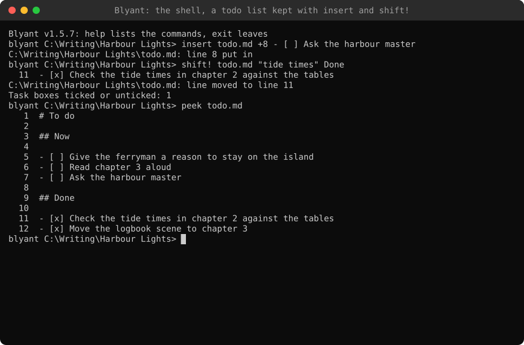

# Shell tutorial
The shell is Blyant on lines of text: you type a command at a prompt, and Blyant writes the answer below it, as in a terminal. It does what the full screen does with files (finding them, looking into them, copying, moving, adding a line, ticking off a task) without leaving the line you type on. It works in any terminal, over SSH, with a screen reader, and from scripts.

This tutorial goes through a day of work on a small novel project, one task at a time. Each part shows what you type after the prompt, and what Blyant writes back. The last part, [Practice](#practice), has fourteen short steps to try on two new files, ending with editing in a window and `undo`. The [guide to the shell](Guide-to-shell.md) describes all the commands in detail.

The project used in the examples is in `~/novel` (`/home/anna/novel`):

```
novel/
  chapters/
    01-attic.md
    02-storm.md
  notes/
    places.md
  plot.md
  todo.md
```

## Starting the shell
Start Blyant with `--shell`, and a directory if you want to start in one:

```
blyant --shell ~/novel
```

```
- Shell mode -

"""""MM_ MMM      MMM  MMM """""MM_ M_   MMM """MMM"""
MMM _MM" M%M      "MM__MM" MMM _M%M MMM_ M%M    M%M
M%M" M%M M%M  ___   M%M    M%M" M%M M%M"_M%M    M%M
MMM__MM" "MM__MMM   MMM    MMM  MMM MMM  "MM    MMM

Blyant v1.6.0: help lists the commands, exit leaves
blyant ~/novel>
```

The logo above the first line shows that Blyant was started as the shell. `set shelllogo false` leaves it out (with a screen reader, say).

The prompt shows where you are: `~` is your home directory. `about` shows the commands used the most, `help` lists them all, `help shift` explains one command, `help -t start` finds the commands with _start_ in them, and `exit` (or `Ctrl+D`) leaves Blyant. `set language de` switches Blyant to German (`en`, `da`, `nb`, `sv`, `es`, `fr`, `it`, `pl`, `nl` and `fi` are also available); the commands stay the same.

Other ways in:

- `:shell` on any command line of the full screen switches to the shell, in the directory of the page you were on, and `screen` in the shell goes back to the file browser in that directory. You can go back and forth as often as you like
- _Start in the shell_ on the General page of Configuration makes Blyant start in the shell every time (`blyant --screen` then starts on the full screen once)
- The setting `shelldir` is the directory the shell starts in: `set shelldir ~/novel`, or `set shelldir last` to start where you left off

## Getting around
`ls` lists the directory you are in: the folders first, then the files, each with a number:

```
blyant ~/novel> ls
/home/anna/novel
  1  chapters/
  2  notes/
  3  plot.md
  4  todo.md
```

The numbers are the key to the shell. A number given to a command means that row of the last list shown, so you seldom need to type a name. The list is kept until another list is shown, or a command works on a file (`peek`, `insert`, `copy` ...: that file then becomes the list, as row 1); `cd` into a directory, `open`, `clip` and `reg` leave the list as it is. See [Prompt and lists](Guide-to-shell.md#prompt-and-lists) for the details:

```
blyant ~/novel> cd 1
blyant ~/novel/chapters> ls
/home/anna/novel/chapters
  1  01-attic.md
  2  02-storm.md
blyant ~/novel/chapters> up
blyant ~/novel>
```

- `cd 1` goes into row 1, `cd chapters` does the same by name, and `cd ../other` or `cd ~/letters` take a path
- `up` goes to the directory above, `home` (or `cd` alone) to your home directory, and `pwd` shows where you are
- `ls -a` also lists hidden files (such as `.gitignore`), which `ls` leaves out, as the file browser does
- `ls -d` shows when each file was last changed, and `ls -s` how large it is: `ls -d -s` shows both. `ls -` and `Tab` offers the options
- `Tab` completes what you type: `cd ch` and `Tab` gives `cd chapters/`, and `Tab` again continues inside that directory. `Up` and `Down` bring back the commands you typed before
- `again` lists the commands you typed, numbered, and `again 3` (or `!3`) runs number 3 again; `!!` runs the last one. `!3` and `Tab` puts the command on the line, so you can change it first
- `open ` and `Tab` with nothing typed gives the file you opened last in this directory, and `Tab` again the one before it: a quick way to switch between the files you are working on. `open chapters/*storm*` and `Tab` gives `open chapters/02-storm.md`: `*` stands for any characters, and `?` for one
- `cd` on a file goes to the file's directory, and makes the file the last list, so `open 1` opens it:

```
blyant ~/novel> cd chapters/02-storm.md
In /home/anna/novel/chapters (the directory of 02-storm.md)
```

A list longer than the window comes in pages: `Enter` or `Space` gives the next page, and `q` stops it.

## Looking into a file
`peek` shows the numbered lines of a text file without opening the file (and never changes it):

```
blyant ~/novel> peek 3
-> plot.md
  1  # Plot
  2  
  3  Anna finds a letter in the attic.
  4  The storm comes that night.
<- lines 1-4 of 4
```

- The lines come between two markers: the name of the file above them, and where the lines are in the file below them, so you can tell where a peek starts and ends. `->` and `<-` show that the top and the end of the file are shown; `-^` and `-v` show that the file has more lines above or below (`set shellmarkers false` leaves the markers out)
- `peek plot.md 40` shows the first 40 lines (15 when no number is given: `set shellpeeklines 25` changes it), and `peek plot.md 100-120` lines 100 to 120
- `peek +` moves the last peek 1 line further down, and `peek ++` 5 lines (`set shellpeekstep 2` and `set shellpeekbigstep 10` change the steps); `peek -` and `peek --` go back up. Each one moves from the last window, so `peek +`, `peek +` goes on down the file. Shorter still: `+`, `++`, `-` and `--` alone on the line, even after an `insert` in between. The keys of the editor work too: `j`, `jj`, `k` and `kk`, and `gg` and `G` for the top and the end of the file
- `+ 20` moves the window 20 lines, and `peek bottom`, `peek top`, `peek middle` or `peek 75%` move the window to that place in the file peeked last
- `.` (or `peek` alone) shows the last peek again, as the file is now: a window into the lines you are changing. `set shellautopeek true` shows it automatically after each change to that file
- What `peek` showed last is `$peek`, to put in another file: `peek plot.md 3-4`, then `insert ideas.md bottom $peek`
- `peek chapters/02-storm.md +3 2` shows 2 lines from line 3. The file then becomes the last list, at that line, so `open 1` opens the file right there:

```
blyant ~/novel> peek chapters/02-storm.md +3 2
-^ 02-storm.md
  3  The storm came at night.
  4  The lights went out.
<- lines 3-4 of 4
blyant ~/novel> open 1
```

`info plot.md` shows the size and dates of a file, and for a text file the number of characters, words and lines, the encoding and the line endings.

## Finding files
`find` searches the directory you are in and its subdirectories, by name, by a text in the files, or both:

```
blyant ~/novel> find storm
  1  chapters/02-storm.md
blyant ~/novel> find -t storm
  1  plot.md:4  The storm comes that night.
  2  chapters/02-storm.md:3  The storm came at night.
blyant ~/novel> find *.md -t attic
  1  plot.md:3  Anna finds a letter in the attic.
  2  chapters/01-attic.md:4  Anna climbed to the attic.
```

In a directory with many folders the paths get long: `find -b storm` shows the names only, and `find -f storm` the folder and the name. `info 2` then shows the full path of row 2.

```
blyant ~/novel> find -b storm
  1  storm.md (part-1/drafts)
  2  storm.md (scenes/drafts)
```

The results are a list like any other: `peek 2` shows the lines around the line found (marked with `>`), and `open 2` opens the file at that line.

After working on other things, `find` alone shows the last search again, from wherever you are, with the same row numbers. `find -r` searches again for the same, in the same directory, to see what is there now. In one file, `peek plot.md /storm` goes to the first line with "storm", and `/` to the next.

## Editing a file
`open` edits a file in the editor of the full screen, with all the keys and commands of the editor:

```
blyant ~/novel> open plot.md
blyant ~/novel> open 3 +12
```

`+12` opens the file at line 12. When you close the editor (`:wq`, `:q`), you are back at the prompt, in the same directory. If the file does not exist, the shell asks whether to make it.

`resume` (or `res`) opens the file you worked on last (`$file`) again, where you left off. The shell keeps `$file` when you leave it, so the next day `blyant --shell` and `resume` take you back into your text:

```
blyant ~/novel> insert chapter-3.md bottom She opened the letter.
blyant ~/novel> resume
```

Here `resume` opens chapter-3.md at the line just put in.

## Making, copying and moving
The shell follows the rules of the file browser: nothing is overwritten, and what is deleted goes to the trash.

```
blyant ~/novel> new scenes
Made: /home/anna/novel/scenes.md
blyant ~/novel> mkdir old
Made: /home/anna/novel/old
blyant ~/novel> copy plot.md old
Copied to /home/anna/novel/old/plot.md
blyant ~/novel> rename scenes.md scene-list.md
Renamed: /home/anna/novel/scene-list.md
blyant ~/novel> move scene-list.md notes
Moved to /home/anna/novel/notes/scene-list.md
```

- `new` makes an empty file (`.md` when no extension is given), and `mkdir` a directory. A new file shows up in `recent` at once
- `copy` and `move` take what to copy or move, and the directory to put it in; `rename` takes what to rename, and the new name. Rows work too: `copy 3 1` copies row 3 into row 1
- Afterwards the new place is the last list, so `open 1` opens it
- Put a name with blanks in quotes: `rename "old notes.md" notes.md`

`delete` asks first, and for a directory tells what is in it. Type the answer in full to go ahead:

```
blyant ~/novel> delete old
Delete directory: Move "old" to the trash?
  With all its content (files: 1, directories: 0). It can be found again in the trash (:trash in the file browser)
  Type Yes to go ahead (anything else: no): Yes
Moved to the trash: /home/anna/novel/old
```

To open the trash, type `:trash` in the file browser (`screen` takes you there); there you can put a file back.

## Adding and changing lines
`insert` adds a line of text to a file without opening it, for quick notes: at the `top`, at the `bottom`, or as line 12 (`+12`). The text is everything after the place, as you type it:

```
blyant ~/novel> insert plot.md bottom Then the phone rings.
/home/anna/novel/plot.md: line 5 put in
blyant ~/novel> insert plot.md +4 The letter is from her sister.
/home/anna/novel/plot.md: line 4 put in
blyant ~/novel> peek plot.md
-> plot.md
  1  # Plot
  2  
  3  Anna finds a letter in the attic.
  4  The letter is from her sister.
  5  The storm comes that night.
  6  Then the phone rings.
<- lines 1-6 of 6
```

`change` replaces a line (`+4`) or several lines (`4-6`, which become one line) with a text. Without a text, the lines are shown, and deleted when you answer yes:

```
blyant ~/novel> change plot.md +4 The letter is from her mother.
/home/anna/novel/plot.md: line 4 changed
blyant ~/novel> change plot.md 6
-^ plot.md
  6  Then the phone rings.
<- lines 6-6 of 6
Delete lines: Delete line 6 of plot.md?
  Y Yes  N No*: y
/home/anna/novel/plot.md: line 6 deleted
```

`lines` changes the text of lines but keeps what is already there: `start` puts a text at the start of a line, and `end` at the end:

```
blyant ~/novel> lines plot.md 4 start Draft:
  4  Draft: The letter is from her mother.
/home/anna/novel/plot.md: line 4 changed
blyant ~/novel> lines plot.md 4 unstart Draft:
  4  The letter is from her mother.
/home/anna/novel/plot.md: line 4 changed
```

- `unstart` and `unend` take the text off again, and `lines plot.md 3-5 replace letter note` replaces a word in lines 3 to 5
- `lines plot.md 3-5 sort` sorts lines 3 to 5 A to Z (`sort -d`: Z to A), and `lines plot.md 1 upper` makes line 1 UPPERCASE (`lower`: lowercase)
- A text in quotes is put in exactly as written, with no blank added: `lines todo.md 5-7 start "- [ ] "` makes lines 5 to 7 tasks

To change one word, without typing the line again, see the words of the line numbered, and change a word by number:

```
blyant ~/novel> words plot.md 4
-> plot.md, line 4
  #1 The  #2 letter  #3 is  #4 from  #5 her  #6 mother
<- 6 words
blyant ~/novel> word @ 6 replace aunt
   4  The letter is from her aunt.
/home/anna/novel/plot.md: line 4 changed
-> plot.md, line 4
  #1 The  #2 letter  #3 is  #4 from  #5 her  #6 aunt
<- 6 words
```

- `@` is the file and the line of the last command: after `words plot.md 4`, `word @ 6 replace aunt` is `word plot.md 4 6 replace aunt`
- `word @ 5 before rich` puts a word in front of word 5, `after` after it, and `delete` takes it out
- `word @ 1-2 upper` makes words 1 and 2 UPPERCASE (`lower`, `title` too)
- `shift @ up` moves the line one line up, and `@` goes with it: `shift @ up` again moves it further. `shift -s plot.md Ideas down` moves a whole section, with the heading
- The full stop after `mother` stays where it is: punctuation is not part of a word. With `-p` a word is all between blanks, so `word -p @ 6 replace aunt!` takes the full stop too, and the line ends with `her aunt!`. Use `-p` on both or on neither: `words -p` can number the words differently (a `-` alone is a word with `-p` only), and the shell refuses `word` without `-p` after `words -p` of the same line when the numbers differ

`undo` takes back the last change made by `insert`, `change`, `lines` (also a sort), `word` or `shift` while Blyant is running (`redo` makes it again, and `changes` lists the changes). Still, `peek` first to be sure of the line numbers. A file keeps its line endings and byte order mark, and these commands leave the files Blyant uses alone.

To replace a name everywhere in a file, use `replace`. With `-n` it first shows what would change, and asks: `y` replaces, and `Enter` alone (No) leaves the file as it is. `undo` takes a replace back:

```
blyant ~/novel> replace -n plot.md Anna Maren
-^ plot.md
  3  Maren finds a letter in the attic.
-v 1 line of 5
/home/anna/novel/plot.md: 1 would be replaced, in line 3
Replace: Replace them in plot.md?
  Y Yes  N No*: y
/home/anna/novel/plot.md: 1 replaced, in line 3
```

`replace plot.md Anna Maren` (without `-n`) replaces at once, without asking.

`replace -i` replaces in any letter case (`anna`, `ANNA`).

## Todo list


`todo.md` is a list of tasks under headings:

```
blyant ~/novel> peek todo.md
-> todo.md
   1  # Week 46
   2  
   3  ## Todo
   4  
   5  - [ ] Rewrite chapter two
   6  - [ ] Check the dates
   7  - [ ] Call the editor
   8  
   9  ## Done
  10  
  11  - [x] Outline
<- lines 1-11 of 11
```

`shift` moves lines to another place in the same file, such as under a heading. `shift!` also ticks any task boxes on the lines it moves. Once the dates are checked:

```
blyant ~/novel> shift! todo.md 6 Done
  10  - [x] Check the dates
/home/anna/novel/todo.md: line moved to line 10
Task boxes ticked or unticked: 1
```

A text from the line finds it, so you don't need to look up the line number:

```
blyant ~/novel> shift! todo.md "Call the editor" Done
  9  - [x] Call the editor
/home/anna/novel/todo.md: line moved to line 9
Task boxes ticked or unticked: 1
blyant ~/novel> peek todo.md
-> todo.md
   1  # Week 46
   2  
   3  ## Todo
   4  
   5  - [ ] Rewrite chapter two
   6  
   7  ## Done
   8  
   9  - [x] Call the editor
  10  - [x] Check the dates
  11  - [x] Outline
<- lines 1-11 of 11
```

- The lines go right under the heading, so the newest come first. `Done+` puts them at the end of the section instead: `shift! todo.md Rewrite Done+`
- `shift!` on a ticked line unticks it, so a task moved back is open again: `shift! todo.md Outline Todo`
- Several lines move together, keeping their order: `shift todo.md 5-7 Done`, `shift todo.md 5,8,10 Done`
- Other places: `+3` (before line 3), `top` and `bottom`
- `shift` without `!` moves the lines as they are, for any kind of list: scenes in an outline, items in a shopping list
- `Tab` after the lines completes the headings of the file

At the end of the week the finished tasks go to a separate file. `lines` copies lines to another file, and with `cut` moves them there:

```
blyant ~/novel> new done
Made: /home/anna/novel/done.md
blyant ~/novel> lines todo.md 9-11 > done.md bottom cut
  1  - [x] Call the editor
  2  - [x] Check the dates
  3  - [x] Outline
/home/anna/novel/done.md: lines 1-3 put in
/home/anna/novel/todo.md: 3 lines taken out
```

- Without `cut` the lines are copied, and stay where they were
- The places are the same as for `shift` (`top`, `bottom`, `+12`, a heading or `Heading+`), but in the other file. So are the lines, including `+9 3` (3 lines from line 9)

You don't have to type the file and the line each time. `@` stands for the file and the line the last command worked on, so you can find a line once and go on with it:

```
blyant ~/novel> peek todo.md /Rewrite
-> todo.md
  1  # Week 46
  2
  3  ## Todo
  4
> 5  - [ ] Rewrite chapter two
  6
  7  ## Done
  8
<- match 1 of 1, lines 1-8 of 8
blyant ~/novel> insert @ - [ ] Check the map
/home/anna/novel/todo.md: line 6 put in
blyant ~/novel> lines @ end (chapter 4)
  6  - [ ] Check the map (chapter 4)
/home/anna/novel/todo.md: line 6 changed
blyant ~/novel> shift @ up
  5  - [ ] Check the map (chapter 4)
/home/anna/novel/todo.md: line moved to line 5
blyant ~/novel> echo $file $line
/home/anna/novel/todo.md 5
blyant ~/novel> shift! @ Done
  9  - [x] Check the map (chapter 4)
/home/anna/novel/todo.md: line moved to line 9
Task boxes ticked or unticked: 1
```

- The search makes line 5 `@`. `insert @` puts the new task after it, and `@` goes on to the line put in
- `lines @ end` adds a text to that line, and `shift @ up` moves it one line up: `@` goes with it, to line 5
- `$file` and `$line` are the two parts of `@`, so `echo $file $line` shows where it is
- `shift! @ Done` ticks the task and moves it under _Done_
- `@` also works with `words` and `word` (see [Adding and changing lines](#adding-and-changing-lines)), `change` and `peek`. `line 3` points it at line 3 of `$file`, and after `new` it is the top of the new file, so `insert @` writes the first line. More examples are in the guide to the shell: [Working on one line](Guide-to-shell.md#working-on-one-line)

## Registers
A register keeps a path or a text under a name, and `$name` puts it in any command. Registers are kept until you remove them, even when Blyant is started again.

Use `.` to keep the directory you are in, and `#` to keep a row of the last list:

```
blyant ~/novel> cd chapters
blyant ~/novel/chapters> reg chap .
  $chap = /home/anna/novel/chapters
blyant ~/novel/chapters> up
blyant ~/novel> ls
/home/anna/novel
  1  chapters/
  2  notes/
  3  done.md
  4  plot.md
  5  todo.md
blyant ~/novel> reg plot #4
  $plot = /home/anna/novel/plot.md
```

Or keep a text, everything after the name:

```
blyant ~/novel> reg note Check the dates in chapter two
  $note = Check the dates in chapter two
blyant ~/novel> reg
  $chap /home/anna/novel/chapters
  $note Check the dates in chapter two
  $plot /home/anna/novel/plot.md
```

Then use them anywhere:

```
blyant ~/novel> copy $plot $chap
Copied to /home/anna/novel/chapters/plot.md
blyant ~/novel> insert todo.md +5 - [ ] $note
/home/anna/novel/todo.md: line 5 put in
blyant ~/novel> cd $chap
blyant ~/novel/chapters>
```

A register is also the way to keep a second file at hand. `$file` follows the file the last command worked on, so it moves as you work, but a register stays as you set it:

```
blyant ~/novel> peek notes.md
-> notes.md
  1  # Notes
  2  The lighthouse keeper hums.
<- lines 1-2 of 2
blyant ~/novel> file chapter-3.md > $other
  $other = /home/anna/novel/chapter-3.md
blyant ~/novel> lines notes.md 2 > $other bottom
  4  The lighthouse keeper hums.
/home/anna/novel/chapter-3.md: line 4 put in
```

`file chapter-3.md > $other` keeps the full path of chapter 3 in `$other`, and `$file` stays `notes.md`. Line 2 of the notes is now at the end of chapter 3, and `$other` still points to chapter 3 for the next command. `file 3 > $other` keeps a row of the last list, and `reg other $file` the file you are working on.

- `reg -d note` removes a register, and `reg -d all` removes every register
- `reg -t storm` finds the registers with _storm_ in the name or the value, when there are many
- `calc 22 * 3500 > $words` keeps a result under a name, so several can be kept (`$calc` holds only the last)
- `forget` clears what the shell keeps while Blyant runs (the commands typed, `$clip`, `$peek`, `$calc`, the last search, the undo steps), after asking; the registers stay
- Put a path with blanks in quotes: `reg docs "~/my docs"`
- `Tab` completes the names of the registers after a `$`
- A register can collect lines from several places: `peek plot.md 3-4`, then `reg notes += $peek`, and `lines todo.md 6 >> $notes` adds a line from another file. `insert ideas.md bottom $notes` puts all the lines in a file
- Blyant sets some names itself: `$pwd` is the directory you are in, `$file` the file the last command worked on, `$calc` the result of the last `calc` (`calc 1250 * 1.25`, then `insert budget.md bottom Total: $calc`), and `$date`, `$time` and `$now` the time now. `insert todo.md bottom $date Called the editor` puts in a line with the date, and `peek plot.md` then `insert $file bottom The end` adds to the file you looked at
- The registers of the shell are separate from the string memory of the editor

## Clipboard
`clip` copies to the clipboard what you would otherwise select and copy by hand, as `:path` and `:name` do in the file browser:

```
blyant ~/novel> ls
...
blyant ~/novel> clip 3
Copied to the clipboard and the string memory
  /home/anna/novel/plot.md
blyant ~/novel> clip name 3
Copied to the clipboard and the string memory
  plot.md
```

- `clip .` copies the path of the directory you are in, `clip text plot.md` the whole text of a file, `clip lines plot.md +3 2` two lines from line 3, and `clip $note` the value of a register
- The copy goes where the clipboard settings of the editor send a yank: the clipboard of your system (through the terminal), the paste bin file, or both
- It also goes to the string memory of the editor: after `open`, `p` in the editor pastes it. This works even in a terminal without a clipboard

`$clip` puts what you copied last in a command, as a register does. Copied lines go in as lines:

```
blyant ~/novel> clip lines plot.md +3 2
Copied to the clipboard and the string memory
  Lines 3-4 of /home/anna/novel/plot.md
blyant ~/novel> new ideas
Made: /home/anna/novel/ideas.md
blyant ~/novel> insert ideas.md bottom $clip
/home/anna/novel/ideas.md: lines 1-2 put in
```

- `$clip` is kept until Blyant ends: it is not read from the clipboard of your system. To paste text copied in another program, use the paste keys of your terminal
- `reg` lists it after the registers, and `reg clip` shows all of it

## Favorites, history and hotlist
The shell uses the same lists as the full screen:

```
blyant ~/novel> fav add chapters
Added to the favorites: /home/anna/novel/chapters
blyant ~/novel> fav add plot.md
Added to the favorites: /home/anna/novel/plot.md
blyant ~/novel> fav
List: main
  1  plot.md
  2  chapters/
blyant ~/novel> hot add
Added to the hotlist: /home/anna/novel
```

- A favorite added goes to the top of the list, so the one added last is row 1
- `fav` lists the favorites, `hist` the files you have opened (newest first), and `recent` (or `rec`) the latest nine of them. `help` lists all the short forms at the end. `open 1`, `peek 1` and `cd 1` work in each list
- `recent -t storm` shows only the latest files with _storm_ in a line, and the line, as `find -t` does; `recent -t *` shows the first line of each file, a quick look at what is in them. `hist` and `fav` take `-t` too
- `recent -s` adds the size of each file, `recent -f` shows the folder before the name (`novel/plot.md`), and `recent -n` sorts the list by name. They work together (`recent -n -f -s`), and with `hist` too
- A favorite is marked with ` *` after its name in the other lists: `ls` now shows `plot.md *` and `chapters/ *`
- The lists show names only. `info 1` tells where row 1 is and shows its size and dates, and the list stays, so `info 2` and `open 2` work after it. `fav -l` shows the full paths
- `hot` lists the directory hotlist, and `cd 2` goes to row 2 of it. `hot add` adds the directory you are in, and `hot remove 2` takes row 2 off
- `book` lists the bookmarks of the Jump menu, `projects` the projects, and `project novel` goes to the directory of a project
- `fav remove 1` takes a favorite off the list (the file itself stays)

You can keep favorites in several lists, as with `:list` in the file browser: one for the novel, one for research. The list you open is also the one the full screen shows:

```
blyant ~/novel> fav new research
List made and opened: research
blyant ~/novel> fav add notes
Added to the favorites: /home/anna/novel/notes
blyant ~/novel> fav lists
    main
  * research
blyant ~/novel> fav main
List: main
  1  plot.md
  2  chapters/
```

- `fav research` opens the list again, and `fav main` goes back to the main list
- `fav rename research sources` gives a list a new name, and `fav delete sources` deletes it, after asking (the files in it stay where they are)

Within a list, favorites can be kept in folders, as on the favorites page of the full screen. Name a folder in brackets, as `fav` shows it, and a favorite by its row:

```
blyant ~/novel> fav folder Story
Folder made: [Story]
List: main
  1  plot.md
  2  chapters/
[Story]
blyant ~/novel> fav move 1 [Story]
Moved: plot.md
List: main
  1  chapters/
[Story]
    2  plot.md
```

- `fav move 2 top` moves row 2 to the top of its folder, `up` and `down` move it one step, `out` takes it out of the folder, and `fav move [Story] top` moves the folder with everything in it. You can also name a favorite: `fav move plot.md top`, and `fav move *.md [Story]` moves all that match
- `fav add notes [Story]` adds a favorite right into a folder (or `top`), and `fav filter plot` shows only the rows with _plot_ in them, numbered as in the whole list
- `fav subfolder [Story] Ideas` makes a subfolder, `fav rename [Story] Novel` renames a folder, and `fav remove [Story]` removes it after asking. `fav undo` puts it back

## Tags
Give files a tag to find them again, wherever they are: `tag add` and the tag, then `tag` and the tag lists them, numbered:

```
blyant ~/novel> tag add plot.md draft
Tagged draft: /home/anna/novel/plot.md
blyant ~/novel> tag add chapters/02-storm.md draft
Tagged draft: /home/anna/novel/chapters/02-storm.md
blyant ~/novel> tag draft
  1  plot.md
  2  02-storm.md
blyant ~/novel> open 2
```

- A file can have several tags: `tag add plot.md ferry`. `tags` lists the tags, and `tags -f` the files with their tags. `tags -t storm` finds the tagged files with _storm_ in a line, `tags filter chapter` those with _chapter_ in the name, and `tag draft -t storm` searches only the files tagged `draft`
- `tag add 2,4 draft` gives rows 2 and 4 of the last list the tag, and `tag add @ draft` the file you work on
- `$tag` is the tag you work with, and `tag` alone lists the files of `$tag`. It changes when you work on a file that has other tags (the shell says so: `$tag = ferry`), so look at it with `echo $tag` before you use it
- `tag remove plot.md draft` takes the tag off, and `tag rename draft final` renames it on all files. Files keep their tags when you rename or move them, and a copy gets them too

## Tidying files
`format` and `trim` are the commands `:format` and `:trim` of the editor, run on a file without opening it:

```
blyant ~/site> format index.html
/home/anna/site/index.html: Formatted
blyant ~/novel> trim plot.md
/home/anna/novel/plot.md: No blank space at line ends
```

`format` formats HTML, CSS and XML files, as Blyant Validator does. `trim` removes blank space at line ends (`trim!` also removes the line breaks of Markdown).

## Settings
`set` shows all settings or one setting, or changes one, as the pages of Configuration do:

```
blyant ~/novel> set indent
  indent = 4
blyant ~/novel> set indent 2
  indent = 2
blyant ~/novel> set shelldir ~/novel
  shelldir = ~/novel
```

`reset` puts all the settings back to their defaults (it asks first). Your files and lists are kept.

You can also change settings in the settings file itself. `data` goes to the data directory of Blyant, where the file is (`~/blyant/data` when Blyant is in `~/blyant`). `open settings.ini` edits it in the editor, and what you save there is used at once. When you edit it in another program, `reload` uses what you saved, without starting Blyant again:

```
blyant ~/novel> data
blyant ~/blyant/data> reload
Settings and registers read again
```

The registers are kept in the same directory, in `registers.txt` (a name, a tab, and the value on each line). When you edit that file, the shell reads it again automatically before the next command.

## Scripts
Shell commands can also be run from the command line, or read from a file as a small script:

```
blyant --run "format index.html" ~/site
blyant --run "insert todo.md bottom - [ ] Buy ink" ~/novel
printf 'cd chapters\nfind -t storm\n' | blyant --shell ~/novel
blyant --shell ~/novel < weekly.txt
```

- No prompt is shown, and errors go to the error output. The exit code is 1 when a command failed
- No questions are asked: the answer is always no, so nothing is deleted. With `--yes` the answer is yes
- `reg docs` alone writes the value of the register on a line by itself, so a script can read it: `blyant --run "reg docs"`
- `echo $docs` writes the value too, inside a line you write (`echo $file was changed on $date`): a quick way to see a value, or what a command will get

Inside the shell, a register can hold commands, one per line, and `run` runs them: a small script you keep. Write `$$date` for a date that is put in when the script runs, not when it is kept:

```
blyant ~/novel> reg tidy = trim plot.md
  $tidy = trim plot.md
blyant ~/novel> reg tidy += insert done.md bottom - [x] Tidied on $$date
  $tidy = trim plot.md ...  (2 lines)
blyant ~/novel> run $tidy
trim plot.md
/home/anna/novel/plot.md: No blank space at line ends
insert done.md bottom - [x] Tidied on $date
/home/anna/novel/done.md: line 4 put in
```

- Each command is written out before it runs, and `run` stops at the first one that fails
- `run weekly.txt` runs the commands of a file in the same way: one per line, and a line starting with `#` is a comment
- `!!` after `run $tidy` runs the whole script again
- Commands you have just typed become a script with `again`: it lists them, the newest first, and `again 2-3 > $tidy` keeps numbers 2 and 3 in `$tidy`, the oldest first, as they were typed

## Make your own script
A script is a register with one command on each line. `run` runs the lines one after another, and each command is done before the next one starts, so a command can work on what the one before it showed. Here the script lists the latest files with sizes, and then shows the details of the first file:

```
blyant ~/novel> reg check = recent -s
  $check = recent -s
blyant ~/novel> reg check += info 1
  $check = recent -s ...  (2 lines)
blyant ~/novel> reg check
recent -s
info 1
blyant ~/novel> run $check
recent -s
  1  plot.md      2026-11-17 09:12     1.2 kB
  2  02-storm.md  2026-11-16 21:40     4.8 kB
  3  todo.md      2026-11-16 18:05  312 bytes
info 1
  Name:          plot.md
  Type:          MD file
  Size:          1.2 kB
  ...
```

1. `reg check = recent -s` makes the register with the first command
2. `reg check += info 1` adds the second command as a new line. Add one line for each command
3. `reg check` shows the lines, so you can check that each command is on a separate line
4. `run $check` runs them. `info 1` takes row 1 of the list `recent -s` showed just before

Keep each command on a separate line. Two commands typed on one line are one command: the first command takes the second as extra words, and refuses them:

```
blyant ~/novel> reg check recent -s info 1
  $check = recent -s info 1
blyant ~/novel> run $check
recent -s info 1
Not taken: info 1 (-l full paths, -s sizes, -f folder/name, -n by name)
run stopped at line 1 of $check: recent -s info 1
```

To start again, set the register anew with `reg check = recent -s`, and add the other lines with `+=`.

Other ways to put commands on separate lines:

- Type the commands once at the prompt, and keep them: `again` lists them, newest first, and `again 1-2 > $check` keeps the last two in `$check`, oldest first
- Write them in a text file, one per line, and run the file: `run check.txt`. A line starting with `#` is a comment
- In the editor (`open check.txt`) a script file is easy to change and to read

A script can also take words when it runs: write `$1` where the first word goes, `$2` for the second:

```
blyant ~/novel> reg show = words $1 $2
  $show = words $1 $2
blyant ~/novel> run $show plot.md 4
words plot.md 4
  #1 The  #2 letter  #3 is  #4 from  #5 her  #6 aunt
```

A register of one line can be the start of a command, like a short name: after `reg w words`, `$w plot.md 4` does the same.

## Full screen and shell side by side
What you do on the full screen, and the command for it in the shell:

| On the full screen | In the shell |
|---|---|
| The file browser of a directory | `ls`, `cd 2`, `up` |
| `Enter` on a file | `open 3` (or `edit 3`) |
| Peek (`V` in the file browser) | `peek 3`, `peek 3 +100 20` |
| Search for files (`S` or `:find`) | `find plot`, `find -t storm` |
| New file, new directory | `new ideas`, `mkdir drafts` |
| Copy, move, rename, delete | `copy 3 1`, `move 3 1`, `rename 3 notes.md`, `delete 3` |
| Favorites, history, hotlist | `fav`, `hist`, `recent`, `hot` |
| Projects, bookmarks | `projects`, `project novel`, `book` |
| `:path`, `:name` | `path`, `name` (of `$file`), or `clip 3`, `clip name 3` (of a row) |
| `:format`, `:trim` in the editor | `format 3`, `trim 3` |
| A line added in the editor | `insert 3 bottom text` |
| Lines changed or deleted in the editor | `change 3 +12 text`, `change 3 12-15` |
| Lines cut and put under another heading | `shift 3 4-6 Done` |
| Lines copied or moved to another file | `lines 3 4-6 > 5 bottom`, `lines 3 4-6 > 5 bottom cut` |
| `:sort`, `gU`, `gu` in the editor | `lines 3 4-9 sort`, `lines 3 1 upper`, `lines 3 1 lower` |
| A word changed in the editor (`cw`, `gUiw`) | `words 3 12`, then `word 3 12 9 replace wish`, `word 3 12 9 upper` |
| Copy and paste | `clip lines 3 4-6`, then `insert 5 top $clip` |
| Configuration | `set`, `set indent 2` |
| `:shell` | `screen` |

## Practice
Fourteen steps to practice the commands of this tutorial on two new files. Type each command after the prompt: what Blyant writes back is shown under it. To keep the practice files separate, first make a directory for them, and go into it:

```
blyant ~> mkdir practice
Made: /home/anna/practice
blyant ~> cd practice
```

**1. Create a file.** `new` makes an empty file, and gives it `.md` when the name has no extension:

```
blyant ~/practice> new file1
Made: /home/anna/practice/file1.md
```

**2. Insert the text "File 1" at the top of the file.** Everything after `top` is the text:

```
blyant ~/practice> insert file1.md top File 1
/home/anna/practice/file1.md: line 1 put in
```

**3. Peek at the change.** `peek` shows the lines of the file, numbered:

```
blyant ~/practice> peek file1.md
-> file1.md
  1  File 1
<- lines 1-1 of 1
```

**4. Insert another line below the first.** `bottom` puts it after the last line:

```
blyant ~/practice> insert file1.md bottom A second line
/home/anna/practice/file1.md: line 2 put in
blyant ~/practice> peek file1.md
-> file1.md
  1  File 1
  2  A second line
<- lines 1-2 of 2
```

**5. Move the first line below the second.** `shift` moves lines within a file, here line 1 to the `bottom`. The line is shown in its new place:

```
blyant ~/practice> shift file1.md 1 bottom
  2  File 1
/home/anna/practice/file1.md: line moved to line 2
```

**6. Create a second file:**

```
blyant ~/practice> new file2
Made: /home/anna/practice/file2.md
```

**7. Copy line 2 of file1 into file2.** `lines` takes the file and the lines, a `>`, and the other file and the place in it. Line 2 of `file1.md` is now "File 1":

```
blyant ~/practice> lines file1.md 2 > file2.md top
  1  File 1
/home/anna/practice/file2.md: line 1 put in
```

**8. Change the line in file2 into "File 2".** `change` takes the line (`+1`) and the new text:

```
blyant ~/practice> change file2.md +1 File 2
/home/anna/practice/file2.md: line 1 changed
blyant ~/practice> peek file2.md
-> file2.md
  1  File 2
<- lines 1-1 of 1
```

**9. Copy the whole text of file2.** `clip text` copies it to the clipboard, and keeps it as `$clip`:

```
blyant ~/practice> clip text file2.md
Copied to the clipboard and the string memory
  /home/anna/practice/file2.md (7 characters)
```

**10. Insert it at the bottom of file1.** `$clip` puts in what was copied last:

```
blyant ~/practice> insert file1.md bottom $clip
/home/anna/practice/file1.md: line 3 put in
blyant ~/practice> peek file1.md
-> file1.md
  1  A second line
  2  File 1
  3  File 2
<- lines 1-3 of 3
```

That is the whole round: making files, adding, moving, copying and changing lines, without opening an editor. `open file1.md` shows the result in the editor of the full screen.

The last four steps use a peek as a window into the file while you change it, and then take a change back.

**11. Find a line.** `/` after the file name searches the file: the window goes to the first line with the text, marked with `>`:

```
blyant ~/practice> peek file1.md /file 2
-> file1.md
  1  A second line
  2  File 1
> 3  File 2
<- match 1 of 1, lines 1-3 of 3
```

**12. Change it, and look again.** `.` shows the same window again, as the file is now:

```
blyant ~/practice> change file1.md +3 File 2, changed
/home/anna/practice/file1.md: line 3 changed
blyant ~/practice> .
-> file1.md
  1  A second line
  2  File 1
  3  File 2, changed
<- lines 1-3 of 3
```

**13. Let the window follow.** With `shellautopeek` on, the window is shown again after each change to the file, without `.`:

```
blyant ~/practice> set shellautopeek true
  shellautopeek = true
blyant ~/practice> insert file1.md bottom File 3
/home/anna/practice/file1.md: line 4 put in
-> file1.md (peek again)
  1  A second line
  2  File 1
  3  File 2, changed
  4  File 3
<- lines 1-4 of 4
```

**14. Take it back, and do it again.** `undo` puts the file back as it was before the last change, `redo` does the change again, and `changes` lists what `undo` can take back:

```
blyant ~/practice> undo
Undone: insert file1.md bottom File 3
-> file1.md (peek again)
  1  A second line
  2  File 1
  3  File 2, changed
<- lines 1-3 of 3
blyant ~/practice> redo
Redone: insert file1.md bottom File 3
-> file1.md (peek again)
  1  A second line
  2  File 1
  3  File 2, changed
  4  File 3
<- lines 1-4 of 4
blyant ~/practice> changes
  1  insert file1.md bottom File 3
  2  change file1.md +3 File 2, changed
blyant ~/practice> set shellautopeek false
```

To try again, `delete file1.md` and `delete file2.md` (they go to the trash), or start over in another directory. See [Editing in a window](Guide-to-shell.md#editing-in-a-window) in the guide to the shell for more.
