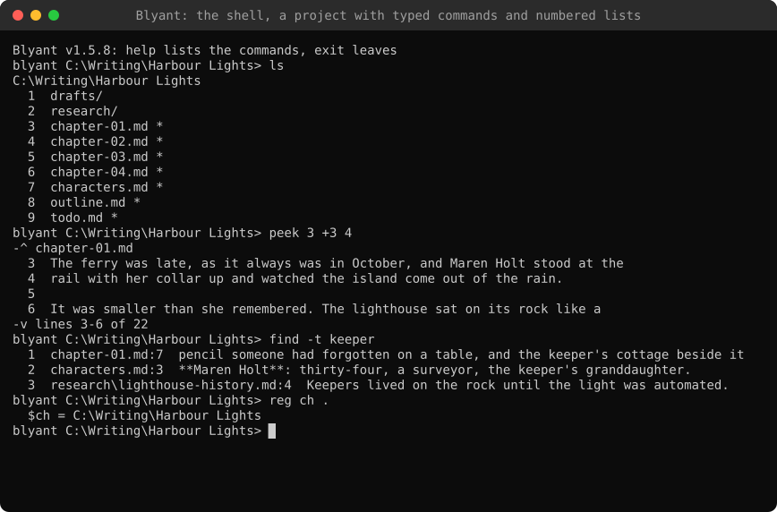
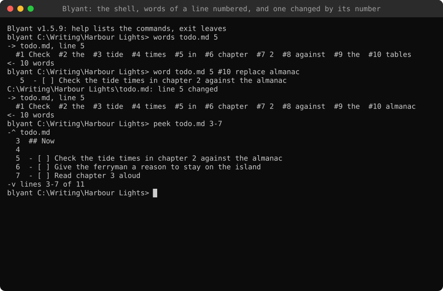
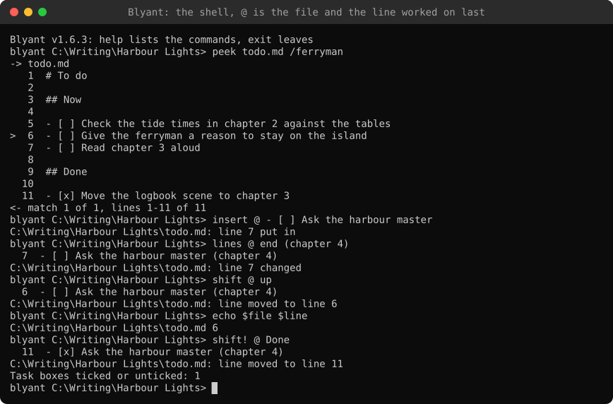
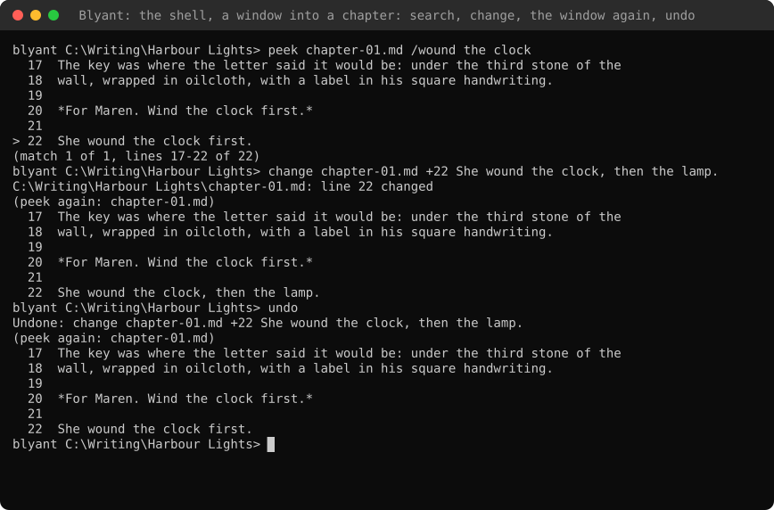
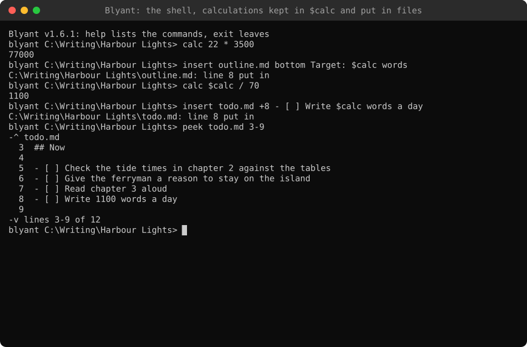

# Guide to the shell


The shell is Blyant on lines: you type a command at a prompt, and Blyant writes the answer as plain lines of text, in the colors of your terminal. It works in any terminal, with a screen reader, and from a script. Files are edited in the full-screen editor, and closing the editor brings you back to the prompt.

Start it with `--shell`, and leave it with `exit`:

```
blyant --shell                 The shell, in the directory you are in
blyant --shell ~/projects      The shell, in that directory
```

(On Windows `Blyant.exe --shell`, and `dotnet Blyant.dll --shell` for the portable version.)

New to the shell? The [shell tutorial](Guide-to-shell-tutorial.md) goes through a day of work with it, task by task: getting around, looking into files, copying and moving, adding lines, a todo list, registers and the clipboard. This guide describes every command.

## Starting in the shell
To have Blyant always start as the shell, turn on _Start in the shell_ on the General page of Configuration (or `set startshell true` in the shell). Then `blyant` alone starts as `blyant --shell` does. A file or directory given (`blyant notes.md`, `blyant +12 page.html`) is still opened on the full screen, so programs that open a file in Blyant (as Blyant Validator does) get the editor. `blyant --screen` starts on the full screen this once, and `screen` in the shell switches to it too.

## Start directory
Without a directory given, the shell starts in the directory you are in, unless the setting `shelldir` names another:

- `set shelldir ~/projects` (or a full path): the shell starts there. `~` is your home directory
- `set shelldir last`: the shell starts where you left it last time (kept as `shelllastdir`)
- `set shelldir .`: in the directory you are in, as without the setting

A directory given (`blyant --shell ~/notes`) is used instead, and so is the directory of the page you leave with `:shell` (the start page, the Jump menu and the corkboard have no directory, so `shelldir` is used). Commands given with `--run` run in the directory you are in, so scripts do what they say wherever `shelldir` points. If the start directory is not there (moved, or on a drive that was taken out), the shell says so and starts in the directory you are in. These settings are in the settings file only, not on the pages of Configuration.

## Between the full screen and the shell
You can go from one to the other while Blyant runs:

- `:shell` on any command line of the full screen switches to the shell, in the directory of the page you leave: from the file browser (and its lists) the directory of the pane, from the editor the directory of the file (which is then the last list: `open 1` opens it again), from the list of projects the directory of the selected project, and otherwise (the start page, the Jump menu, the corkboard) the start directory of `shelldir`, or the directory Blyant was started in
- `screen` in the shell switches to the full screen, opening the file browser in the directory you are in. Closing the file browser shows the start page

Leaving with `:shell` works like a jump from the Jump menu: the editor first asks about unsaved changes (save, discard, or stay), and on a page opened on top of the editor (the Jump menu, the corkboard, the list of projects) `:shell` is refused while the editor has unsaved changes. `exit` in the shell leaves Blyant, wherever it was started.

## Prompt and lists
The prompt shows the directory you are in, from `~` in your home directory:

```
blyant ~/projects/novel> ls
/home/anna/projects/novel
   1  chapters/
   2  notes/
   3  outline.md
   4  plot.md
blyant ~/projects/novel> open 4
```

Every list a command shows is numbered, and a number given to the next command is a row of that list: `open 4` opens `plot.md`, `cd 1` goes to `chapters`. A path works too (`open plot.md`, `cd ../other`), and a relative path starts from the directory you are in. A file or directory that is not there is marked `(missing)`.

The favorites, the history (`hist` and `recent`) and the bookmarks show the names of the files and directories, not their paths, so a list is quick to read. When two rows have the same name, each gets its folder after it (`README.md (novel)`), and more folders when those are alike too (`storm.md (part-1/drafts)`, `storm.md (scenes/drafts)`). `info 3` gives the rest for row 3: full path, size, dates and, for a text, words and lines. `-l` shows a list with the full paths (`fav -l`, `hist -l`, `recent -l`, `book -l`, and `ls -l`, `find -l`). The hotlist and the projects still show paths.

A favorite (in the open list of favorites) gets ` *` after its name in `ls`, `find`, `hist`, `recent` and `book`, as the full screen marks it in the file browser, the history and the search results: `plot.md *`, `notes/ *`. `fav` has no marks (every row is a favorite), and neither has a list with `-l`: its lines are only paths, for a script to read. A line found by `find -t` is not marked; only a file found by name is.

The last list stays until another command replaces it, however long that takes (but only until Blyant ends: it is not kept for the next time):

- A list shown replaces it: `ls`, `fav`, `hist`, `recent`, `hot`, `book`, `projects` and `find`
- So does the file or directory a command worked on, as a list of one row (`open 1` opens it): `peek`, `insert`, `change`, `shift`, `format` and `trim` (the file, at its line), `lines` (the other file, at the lines put in), `undo` and `redo` (the files written), `new`, `mkdir`, `copy`, `move` and `rename` (the new place), and `cd` on a file (the file)
- Other commands leave it as it was: `info` (so `fav`, `info 3`, `info 4` and `open 4` work), `cd` into a directory, `up`, `home`, `data`, `pwd`, `open`, `delete`, `clip`, `path`, `name`, `echo`, `reg`, `set`, `changes`, `help`, `about` and `clear`, and `file` (it changes only `$file`). The rows are full paths, so `fav`, then `cd` somewhere else, and `open 3` still opens row 3 of the favorites
- A row deleted since (`delete 3`) stays in the list, and is reported as missing. When a number is not a row of the list you meant (after `peek 2`, the last list is that file), show the list again

The shell writes in the colors of your terminal (the color scheme is for the full screen), and a character of a file that would steer the terminal (an escape sequence: a color, a title, the clipboard) is shown as `?`. When a command fails unexpectedly, the shell says so (`The command failed: ...`) and goes on.

## Long lists
In a terminal, output longer than the window is shown in pages: when the window is full, the shell waits, with `-- More: Enter or Space next page, q stop --` on the last row.

- `Enter` or `Space` (or another key) shows the next page
- `q`, `Esc` or `Ctrl+C` stops: the rest is not shown, and the prompt comes back
- A line wider than the window takes the rows it needs, and the window size is checked again for each page

Commands read from a file or a pipe, and `--run`, are never paged, so `blyant --run "find *.md" | less` gets the whole list. A terminal that does not report its size is not paged either.

To get all output at once (with a screen reader, say), turn the pages off: `set shellpaging false` in the shell, or `shellpaging=false` in the settings file (`settings.ini` in the data directory). The setting is not on the pages of Configuration.

## Commands
| Command | What it does |
|---|---|
| `pwd` | Show the directory you are in |
| `ls [-a] [-l] [dir\|n]` | List the folders, then the files, of a directory (by name; a favorite marked ` *`). Hidden files are left out, as in the file browser (on Linux and macOS the names that start with `.`); `ls -a` lists them too, and `ls -l` the full paths, without marks |
| `cd [dir\|file\|n]` | Go to a directory; `cd` alone goes to your home directory, `cd ~/notes` to a directory in it. A file (a row of `fav`, `hist`, `find` ...) goes to the directory it is in, and the file is then the last list: `open 1` opens it |
| `up` | Go to the directory above (`cd ..`) |
| `home` | Go to your home directory (as `cd` alone) |
| `data` | Go to Blyant's [data directory](Guide-to-installation.md#good-to-know), with the settings, lists and log. `cd data` still goes to a directory named _data_ |
| `open file\|n [+line]` (`edit`) | Edit a file in the full-screen editor, at a line if one is given (`open plot.md +12`). On a directory, go to it. `edit` does the same |
| `resume [+line]` | Edit `$file` again, where you worked last: at the line the last command worked on in it (after `insert`, `lines`, `change` or a search with `peek`), else where the cursor of the editor was. `$file` is kept when you leave the shell, so `resume` goes on after a restart. `resume +120` opens it at line 120 |
| `peek file\|n [lines]` | Show the lines of a text file, numbered: the first 15, `peek plot.md 40` the first 40, `peek plot.md 100-120` lines 100 to 120, `peek plot.md +100` 15 lines from line 100, and `peek plot.md +100 30` 30 lines from line 100. Read-only. After a peek from a line, `open 1` opens the file at that line. See [Peeking into a file](#peeking-into-a-file) |
| `peek [file\|n] top\|middle\|bottom\|50%` | Put the window of the last peek (same number of lines) at the top, in the middle, at the end, or at a point in the file (`peek 50%`: from halfway). Without a file: the file peeked last. See [Peeking into a file](#peeking-into-a-file) |
| `peek +120` | The file peeked last, from line 120, with the same window size (a file named _+120_ is peeked instead, if there is one) |
| `+ 20`, `- 20`, `++ 3`, `-- 3` | Move the window of the last peek by that many steps: `+ 20` 20 lines down (with `shellpeekstep` 1), `++ 3` 3 big steps |
| `peek [file\|n] /text` | Move the window to the first line containing a text, marked with `>` (`peek notes.md /storm`; without a file: the file peeked last). `/` alone goes to the next line with the text, `?` to the previous one. See [Peeking into a file](#peeking-into-a-file) |
| `peek` (or `.`) | Show the last peek again: the same lines of the same file, as it is now (after `insert`, `change`, `lines` or the editor). See [Peeking into a file](#peeking-into-a-file) |
| `peek [file\|n] +\|++\|-\|--` | Move the window of the last peek: `+` 1 line further down, `++` 5, `-` and `--` up again (the settings `shellpeekstep` and `shellpeekbigstep`: `set shellpeekstep 2`; 1 to 1000, and `reset` puts back 1 and 5), as many lines as before (`peek plot.md +`, then `peek +`: the file peeked last; `+`, `++`, `-` or `--` alone on the line do the same, also after other commands; a number after them is a count of steps: `+ 20`). The lines shown are `$peek`. A file other than the one peeked last starts from the top (`peek other.md +`: from line 2); at the end the last lines are shown |
| `find [-l\|-f\|-b\|-d] [name] [-t text]` | Find files here and in the directories below, by name and by text they contain (see [Files](#files)). The rows show the path from here; `find -l` gives the full paths, `find -f` the folder and the name, and `find -b` the name only. `find -d` shows when each file was last changed |
| `find [-l\|-f\|-b\|-d]`, `find -r` | `find` alone shows the last search again, as it was found, from wherever you are (`find -b`: with the names only); `find -r` searches again for the same, in the directory where it was searched |
| `find\|recent\|hist\|fav ... > $name` | Show the list, and keep the full paths of the rows shown in a register, one per line (`find -t TODO > $open`); `>> $name` adds them. See [Results in a register](#results-in-a-register) |
| `new name` | Make a new, empty file here (`new ideas` makes `ideas.md`: without an extension, the kind of new files is used). It is added to the latest files at once, as an opened file is: `recent` lists it, and `Tab` with nothing typed offers it first |
| `mkdir name` | Make a new directory here |
| `rename file\|n name` | Give a file or directory a new name. A renamed file is added to the latest files, as with `new`. `Tab` after the file gives the name it has now, to change: `rename chapter-1.md ` and `Tab` gives `rename chapter-1.md chapter-1.md` |
| `copy file\|n dir\|n` | Copy a file or directory into a directory (`copy notes.md .`: a copy here, `notes-copy.md`). A copied file is added to the latest files, as with `new` |
| `move file\|n dir\|n` | Move a file or directory into a directory. A moved file is added to the latest files, as with `new` |
| `delete file\|n` (`del`) | Delete a file or directory: to the trash, after asking |
| `info [file\|n]` | Describe a file or directory (alone: the one you are in): kind, size, dates and path, and for a text file characters, words, lines, encoding and line endings. The last list stays as it was |
| `insert file\|n top\|bottom\|+line text` | Put a line of text in a file without opening it: before the first line, after the last, or as line 12 (`+12`). See [Text and settings](#text-and-settings) |
| `change file\|n +line\|from-to [text]` | Replace a line (`+12`) or lines (`12-15`) of a file with a text, or delete them when no text is given (asks first). See [Text and settings](#text-and-settings) |
| `shift file\|n lines place` | Move lines in a file without opening it: under a heading (`shift todo.md 4-6 Done`), at the end of its section (`Done+`), before a line (`+12`), to the `top` or the `bottom`. See [Moving lines](#moving-lines) |
| `shift! file\|n lines place` | Move lines as `shift` does, and tick any task boxes (`- [ ]` to `- [x]`), or untick any that are ticked |
| `shift file\|n lines up\|down [n]` | Move lines up or down, by a line or by n lines: `shift notes.md 12 up`, `shift notes.md 12-15 down 3`. See [Moving lines](#moving-lines) |
| `shift -s file\|n heading place` | Move a section (a heading and what is under it) up or down past the sections of the same level, or to a place: `shift -s notes.md Ideas up`. See [Moving a section](#moving-a-section) |
| `lines file\|n lines > file\|n place [copy\|cut]` | Copy lines to another file without opening the files (`lines notes.md 4-6 > plan.md bottom`), or with `cut` move them there. See [Moving lines](#moving-lines) |
| `lines file\|n lines >\|>> $name [copy\|cut]` | Keep lines in a register (`lines notes.md 4-6 > $notes`), or add them at the end with `>>`; with `cut`, also take them out of the file. A register that holds a path is not written over: give the place in that file (`> $plan bottom`). See [Registers](#registers) |
| `lines file\|n lines start\|end text` | Put a text at the start or the end of lines, keeping the rest (`lines todo.md 4 start Remember this:`). See [Text in lines](#text-in-lines) |
| `lines file\|n lines unstart\|unend text` | Take a text off the start or the end of the lines that have it |
| `lines file\|n lines replace old new` | Replace a text in lines, keeping the rest (`lines notes.md 5-9 replace draft final`) |
| `lines file\|n lines sort [-a\|-d]` | Sort lines A to Z (`-a`, the default) or Z to A (`-d`): `lines notes.md 3-20 sort`. The order is that of `:sort` in the editor, by the value of the characters, so capital letters come before small ones. Lines given apart (`1,5,9`) are sorted among those places |
| `lines file\|n lines upper\|lower\|title` | Make lines UPPERCASE, lowercase or Title Case (each word with a capital first letter), as `gU` and `gu` in the editor: `lines notes.md 1 upper` |
| `words [-p] file\|n line` | Show the words of a line, numbered, for `word`: `words notes.md 12`; with `-p` a word is all between blanks, punctuation too. See [Words in a line](#words-in-a-line) |
| `word file\|n line n\|n-m action [text]` | Change words of a line by number: `replace`, `before`, `after` and `delete` (`word notes.md 12 9 replace wish`), or `upper`, `lower` and `title`. See [Words in a line](#words-in-a-line) |
| `@` | The file and the line the last command worked on, in place of the file and the line: `words notes.md 12`, then `word @ 9 replace wish`. See [Working on one line](#working-on-one-line) |
| `format file\|n` | Format an HTML, CSS or XML file, as `:format` in the editor does (see [Text and settings](#text-and-settings)) |
| `trim file\|n` | Remove blank space at the end of lines, as `:trim` in the editor does; `trim!` also removes Markdown line breaks |
| `set [name [value]]` | Show the settings (`set`), one setting (`set indent`), or change one (`set indent 2`, also `set indent=2` as in the settings file) |
| `reset` | Put all the settings back to their defaults, as _Reset all settings_ on the System page of Configuration (asks first) |
| `reload` | Read the settings file and the registers again, after you have edited them in another program (see [Text and settings](#text-and-settings)) |
| `forget` | Forget what the shell keeps only while Blyant runs: the commands typed (`again`, `Up`), `$clip`, `$peek`, `$calc`, the last search and the undo steps, after asking. The registers, the settings and `$file` stay |
| `reg [name [text\|.\|#n]]` | Keep a text or a path in a register, show one, or list them (see [Registers](#registers)) |
| `reg -t text` | Find the registers with a text in the name or in the value (`reg -t storm`, `reg -t chap*`), the names set by Blyant too |
| `reg name = text`, `reg name += text` | Keep a text in a register (as `reg name text`), or add it at the end, as lines (`reg notes += $peek`) |
| `reg -d name\|all` | Take away one register, or all |
| `echo text` | Write a text with the `$names` put in: `echo $file`, `echo $pwd $date`, `echo $peek` (all the lines). Use it to see a value, or what a command will get (`echo insert $file bottom $date Done`; a command that takes paths gets a value with blanks in quotes). See [Registers](#registers) |
| `calc expression` | Calculate, and keep the result in `$calc`: `calc 1250 * 1.25 + 80` writes `1642.5`, and `insert budget.md bottom Total: $calc` puts it in a file. See [Calculating](#calculating) |
| `calc expression > $name` | Also keep the result in a register (`calc 22 * 3500 > $words`); `>> $name` adds it as a line. See [Results in a register](#results-in-a-register) |
| `file [file\|n [line]]` | Make a file from a list `$file` without opening or peeking it: `recent`, then `file 2`; or name the file (`file plot.md`). The last list stays, so `file 3` or `open 4` still use it. `file` alone shows `$file`. `file plot.md > $other` keeps the full path in a register instead, and leaves `$file` as it is. `file plot.md 12` also makes line 12 `$line`, for `@`. See [Registers](#registers) |
| `line [n\|top\|bottom]` | Set `$line`, the line of `$file` that `@` stands for, without peeking the file: `line 3`, `line bottom` (the last line). `line` alone shows it. See [Working on one line](#working-on-one-line) |
| `clip [path\|name] file\|dir\|n\|.` | Copy the full path of a file or directory (`clip 3`: row 3 of the last list; `clip .`: the directory you are in), or its name, to the clipboard (see [Clipboard](#clipboard)) |
| `clip text file\|n` | Copy the text of a file to the clipboard |
| `clip lines file\|n lines` | Copy lines of a file to the clipboard, given as for `lines` (`40`, `4-6`, `4,7,9-10`, `+100 30`, a text in the line). See [Line numbers](#line-numbers) |
| `clip $name` | Copy the value of a register to the clipboard |
| `path [file\|n]`, `name [file\|n]` | Copy the full path, or the name, of the file you worked on last (`$file`), as `:path` and `:name` do in the editor, or of a given file or row: `path 3`, `name plot.md`. See [Clipboard](#clipboard) |
| `$clip` | The text `clip` copied last, used in a command like a register (`insert plan.md bottom $clip`: the lines copied) |
| `favorites [-l] [list]` (`fav`) | List the favorites of the file browser by name, with their folders as headings (`-l`: the full paths); `fav work` uses the list _work_ from now on, as `:list work` does, and `fav main` the main list again. The open list is named first (`List: main`) |
| `favorites lists` | List the lists of favorites, with `*` at the open one |
| `favorites new\|delete name` | Make a list and open it (`fav new reading`), or delete one: after asking, to the trash (the files in it stay where they are; deleting the open list opens the main list) |
| `favorites rename name new` | Give a list a new name (`fav rename work writing`). The main list cannot be renamed |
| `favorites use name` | Open a list whose name is also a word of the `fav` command (`fav use new` for a list named _new_) |
| `favorites folder name` | Make a folder of favorites, last in the list (`fav folder Drafts`). See [Folders of favorites](#folders-of-favorites) |
| `favorites subfolder [folder] name` | Make a subfolder, first in a folder (`fav subfolder [Writing] Drafts`) |
| `favorites rename [folder] name` | Give a folder a new name (`fav rename [Drafts] Old drafts`) |
| `favorites remove [folder]` | Remove a folder with its favorites and subfolders, after asking (the files stay) |
| `favorites move rows\|name\|[folder] where` | Move favorites or a folder: `top`, `bottom`, `up`, `down`, `out`, to the place of a row (`5`), or into a `[folder]`. Name a favorite by row or name (`fav move plot.md top`), and several by a pattern (`fav move chapter-*.md [Drafts]`) |
| `favorites filter text` | Show the favorites with a text in their name or path, or whose name fits a pattern (`fav filter draft`, `fav filter *.typ`), numbered as in the whole list. See [Folders of favorites](#folders-of-favorites) |
| `favorites undo` | Put back what `fav remove` removed last |
| `history [-l] [-s] [-f] [-n]` (`hist`) | List the files opened in the editor or changed by a command of the shell, by name, newest first, with the time each was opened or changed. The options are those of `recent` |
| `history [-l] filter text` | Show the files opened with a text in their path (`hist filter chapter`), or whose name fits a pattern (`hist filter *.typ`), numbered as in the whole history, so `open 7` is row 7 of `hist`. The options of `recent` go before `filter` (`hist -n -f filter chapter`) |
| `recent [-l] [-s] [-f] [-n]` | List the latest files (the first nine of the history), by name. `-l` shows the full paths, `-s` the size of each file (`-` for a file that is gone), `-f` the folder and the name (`Book/chapter-3.md`; two rows alike get the folder above it: `Book/a.md (novel)`), and `-n` sorts the rows by name, A to Z, numbered as shown, so `open 3` opens row 3. The options go in any order: `recent -n -f -s` |
| `recent\|hist\|fav ... -t text` | Only the files of the list with the text in a line, and the first line with it, instead of the date: `recent -t storm` shows `02-storm.md:3  The storm came at night.` The text is taken as `find -t` takes it (letter case alike, `*` and `?`), and goes last, after the other options and a filter (`hist -n -t storm`, `fav filter draft -t storm`). The rows are numbered as in the whole list, and `open 4` opens row 4 at the line found. Directories and files that are not text are left out. `recent -t *` shows the first line of each file, and `recent -t "# *"` the first heading |
| `hotlist` (`hot`) | List the directory hotlist |
| `hotlist filter text` | Show the directories of the hotlist with a text in their name or path (`hot filter novel`), or that match a pattern, numbered as in the whole hotlist |
| `fav add file\|n [where]` | Add a file or directory to the favorites in use: at the top of the list (row 1, outside the folders), or at the place given: `top`, `bottom`, the place of a row (`5`) or into a `[folder]` (`fav add notes.md [Drafts]`) |
| `fav remove file\|n` | Take a file or directory off the favorites in use |
| `hot add\|remove [dir\|n]` | Add a directory to the hotlist (`hot add` alone: the one you are in), or take it off |
| `bookmarks [-l]` (`book`) | List the bookmarks of the Jump menu, by name (`-l`: the full paths; a Blyant page is listed, but opens only on the full screen) |
| `projects` (`proj`) | List the projects |
| `project n\|name` | Go to the directory of a project (`project 2`, `project novel`) |
| `log [n]` | Show the last lines of the [log](Guide-to-start-page.md#log) (20, or as many as you give) |
| `clear` (`cls`) | Clear the screen: the prompt is at the top again |
| `screen` | Switch to the full screen, opening the file browser in the directory you are in (see [Between the full screen and the shell](#between-the-full-screen-and-the-shell)) |
| `version` | Show the version of Blyant |
| `about [license]` | Show the version of Blyant and the commands used the most (`help`, `ls`, `open`, `peek`, `set language de` ...), and `about license` shows the license, as on the second page of [About](Guide-to-start-page.md#help) |
| `undo [n]` | Put back the last change a command made to a file (`insert`, `change`, `shift`, `lines`, `format`, `trim`), or the last `n`. See [Undo](#undo) |
| `redo [n]` | Do again what `undo` put back |
| `changes` | List the changes `undo` goes back through, the newest first, and those `redo` does again |
| `again filter text` | Show the commands you typed with a text in them (`again filter lines`), or that match a pattern (`again filter peek*`), with their numbers: `!7` runs the one numbered 7 |
| `again [n]` | List the commands you typed, the newest first, or run one again by its number (`again 3`; also `!3`, and `!!` for the last). See [Typing a command](#typing-a-command) |
| `again n\|n-m > $name` | Keep commands you typed in a register, as typed and the oldest first, for `run` (`again 3-5 > $tidy`); `>> $name` adds them. See [Running commands](#running-commands) |
| `run $name\|file` | Run the commands of a register or of a file, one per line, each written out first; it stops at the first that fails. See [Running commands](#running-commands) |
| `run $name\|file words` | Run it with the words put in where the commands have `$1`, `$2` ... (`$*`: all the words): `run $check $file 12`. A script of one command without `$1` gets the words added at the end. See [Script with words](#script-with-words) |
| `$name words` | A register of one line as the start of a command: after `reg w words`, `$w $file 12` runs `words` with the file and the line. See [Script with words](#script-with-words) |
| `help [command]` (`h`) | List the commands, or explain one |
| `exit` (`quit`, `q`) | Leave Blyant |

### Typing a command
In a terminal the line of the shell is read key by key:

- `Tab` completes the word you are typing, and `Tab` again gives the next match (after the last: what you typed; `Shift+Tab` goes back): the name of a command (`fa` to `favorites`), the words that can follow some of them (the names of the settings after `set`, the lists after `fav`, the projects after `project`, `add` and `remove` after `fav` and `hot`, `top` and `bottom` after `insert`, `top`, `bottom` and the headings of the file after the lines of `shift` and after the other file of `lines` (also from a pattern, and of a row or `$file`), `path`, `name`, `text` and `lines` after `clip`, the options not given yet after `recent` and `hist`), and the names of files and directories after the commands that take a path (`open pl` to `open plot.md`). `cd` and `ls`, and the directory of `copy` and `move`, take directories only. A directory gets `/` after it, and when it is the only name that fits, `Tab` again goes on into it (`cd pr` to `cd projects/`, then `cd projects/Article/`). A name with a blank in it is put in quotes, and hidden names are offered only after a `.`
- With nothing typed after a command that takes a file (`open ` and `Tab`), the files you opened last that are in that directory come first, the last opened first: `Tab`, `Tab` goes between the files you are working on. The other names follow, sorted by name. It works after a directory too (`open drafts/` and `Tab`), and for a directory (`cd ` and `Tab`) the directories that have those files come first. Once you have typed a letter, the names are sorted by name. The files opened last are those of `recent` and `hist`. To have all names sorted by name, turn the setting `shellrecentfirst` off (`set shellrecentfirst false`, or `shellrecentfirst=false` in the settings file; not on the pages of Configuration)
- A name with `*` (any characters) or `?` (one character) in it is a pattern: `open *151*` and `Tab` gives `open Blyant-v151.md`, and `Tab` again the next name that matches (ignoring letter case). It works in the name, also after a directory (`open drafts/*151*`), but not in the directories before it. Hidden names match only a pattern that starts with `.`. Without `Tab`, `*` and `?` are taken literally: `open *151*` looks for a file of that name
- `Up` and `Down` bring back the commands you typed before, on Windows, Linux and macOS alike; they bring back only commands that start with what you have typed (`pe` and `Up`: the last `peek`)
- `forget` clears what the shell keeps while Blyant runs, for a clean slate without leaving: the commands typed, `$clip`, `$peek` (and the window of the last peek), `$calc`, the last search of `find` and the undo and redo steps. It asks first, with how many commands and undo steps there are; from a script or `--run` the answer is no, unless `--yes` is given. What is saved stays: the registers, the settings, `$file`, the directory you are in and the last list. The commands typed on the full screen are kept apart, and stay
- `again` lists the commands you typed, numbered, the newest first, and `again 3` (or `!3`) runs number 3 again, as it was typed: it is written out, then run. `!!` runs the last one. `!3` and `Tab` puts the command on the line instead, to be changed before `Enter` (another line number, another file). A command run again becomes the newest, number 1, and `again` itself is not kept. The last 50 are kept while Blyant runs, never in a file (a command can contain text from a file); commands from a file, a pipe or `--run` are not kept. When the list grows long, `again filter lines` shows only the commands with _lines_ in them (or `again filter peek*`, a pattern), with their numbers. The list of `again` does not replace the last list: `open 3` is still a row of the list shown before it
- `Left`, `Right`, `Home` and `End` move on the line, `Backspace` and `Delete` delete, `Ctrl+U` deletes the line before the cursor, `Ctrl+W` the word before it, and `Esc` the whole line. A line wider than the window is scrolled sideways on its row
- `Ctrl+C` drops what you have typed, and `Ctrl+D` (or `Ctrl+Z` on Windows) on an empty line leaves, as `exit` does

With a screen reader the line may work best when the terminal reads it: turn the setting `shellcompletion` off (`set shellcompletion false` takes effect at once, or `shellcompletion=false` in the settings file; not on the pages of Configuration). The line is then read whole after `Enter`, without `Tab` and with the history your terminal gives. Commands from a file, a pipe or `--run` are always read that way.

## Line numbers
The commands that work on the lines of a file take line numbers in a few ways. A plain number is a line to work on; a `+` before it is a place in the file, or the first line of a range counted from there:

| Written | Means | Taken by |
|---|---|---|
| `12` | line 12 | `change`, `shift`, `lines`, `clip lines` |
| `4-6` | lines 4 to 6 | `change`, `shift`, `lines`, `clip lines`, `peek` |
| `4,7,9-10` | those lines, in their order | `shift`, `lines`, `clip lines` |
| `"Get pencils and paper"` | the one line with that text in it | `shift`, `lines`, `clip lines` |
| `+100 20` | 20 lines from line 100 | `peek`, `lines`, `clip lines` |
| `+`, `++`, `-`, `--` | the window of the last peek moved: 1 or 5 lines down, or up (as set) | `peek`, and alone on the line (`+` is `peek +`) |
| `+12` as a place | at line 12, before the line that is there | `insert`, `shift`, `lines` (after the `>`), and `open` (the cursor there) |

- The `+` marks a place where the word could also be something else: `top`, `bottom` or a heading (a heading can be named _12_), and in `open notes.md +12` the line to go to, as in other editors (`vim +12 notes.md`)
- Only `peek` takes a plain number as a count: `peek notes.md 40` shows the first 40 lines, since `peek` only shows lines. Everywhere else `40` is line 40
- `change notes.md +12` is line 12 too: for `change` the `+` can be left out
- A range past the end stops at the last line, and the numbers are those of the file as it is, as `peek` shows them

## Files
The shell works on files with the rules of the file browser:

- A name with blanks in it is written in double quotes: `rename "old notes.md" notes.md`
- When you rename, move or delete the directory you are in (`rename . drafts`, `delete ..`), the shell goes with it, or to the directory above it
- `fav remove` and `hot remove` also remove a file or directory that no longer exists
- `copy` and `move` never overwrite a file or directory of the same name: the shell says so and does nothing. A copy made in the same directory gets a new name (`plot-copy.md`)
- `delete` asks first, telling what would be deleted with a directory, and you type the answer in full (`Yes`) to go ahead. It goes to the trash, which you open from the file browser with `:trash`, unless _Delete to trash_ is turned off on the General page of Configuration. Something that cannot be moved to the trash is deleted for good only if you say so
- The files and directories Blyant uses (its data directory, the settings, the favorites, the history) cannot be renamed, moved or deleted from the shell
- The favorites, the history, the hotlist, the projects and the bookmarks follow what is renamed or moved, as in the file browser, and what is deleted is removed from the favorites
- `find` searches the directory you are in and the directories below it, as the search of the file browser does: hidden files are left out, and at most 5000 files are found. `find plot` finds the names with _plot_ in them, `find *.md` the names that match (`*` and `?`), `find -t storm` the text files with _storm_ in a line (with the line), and `find *.md -t storm` both. The text takes `*` and `?` too: `find -t storm*night` finds a line with _storm_ and then _night_ in it, `find -t st?rm` _storm_ and _starm_ (a `*` you mean literally, as in `**` for bold, is also taken as a wildcard, and finds more lines). `open` on a file found by its text opens it at that line, and `peek` shows the window around it
- In a large tree the paths get long. `find -f storm` shows the folder and the name (`drafts/storm.md`), and `find -b storm` the name only (`storm.md`); a name that more rows have gets as many folders after it as tell the rows apart (`storm.md (part-1/drafts)`). The rows are the same with each option, so `open 2`, `info 2` (the full path, size and dates) and `path 2` (the full path copied) work on the same file. The options go before the name, in any order (`find -b -t storm`), and `-l` wins over the others. A name that starts with `-` is written in quotes (`find "-draft"`)
- `find -d` shows when each file was last changed, after the name, as `recent` shows when a file was opened. The dates are lined up, and a folder has none (its date changes with the files in it). It goes with the other options (`find -b -d *.md`; after the full paths of `-l` the dates are not lined up). After a search by text the date comes before the line found:

```
blyant ~/novel> find -d *.md
  1  plot.md                 2026-11-18 14:02
  2  chapters/01-harbour.md  2026-11-15 09:40
  3  chapters/02-storm.md    2026-11-18 20:31
blyant ~/novel> find -d -t storm
  1  chapters/02-storm.md:3  2026-11-18 20:31  The storm came at night.
```

- `find` alone shows the last search again: the same rows with the same numbers, the path from the directory that was searched, and a line above that tells what was searched for, where, and when (`Last search: -t storm in /home/anna/novel (14:02)`). No new search is made, so it is quick, and it works from any directory: `open 2` and `info 2` take the rows again. A file deleted or moved since is marked `(missing)`. `find -b` and `find -f` show it with the names only, or the folder and the name, and `find -d` with the dates of the files as they are now, so you see what was changed since. The last search is kept while Blyant runs
- `find -r` searches again for the same name and text, in the directory where the last search was made, and shows what is there now (`Search again: storm in /home/anna/novel`). It is the last search then
- After `new`, `mkdir`, `rename`, `copy` and `move`, the new place is the last list: `open 1` opens it

To duplicate a file, copy it to the directory it is in, `.`: the copy gets `-copy` in its name, and a second copy `-copy2`. Copied to another directory, it keeps its name:

```
blyant ~/notes> copy todo.md .
Copied to /home/anna/notes/todo-copy.md
blyant ~/notes> copy todo.md .
Copied to /home/anna/notes/todo-copy2.md
blyant ~/notes> copy todo.md drafts
Copied to /home/anna/notes/drafts/todo.md
blyant ~/notes> open 1
```

`open 1` opens the copy made last (it is the last list), and the copy is the newest of the latest files (`recent`), also after `rename`. `copy` takes a directory, not a new name: rename the copy afterwards (`rename todo-copy.md plan.md`).

## Peeking into a file
`peek` shows the lines of a text file, numbered, without opening it. It only reads: nothing is changed, and the file is not put in the latest files.

```
peek chapter-3.md                            the first 15 lines
peek chapter-3.md 40                         the first 40 lines
peek chapter-3.md 10-12                      lines 10 to 12
peek chapter-3.md +20                        15 lines from line 20
peek chapter-3.md +20 3                      3 lines from line 20
peek 2                                       row 2 of the last list (ls, fav ...)
peek chapter-3.md +                          the window 1 line further down
+                                            the same, in the file peeked last
++                                           5 lines further down
-                                            1 line up (-- 5 lines up)
+ 20                                         20 lines down (- 20 up; ++ 3: 3 steps)
peek top                                     the window at the top of the file
peek middle                                  around the middle
peek bottom                                  at the end: the last lines
peek 75%                                     from three quarters into the file
peek +120                                    from line 120, in the file peeked last
peek chapter-3.md bottom                     the last 15 lines of a file
.                                            the same window again, the file as now
peek chapter-3.md /storm                     at the first line with "storm" in it
/                                            the next line with it (? before)
```

The lines come between two markers, so a peek stands out from the commands and the other output around it: the name of the file above them, and where the lines are in the file below them. The marker also shows whether the file goes on past the lines:

| Marker | Where | What it tells |
|---|---|---|
| `->` | above the lines | the first line of the file is shown |
| `-^` | above the lines | the file has more lines above them |
| `<-` | below the lines | the last line of the file is shown |
| `-v` | below the lines | the file has more lines below them |

```
blyant ~/novel> peek chapter-3.md 10-12
-^ chapter-3.md
  10  The storm came in from the west.
  11  Anna closed the shutters.
  12  Then the lights went out.
-v lines 10-12 of 30
blyant ~/novel> +
-^ chapter-3.md
  11  Anna closed the shutters.
  12  Then the lights went out.
  13  Nobody spoke.
-v lines 11-13 of 30
blyant ~/novel> open 1
```

Use it as a window into the part of the file you are working on: peek, change, and `.` (or `peek` alone) shows the same lines again, as they are now:

```
blyant ~/novel> peek chapter-3.md 10-12
-^ chapter-3.md
  10  The storm came in from the west.
  11  Anna closed the shutters.
  12  Then the lights went out.
-v lines 10-12 of 30
blyant ~/novel> change chapter-3.md +11 Anna closed the shutters, one by one.
/home/anna/novel/chapter-3.md: line 11 changed
blyant ~/novel> .
-^ chapter-3.md
  10  The storm came in from the west.
  11  Anna closed the shutters, one by one.
  12  Then the lights went out.
-v lines 10-12 of 30
```

- `set shellmarkers false` leaves the markers out, and shows the lines alone. Where they are in the file is then written below them as `(lines 10-12 of 30)`, and left out when the lines reach the end of the file, except after `bottom`, a step, or a window moved to the end
- Without lines, `peek` shows 15: `set shellpeeklines 25` makes it 25 (1 to 1000). A window from a line (`peek chapter-3.md +20`) has as many lines
- A plain number is how many lines to show, from the top (`peek chapter-3.md 40`), since `peek` only shows lines. With a `+` it is the line to start at (see [Line numbers](#line-numbers))
- `+`, `++`, `-` and `--` move the window of the last peek, as many lines as before: 1 or 5 lines (the settings `shellpeekstep` and `shellpeekbigstep`), or as many steps as the number after them (`+ 20`). They stop at the ends: at the top line 1 is shown, and at the end the last lines. Alone on the line they go on in the file peeked last, also after other commands, so you can read, edit and read on. A file other than the one peeked last starts from the top (`peek other.md +` shows it from line 2)
- `top`, `middle`, `bottom` and a percentage (`50%`, `0%` to `100%`) put the window of the last peek there, with the same number of lines (3 after `peek chapter-3.md 10-12`). After a file (`peek chapter-3.md bottom`) they put a window there in that file: the size of the last peek if it was of that file, otherwise 15 lines (the setting `shellpeeklines`). `peek +120` alone goes to line 120 in the file peeked last; `+ 20` and `- 20` move the window 20 steps from where it is, and `++ 3` and `-- 3` 3 big steps. At the ends the window stops, as it does for `+` and `-`. `Tab` after `peek` completes `top`, `middle` and `bottom`

To find a place, search: the window goes to the first line with the text, with two lines above it, and the line found is marked with `>`. `/` goes on to the next match, and `?` back:

```
blyant ~/novel> peek chapter-3.md 1-5
...
blyant ~/novel> peek chapter-3.md /storm
-^ chapter-3.md
   8  The ferry was late.
   9  Maren stood at the rail.
> 10  The storm came in from the west.
  11  Anna closed the shutters.
  12  Then the lights went out.
-v match 1 of 3, lines 8-12 of 30
blyant ~/novel> /
-^ chapter-3.md
  18  The rain stopped at midnight.
  19  The harbour was quiet.
> 20  Only the storm lantern still burned.
  21  Maren went down.
  22  The door was open.
-v match 2 of 3, lines 18-22 of 30
```

- The text is part of a line, ignoring letter case, as for `find -t`: `*` and `?` work as there (`peek chapter-3.md /storm*night`), and the text is everything after the `/` (`peek notes.md /the storm came`). Without a file, `peek /storm` searches the file peeked last
- `/` and `?` alone go to the next and the previous line with the last text searched, in the file peeked last. At the end they wrap around and say so: `(from the top again)`, `(from the end again)`
- The window has the size of the last one in that file (15 lines for another file; a window of 1 or 2 lines starts at the line found). `open 1` opens the file at the line found, and `.`, `+` and `-` go on from the window. `/storm` alone, typed as a command, searches the file peeked last too
- A word starting with `/` that is a file or directory, or that has another `/` in it, is a path: `peek /home/anna/notes.md /storm` searches that file, and a mistyped path is reported as not found instead of being searched. A file other than the one searched last is searched from the top
- A row of `find -t` (a line found in a file) is peeked at that line: `find -t storm`, then `peek 2` shows the window around the line found, marked, as `open 2` opens it there. When the file was changed since, the line with the text nearest to it is marked

- `.` and `peek` alone show the window of the last peek again: the same file, the same first line and as many lines, read again. It is the window you peeked, whatever the commands after it worked on (`$file` can be another file by then). A line put in above the window moves the lines in it down, as you see. Before the first peek, the shell says there is nothing to show
- With the setting `shellautopeek` on (`set shellautopeek true`; off from the start), the window is shown again automatically after each command that changed the file: `insert`, `change`, `lines`, `shift`, `format`, `trim`, or the editor opened with `open`. The first marker says so: `-> chapter-3.md (peek again)` (without the markers, `(peek again: chapter-3.md)` is written above the lines). A command that changed another file, or nothing, shows nothing more
- After a peek, `open 1` opens the file at the first line shown, and `$file` is the file. The lines shown are `$peek`: `insert plan.md bottom $peek` puts them in another file (see [Registers](#registers))
- Control characters of a file are shown as `?`, and a file that is not text (an image, a program) is not shown

## Text and settings
`format` and `trim` change a file without opening it: they run the editor commands `:format` and `:trim` on the text of the file, so they do exactly what they do there (see the [guide to the editor](Guide-to-editor.md#other-commands)). The file is saved only when the text changed, keeping the line endings and byte order mark as they were, and the shell reports it with the path of the file: `/home/anna/site/page.html: Formatted`, `/home/anna/poems/poem.md: Lines trimmed: 3`, or `Already formatted` when nothing changed. A file that cannot be formatted safely is left as it is, and the shell says why.

- Only files in UTF-8 are changed: a file in another encoding (Windows-1252, say) is left as it is. Open it in the editor, which saves it in UTF-8
- A file with more than one kind of line endings (some lines CRLF, some LF) is left as it is too: saving it would give every line the same kind. The editor reports it, and saves it with one kind. This also goes for `insert`, `change`, `shift` and `lines`, as does leaving alone the files Blyant uses
- A file changed by `format` or `trim` is saved at once; `undo` puts it back, while Blyant runs (see [Undo](#undo))

`insert` puts a line of text in a file, like jotting down a quick note: `insert todo.md bottom Get pencils and paper`, `insert notes.md top # Monday`, `insert 3 +12 A new line` (a row of the last list). The text is all that follows the place, as you type it (blanks and quotes too), and it is one line; `$clip` holding copied lines puts in those lines. `+12` makes it line 12, before the line that was there, and a line past the end puts it after the last. The file keeps its line endings and byte order mark, and the file is then the last list, at the line put in: `open 1` opens it there. As for `format`, only a file in UTF-8 is changed, the files Blyant uses are not, and `undo` puts the file back.

`change` replaces lines of a file with a text, without opening it: `change notes.md +12 A new line` (line 12), `change notes.md 12-15 One line instead` (lines 12 to 15 become one line). The text is all that follows the lines, as you type it, and it is one line (`$clip` holding copied lines: those lines). Without a text, the lines are deleted: `change notes.md 12-15` shows them, between the markers of `peek`, and asks first (No is selected: deleted lines are back only with `undo`, while Blyant runs), and from a file or with `--run` they are only deleted with `--yes`. A range past the end stops at the last line. As for `insert`, the file keeps its line endings and byte order mark, only a file in UTF-8 is changed and not the files Blyant uses, and the file is then the last list at the place changed (`open 1`). (The editor's `:replace` finds a text and replaces it with another; `change` works on whole lines.)

`set` shows the settings as they are in the settings file (`settings.ini` in the data directory), and changes one as the pages of Configuration do: `set indent 2`, `set wrap false`, `set colorscheme Deep Blue`. The setting is read again at once, as Blyant reads it when it starts, and `set shelldir ""` empties a setting. An invalid value is reported, and the setting stays as it was: `indent cannot be 3: it stays 4`. A settings file written by an earlier version of Blyant lacks the newer settings: `set` writes the file whole first (as changing a setting in Configuration does), so every setting of this version can be shown and changed.

`reset` puts all the settings back to their defaults, as _Reset all settings_ on the System page of Configuration does: your lists, favorites, bookmarks and files are kept. It asks first, and only `y` (or `Yes`) goes ahead: `Enter` alone answers no. The settings of the shell go back too (`shellpaging` on, `shelldir` empty), but the language stays as it is, and so do the places Blyant keeps (the directories of the file browser, the hint shown next) and the spell languages. From a file or with `--run`, nothing is reset unless `--yes` is given. The names and values are those of the settings file: [Settings file](Guide-to-settings-file.md) lists them all, with their defaults, and the guide to [Configuration](Guide-to-start-page.md#configuration) tells more about what each setting does.

`reload` reads the settings file again after you have edited it in another program (when you save it in Blyant's editor, `open settings.ini` from `data`, it is used at once), and uses it as Blyant does when it starts: `Settings and registers read again`. An invalid value is reported (`shellpaging cannot be often: it is true`), and the setting gets its default, as when Blyant starts. The language changes at once; the color scheme and the other settings of the full screen are used the next time it is shown. The directory you are in, the last list and the commands typed before stay as they were. `reload` also reads the registers again.

## Moving lines
`shift` moves lines to another place in the same file, without opening it, as items are moved from _Todo_ to _Done_:

```
peek todo.md                                 the lines, numbered
shift todo.md 5 Done                         line 5 under the heading Done
shift todo.md 5-7 Done                       lines 5 to 7
shift todo.md 5,8,10-11 Done                 lines apart, in their order
shift todo.md "Get pencils and paper" Done   the line with that text in it
shift todo.md 5 Done+                        at the end of the section of Done
shift todo.md 12 +3                          before line 3
shift todo.md 12 top                         to the top (or bottom)
shift todo.md 12 up                          one line up
shift todo.md 12-14 down 3                   lines 12 to 14, three lines down
shift! todo.md "Get pencils and paper" Done  moved, and its task box ticked
```

- The numbers are those of the file as it is, as `peek` shows them
- A place that is not `top`, `bottom` or `+12` is a heading: `Done` is `## Done` (any level, ignoring letter case; `"## Done"` and `"Done today"` in quotes also do). The lines go right under the heading (after a blank line below it), so the newest come first; `Done+` puts them after the last line of the section, before the next heading of the same or a higher level. In a Typst file (`.typ`) the headings are `= Done`. Headings in a code block do not count
- A heading is named by its whole text first. When no heading has it, the one heading that starts with it is taken (`Done` for `##### Done herunder`), and `*` and `?` make a pattern that matches the whole heading (`"*herunder"`, `"Chap*"`, also `"Chap*+"` for the end of its section). When several headings start with it or match it, they are shown with their lines and nothing is moved: give more of the name, or the line (`+12`). A heading with `*` or `?` in it (`## What?`) is found by its whole text as it is
- `Tab` after the lines completes `top`, `bottom` and the headings of the file, also from a pattern (`*herunder` and `Tab`), and also when the file is a row (`shift 3 5 Do`) or `$file`
- A text in place of the lines finds the one line that has it (ignoring letter case). When several lines have it, or none does, they are shown with their numbers and nothing is moved; the same goes when no heading has the name, or two do (then the headings are shown)
- `shift!` also ticks any task boxes in the lines moved (`- [ ] Milk` to `- [x] Milk`, also in a numbered list), and unticks any that are ticked: `shift! todo.md Milk Done` when it is done, `shift! todo.md Milk Todo` to move it back. A line without a box is moved as it is
- The place cannot be in the lines moved (the heading moved, or `+5` with line 5 moved). Lines already at the place are left there
- `up` and `down` move the lines by one line, or by as many as given (`down 3`), and stop at the top and the bottom of the file. Lines given apart (`5,8`) are put together. A heading named _Up_ or _Down_ is written in quotes (`"Up"`)
- The lines moved are shown at their new place, and the file is then the last list there (`open 1`). As for `insert`, the file keeps its line endings and byte order mark, only a file in UTF-8 is changed and not the files Blyant uses, and `undo` puts it back; a move loses nothing, so there is no question first

`lines` copies lines to another file, or moves them there with `cut` last:

```
lines notes.md 4-6 > plan.md bottom          lines 4 to 6 copied to the end
lines notes.md +10 5 > plan.md top           5 lines from line 10, as peek
lines todo.md "Get pencils and paper" > done.md Done+ cut
                                             that line moved to the end of Done
```

- The lines are given as for `shift` (`4`, `4-6`, `4,7,9-10`, a text), or as `+10 5`: 5 lines from line 10. After the `>` come the other file and the place in it, as for `shift`: `top`, `bottom`, `+12`, a heading, or `Heading+`
- `copy` is the default, and can be written too. `cut` removes the lines from the first file after they are in the other: when something goes wrong, they are in both files, never in neither. The first file is not changed if it was changed by something else since it was read (the lines are then only copied, and the shell says so). A heading named _Cut_ is written in quotes (`"Cut"`), as the place
- The lines put in are shown, and the other file is then the last list there (`open 1`). Both files keep their line endings and byte order mark, only files in UTF-8 are changed and not the files Blyant uses, and nothing is asked: no line is lost. To move lines within one file, use `shift`
- `Tab` completes the other file after the `>`, then the headings of that file (also from a pattern, and of a row or `$file`), then `copy` and `cut`. A heading is found by the whole text, the start or a pattern, as for `shift`
- From the command line of your system, give the command in quotes: `blyant --run "lines notes.md 4-6 > plan.md bottom"`. Without them, bash, PowerShell and cmd take the `>` as a redirection to a file

### Moving a section
`shift -s` moves a whole section: a heading, with the text and the headings under it, up to the next heading of the same level or above. Chapters and scenes change places without counting lines:

```
shift -s notes.md Ideas up                   above the section before it
shift -s notes.md Ideas down 2               below the two sections after it
shift -s notes.md Ideas top                  to the top (or bottom, +12, a heading)
shift -s notes.md +40 up                     the section of the heading on line 40
```

- `up` and `down` pass whole sections of the same level under the same heading: a `##` section passes the `##` sections, never into the middle of one, and a `###` section stays under the `##` heading above it. At the first or the last section of that level, nothing is moved, and the shell says so
- The heading is named as a place is (the whole name, the start, or a pattern; `Tab` completes it), or given by a line in the section: `+40` takes the section line 40 is in, so `shift -s @ up` moves the section of the line you work on
- Blank lines stay as they were: when the sections have a blank line between them, they have one after the move too, and the blank lines at the end of the file stay at the end (`bottom` puts the section before them)
- A place (`top`, `bottom`, `+12`, a heading) takes the section there, as lines go; it cannot be in the section itself
- The heading is shown at its new place, with how many lines the section has. `shift! -s` ticks any task boxes in the section, and `undo` takes a move back

## Text in lines
`lines` also changes the text in lines, keeping what is there: it puts a text at the start or end, takes it off again, or replaces a text. The word after the lines says which:

```
lines todo.md 4 start Remember this:         "Remember this: This is some task"
lines todo.md 4 end (by Friday)              "This is some task (by Friday)"
lines todo.md 5-9 start "- [ ] "             lines 5 to 9 made task items
lines code.md 12 end ";"                     a ";" at the end, no blank before it
lines todo.md 4 unstart Remember this:       taken off again
lines todo.md 5-9 unstart "- [ ] "           the task boxes taken off
lines notes.md 5-9 replace draft final       "draft" in lines 5 to 9 made "final"
lines notes.md 5-9 replace " (draft)" ""     " (draft)" taken out of them
```

Here a todo list is made into task items, given a date, changed and tidied again, one step at a time. Each step shows the lines it changed:

```
blyant ~/notes> peek todo.md
-> todo.md
  1  # Todo
  2
  3  Get pencils and paper
  4  Call Anna
  5  Write chapter 3 (draft)
<- lines 1-5 of 5
blyant ~/notes> lines todo.md 3-4 start "- [ ] "
  3  - [ ] Get pencils and paper
  4  - [ ] Call Anna
/home/anna/notes/todo.md: 2 lines changed
blyant ~/notes> lines todo.md 5 end (by Friday)
  5  Write chapter 3 (draft) (by Friday)
/home/anna/notes/todo.md: line 5 changed
blyant ~/notes> lines todo.md 5 replace "(draft)" "(final)"
  5  Write chapter 3 (final) (by Friday)
/home/anna/notes/todo.md: line 5 changed
blyant ~/notes> lines todo.md 5 unend (by Friday)
  5  Write chapter 3 (final)
/home/anna/notes/todo.md: line 5 changed
blyant ~/notes> lines todo.md 3 unstart "- [ ] "
  3  Get pencils and paper
/home/anna/notes/todo.md: line 3 changed
```

- The lines are given as for `shift` and the other forms of `lines`: `4`, `4-6`, `4,7,9-10`, `+10 5` (5 lines from line 10), or a text that finds one line (`lines todo.md "some task" start Note:`). Every line given is changed
- `start` and `end` put the text with a blank between it and the line. In quotes it is put as it is: no blank, or the blanks in the quotes (`"- [ ] "`). A blank line is left as it is
- `unstart` and `unend` take the text off the lines that have it at their start or end, with the blank `start` and `end` put there (in quotes: the text only), so they undo `start` and `end`. The other lines are left as they are
- `replace old new` replaces the text everywhere in the lines, with the letter case as typed (`draft`, not `Draft`). A text with blanks is written in quotes, and `""` is an empty text: what is replaced is removed
- After the lines, `Tab` completes `start`, `end`, `unstart`, `unend`, `replace`, `sort`, `upper`, `lower`, `title` and `>`, and after `sort` it completes `-a` and `-d`. A `>` or one of these words later on is part of the text: `lines notes.md 3 start ">"` makes line 3 a quote
- `$name` and `$clip` put in their value: `lines todo.md 4 end $note`
- The lines changed are shown, and the file is then the last list, at the first of them (`open 1`). When no line changes, nothing is written, and the shell says so. As for `insert`, the file keeps its line endings and byte order mark, only a file in UTF-8 is changed and not the files Blyant uses, and `undo` puts it back; nothing is asked, as no line is lost

## Words in a line


`words` shows the words of one line, numbered, and `word` changes a word, or several, by number, without opening the file and without typing the line again:

```
blyant ~/novel> words notes.md 12
-> notes.md, line 12
  1 This  2 is  3 a  4 line  5 of  6 text  7 that  8 I  9 want  10 to
  11 change  12 with  13 a  14 few  15 commands
<- 15 words
blyant ~/novel> word notes.md 12 9 replace wish
  12  This is a line of text, that I wish to change, with a few commands...
/home/anna/novel/notes.md: line 12 changed
-> notes.md, line 12
  1 This  2 is  3 a  4 line  5 of  6 text  7 that  8 I  9 wish  10 to
  11 change  12 with  13 a  14 few  15 commands
<- 15 words
```

| Command | What it does |
|---|---|
| `word file line n replace text` | Put the text in place of the word: `word notes.md 12 9 replace wish` |
| `word file line n before text` | Put the text in front of the word, with a blank: `word notes.md 12 14 before handful of` |
| `word file line n after text` | Put the text after the word, with a blank: `word notes.md 12 6 after or two` |
| `word file line n delete` | Take the word out, with one of the blanks around it |
| `word file line n upper`, `lower`, `title` | Make the word UPPERCASE, lowercase or Title Case (the first letter capital, the rest as it is: `NASA` stays `NASA`) |

- A word is letters and digits, and a `'` or `-` between two letters belongs to the word (`don't`, `well-known`). Punctuation and the marks of Markdown are not part of a word, and stay where they are: `text,` replaced by `note` is `note,`, and `**bold**` made upper case is `**BOLD**`. A dash or a mark alone is not a word, and has no number
- `delete` takes the word out with the marks around it that open and close each other (`**bold**`, `(see)` and `"why"` go whole). A mark that opens or closes something else stays (`(see chapter 3)` without `see` is `(chapter 3)`), and so does punctuation after the word (`the end.` without `end` is `the.`). One of the blanks around the word goes with it, and none is left at the start or the end of the line
- A word is letters and digits with any accents or marks that go with them, also when an accent is a separate character, as in files from macOS
- Several words are given as `5-7`: `replace` puts the text in place of all those words, and `before` and `after` go in front of the first and after the last
- The line is given as `12` or `+12`, and the file as a name, a row of the last list or `$file`. After `words`, `@` is the file and the line, so the next command can be `word @ 9 ...` (see [Working on one line](#working-on-one-line))
- The words come between two markers: `-> notes.md, line 12` above them, and `<- 15 words` below them (as for `peek`, `set shellmarkers false` leaves them out)
- After a change the line is shown, with the words numbered again, as the numbers after a word put in or taken out move
- The text is all that follows `replace`, `before` or `after`, as typed; in quotes it is put in exactly as written. `$name` puts in a value
- `undo` takes a change back. A file Blyant uses, or one that is not UTF-8, is not changed, and the line endings and byte order mark of the file are kept, as with `lines`
- `lines notes.md 3-9 title` makes whole lines Title Case, as `upper` and `lower` do: the first letter of each word capital, the rest as it is. Code in backticks, the address of a link (`[text](address)`, `<address>`) and web addresses are left as they are

With `-p` before the file, a word is all between blanks, with the punctuation and the marks around it, so a change takes them too, without counting characters:

```
blyant ~/novel> words -p notes.md 12
-> notes.md, line 12
  1 This  2 is  3 a  4 line  5 of  6 text,  7 that  8 I  9 want  10 to
  11 change,  12 with  13 a  14 few  15 commands...
<- 15 words
blyant ~/novel> word -p notes.md 12 6 replace note:
blyant ~/novel> word -p notes.md 12 15 replace commands.
```

- `text,` becomes `note:` and `commands...` becomes `commands.`; without `-p` the comma and the dots stay
- `title` makes the first letter capital, after any marks: `**bold**` becomes `**Bold**`, and `"why?"` becomes `"Why?"`

### Use -p on both, or on neither
`words -p` and `words` can number the words of a line differently, so give `word` the same `-p` as `words`. A mark alone between blanks (`-`, `...`) is a word with `-p` only, and `a/b` is one word with `-p` but two without:

```
blyant ~/novel> words -p notes.md 4
-> notes.md, line 4
  1 Well  2 -  3 she  4 said:  5 try  6 a/b  7 first.
<- 7 words
blyant ~/novel> words notes.md 4
-> notes.md, line 4
  1 Well  2 she  3 said  4 try  5 a  6 b  7 first
<- 7 words
```

Word 6 is `a/b` with `-p`, and only `b` without it. So `word @ 6 upper` after `words -p` would change another word than the one you saw. The shell catches this: when `word` counts a line another way than the last `words` of that line, and the numbers you give point at other words, nothing is changed:

```
blyant ~/novel> words -p notes.md 4
-> notes.md, line 4
  1 Well  2 -  3 she  4 said:  5 try  6 a/b  7 first.
<- 7 words
blyant ~/novel> word @ 6 upper
words -p numbered line 4, and without -p the numbers differ: give -p to word too
blyant ~/novel> word -p @ 6 upper
   4  Well - she said: try A/B first.
/home/anna/novel/notes.md: line 4 changed
-> notes.md, line 4
  1 Well  2 -  3 she  4 said:  5 try  6 A/B  7 first.
<- 7 words
```

- Where the numbers are the same words both ways (`Well` is word 1 either way), `word` does what it is told, with `-p` or without
- Only the line numbered last is checked: the line of the last `words`, or of the last change by `word`, also in a `run`. Another line, or the line after another command has changed the file (`insert`, `shift`, `undo` ...: the line can have moved), is not checked, so run `words` (or `words -p`) again to see the numbers

## Working on one line
`@` stands for the file and the line the last command worked on, so the next command takes them without typing them again:

```
words notes.md 12                            the words of line 12
word @ 9 replace wish                        = word notes.md 12 9 replace wish
word @ 3 upper
insert @ A new line after it                 after line 12: @ is then line 13
shift @ up                                   line 13 one line up, and @ with it
shift @ up                                   ... and up again
```

- `@` goes in the place of the file and the line: in `words`, `word`, `change`, `peek`, `shift` (the lines, or with `-s` the heading), `lines` (the lines), and `open` and `edit` (the cursor at the line). With `insert` the text goes after the line
- It follows the line: after `shift @ up` it is the line at the new place, and after `insert` the last line put in (with several lines, as from `$clip`, the next `insert @` goes after them all). After `lines ... > plan.md` it is the other file, at the last line put in. A section moved with `shift -s` is followed by its heading
- The line is that of the last command that worked on a line: `words`, `word`, `insert`, `change`, `shift` and `lines` (the other file, at the lines put in). A peek of the same file is a look, and leaves it; a search with peek (`peek notes.md /storm`) makes the line found `@`, and a peek of another file the first line shown (a peek past the end of a file sets no line). `format` and `trim` keep it, and `undo` and `redo` put `@` back where it was before the change, or after it. After the editor (`open`, `edit`, `resume`), `@` is where the cursor was when you left it
- `@` is checked against the file as it is now: a line past the end (the file got shorter in the editor or in another program) is refused, not taken as the end
- `$file` and `$line` are the two parts: `echo $file $line` shows where `@` is
- With `line 3` you set the line: `file test1.html`, `line 3`, then `insert @ <p>&nbsp;</p>` puts the text in after line 3. `line top` and `line bottom` are the first and the last line, and `file test1.html 3` sets both at once. `line` alone shows the line. Nothing is written, and a line that is not in the file is refused
- A file you pick before any command has worked on a line in that file (`recent`, then `file 2`; `file plot.md`) has the line where the cursor was when you closed it in the editor last, as `resume` takes it: `file 2`, then `insert @ <p>&nbsp;</p>` puts the line in after it. A file never opened in the editor has no line until a command works on one, and `@` says so (`peek` it, or give the line)
- After `new`, `@` is the top of the empty file (`$line` is 0), as in any empty file: `new scene` and `insert @ The ferry was late.` writes the first line, and each `insert @` after it adds a line below the last. Until then `insert` puts a line there, and `open`, `edit` and `peek` take the file from line 1; `word` and the other commands have no line to work on
- `Tab` after `@` goes on as after a file and a line: `word @ 2 re` and `Tab` gives `replace`, and `lines @ st` gives `start`
- `@` counts only alone in the place of the file. In a text it stays as it is (`insert @ Ask @anna`), and a file named _@_ is written in quotes (`peek "@"`)

### With insert, lines and shift


A todo list, worked on line by line. The search finds the line once, and `@` follows it from command to command:

```
peek todo.md /dates                  the line with "dates": @ is line 6
insert @ - [ ] Check the map         a task after it, as line 7: @ is line 7
lines @ end (chapter 4)              a text at the end of line 7
shift @ up                           one line up, above "dates": @ is line 6
echo $file $line                     /home/anna/novel/todo.md 6
shift! @ Done                        the task ticked, and moved under Done
```

`$file` and `$line` are the two parts of `@`. Write them out where `@` does not fit: a place before the line, or more lines than one:

```
insert $file +$line - [ ] First       before the line (insert @: after it)
lines $file $line-7 > plan.md bottom  from the line to line 7, to plan.md
shift $file $line Done+               the same as shift @ Done+
```

After `lines ... > plan.md`, `@` is `plan.md`, at the last line put in, so `insert @` goes on there. A new file starts at the top:

```
new scene                            an empty file: @ is the top (line 0)
insert @ The ferry was late.         line 1
insert @ Nobody waited on the quay.  line 2, after it
shift @ up                           line 2 to the top
```

And a whole section, from any line in it:

```
peek chapter-3.md /Rain              a line in the section "The storm"
shift -s @ up                        the section above "The quay"
```

## Undo
The commands that change the text of a file (`insert`, `change`, `shift`, `lines`, `format` and `trim`) keep what the file was before, so `undo` puts it back:

```
blyant ~/notes> change todo.md +3 Get pencils and paper
/home/anna/notes/todo.md: line 3 changed
blyant ~/notes> undo
Undone: change todo.md +3 Get pencils and paper
blyant ~/notes> redo
Redone: change todo.md +3 Get pencils and paper
blyant ~/notes> changes
  1  change todo.md +3 Get pencils and paper
  2  insert todo.md bottom Call Anna
```

- One command is one step: `lines a.md 4-6 > b.md bottom cut` changed two files, and one `undo` puts both back. Each command in a `run` is a separate step
- `undo 3` puts back the 3 newest steps, one after another. `redo` does again what `undo` put back, the last first, until a new change is made: then there is nothing more to redo
- `changes` lists the steps, numbered as `undo 3` counts them, and below them the steps undone, which `redo` does again
- A file is put back exactly as it was: line endings and byte order mark too. The files written are the last list (`open 1`)
- A step is only undone while its files are as the step left them. If a file was changed since (in the editor, by another program), the shell says so and writes none of the step: your change is never written over. The editor has a separate undo (`u`)
- The last 50 steps are kept (the setting `shellundosteps`, 10 to 200: `set shellundosteps 100`), while Blyant runs: they are never written to a file, so no copy of your text stays on the disk.
- A command that works on a file larger than 2 MB (or on a file that could not be read first) cannot be undone: the shell says so, and what was undone before it can no longer be redone. A change that leaves a file as it was is not a step. All steps together keep at most 32 MB: beyond that, the oldest are dropped
- When the files of a step are no longer there (renamed, moved, deleted), the shell says so. When a file cannot be written, the files of the step written already are put back, so the step stays whole
- `lines a.md 4-6 > $notes cut` is undone in `a.md`; the register keeps the lines (`reg -d notes` takes it away)
- `new`, `copy`, `rename`, `move` and `delete` are not undone: they change files, not their text (`delete` goes to the trash)

## Editing in a window
A peek is a window into the part of a file you are working on: find the place, change the lines, and look again, without opening the editor. `undo` takes a change back.



**Find the place.** A window of 5 lines first, then a search moves it to the line, marked with `>`:

```
blyant ~/novel> peek chapter-3.md 1-5
...
blyant ~/novel> peek chapter-3.md /storm came
-^ chapter-3.md
   8  ## The storm
   9
> 10  The storm came in from the west.
  11  Anna closed the shutters.
  12  Then the lights went out.
-v match 1 of 1, lines 8-12 of 14
```

**Change the lines, and look again.** `change`, `insert`, `shift` and `lines` change the file; `.` shows the same window again, as the file is now:

```
blyant ~/novel> change chapter-3.md +10 The storm came in from the west.
/home/anna/novel/chapter-3.md: line 10 changed
blyant ~/novel> .
-^ chapter-3.md
   8  ## The storm
   9
  10  The storm came in from the west.
  11  Anna closed the shutters.
  12  Then the lights went out.
-v lines 8-12 of 14
blyant ~/novel> insert chapter-3.md +11 The first drops hit the glass.
/home/anna/novel/chapter-3.md: line 11 put in
blyant ~/novel> .
-^ chapter-3.md
   8  ## The storm
   9
  10  The storm came in from the west.
  11  The first drops hit the glass.
  12  Anna closed the shutters.
-v lines 8-12 of 15
```

**Take a change back.** `undo` puts the file back as it was before the last change, and `redo` does the change again:

```
blyant ~/novel> undo
Undone: insert chapter-3.md +11 The first drops hit the glass.
blyant ~/novel> .
-^ chapter-3.md
   8  ## The storm
   9
  10  The storm came in from the west.
  11  Anna closed the shutters.
  12  Then the lights went out.
-v lines 8-12 of 14
blyant ~/novel> redo
Redone: insert chapter-3.md +11 The first drops hit the glass.
```

**Let the window follow by itself.** With the setting `shellautopeek` on, the window is shown again after each command that changed the file, `undo` and `redo` too, so `.` is not needed:

```
blyant ~/novel> set shellautopeek true
  shellautopeek = true
blyant ~/novel> change chapter-3.md +12 Anna closed the shutters, one by one.
/home/anna/novel/chapter-3.md: line 12 changed
-^ chapter-3.md (peek again)
   8  ## The storm
   9
  10  The storm came in from the west.
  11  The first drops hit the glass.
  12  Anna closed the shutters, one by one.
-v lines 8-12 of 15
blyant ~/novel> shift chapter-3.md 14 +12
  12  Somewhere a door banged.
/home/anna/novel/chapter-3.md: line moved to line 12
-^ chapter-3.md (peek again)
   8  ## The storm
   9
  10  The storm came in from the west.
  11  The first drops hit the glass.
  12  Somewhere a door banged.
-v lines 8-12 of 15
```

**See what can be taken back.** `changes` lists the changes, the newest first, and `undo 2` takes back the two newest:

```
blyant ~/novel> changes
  1  shift chapter-3.md 14 +12
  2  change chapter-3.md +12 Anna closed the shutters, one by one.
  3  insert chapter-3.md +11 The first drops hit the glass.
  4  change chapter-3.md +10 The storm came in from the west.
blyant ~/novel> undo 2
Undone: shift chapter-3.md 14 +12
Undone: change chapter-3.md +12 Anna closed the shutters, one by one.
-^ chapter-3.md (peek again)
   8  ## The storm
   9
  10  The storm came in from the west.
  11  The first drops hit the glass.
  12  Anna closed the shutters.
-v lines 8-12 of 15
```

- The window keeps its place and size: a line put in above it moves the lines in it down, as you see. `+`, `-`, `top`, `bottom` and a new search move it (see [Peeking into a file](#peeking-into-a-file))
- `shellautopeek` stays on until you turn it off (`set shellautopeek false`), also the next time Blyant starts: it is kept in the settings file (see [Settings file](Guide-to-settings-file.md))
- `undo` keeps the last 50 changes while Blyant runs (the setting `shellundosteps`, 10 to 200), and never writes over a change made since in the editor or by another program (see [Undo](#undo))
- `open 1` opens the file in the editor at the window, for a change that is more than a few lines

## Folders of favorites
The favorites can be kept in folders, as on the favorites page of the full screen: a folder holds favorites and subfolders, and a subfolder holds favorites (two levels). A folder is only in the list of favorites: nothing is made on disk, and no file is moved. `fav` shows the folders in brackets, with their contents below:

```
blyant ~> fav
List: main
  1  plot.md
[Writing]
  [Drafts]
      2  chapter-1.md
      3  chapter-2.md
    4  notes.md
```

Rows in a folder are indented more than rows outside folders, and rows in a subfolder more still: here `chapter-1.md` and `chapter-2.md` are in Drafts, and `notes.md` is in Writing.

A folder is named as `fav` shows it, in brackets: `[Writing]`, and a subfolder with its folder, `[Writing/Drafts]` (or `[Drafts]` when no other folder has that name). A favorite is named by its row, as `fav` numbers it: the folders are not rows.

```
fav folder Research                  a folder, last in the list
fav subfolder [Writing] Drafts       a subfolder, first in Writing
fav rename [Research] Sources        a folder renamed
fav move 1 [Writing]                 row 1 into Writing, at the top
fav move 2,3 [Writing/Drafts]        rows 2 and 3 into the subfolder
fav move 4 top                       to the top of its folder (or of the list)
fav move 4 bottom                    to the end
fav move 4 up                        one step up (down: one step down)
fav move 4 2                         to the place of row 2, in its folder
fav move plot.md top                 a favorite by its name
fav move chapter-*.md [Writing]      all those whose names fit the pattern
fav move 2 out                       out of its folder, last in the list
fav move [Sources] top               a folder, with what is in it
fav move [Sources] [Writing]         a folder into another, as a subfolder
fav move [Writing/Sources] out       a subfolder out of its folder
fav remove [Sources]                 a folder with what is in it (asked first)
fav undo                             what fav remove removed last, put back
fav add ideas.md [Writing]           a new favorite, last in Writing
fav add ideas.md top                 a new favorite, at the top
fav filter chapter                   only the rows with "chapter" in them
```

- The rows are given as in [Line numbers](#line-numbers): `3`, `3-5`, `3,7`. `fav move` also takes a favorite by name, as `fav` shows it (`plot.md`, `chapters/`), or by path, and all the favorites whose names fit a pattern (`chapter-*.md`), in list order. When two favorites have the same name (`README.md` of two projects), the shell lists their rows: give the row. `Tab` after `fav move` completes the names of the favorites, also from a pattern that fits the whole name, as for files (`fav move *ch*` and `Tab`), and the folders. `up` and `down` move one row, or one folder, a step at a time, as `V` with `j` and `k` does on the full screen: a favorite moved onto a folder goes into it, and one moved past the first or last favorite of its folder leaves it
- A folder with subfolders does not go into another folder, as there are two levels at most, and a subfolder goes into a folder at the top. If a move cannot be done, the shell says so and moves nothing
- After each change the list is shown again with the new rows, and it is the last list: `open 2` opens row 2 of it. A folder name with blanks is written in quotes (`"[My drafts]"`), and `Tab` completes the names of the folders after `[`, and the places after `fav move 3`
- `fav remove [Sources]` asks first, and tells how many favorites and subfolders go with the folder; the files stay where they are. `fav undo` puts back what `fav remove` (a folder, or a favorite: `fav remove 3`) removed last in this shell, as long as the list has not changed since
- `fav add` takes a place after the file: `top`, `bottom`, the place of a row (`5`) or a `[folder]` (at the top of the folder), as `fav move` does. Without one the favorite is added at the top of the list, outside the folders, as `P` on the full screen adds it: it is row 1, ready for `fav move 1 [Drafts]`. `fav add notes.md bottom` puts it last. When the place is not there (no such folder), nothing is added. `Tab` after the file completes `top`, `bottom` and the folders
- `fav filter draft` shows the favorites with _draft_ in their name or path (ignoring letter case), and `fav filter *.typ` those whose name matches the pattern, with the folders they are in above them. The rows keep their numbers from the whole list, so `open 7` and `fav move 7 top` are the same row as in `fav`. The filter is not kept: `fav` shows all favorites again. `fav -l filter draft` gives the full paths
- These commands work on the open list of favorites, and each change is saved at once, so the full screen shows the same folders. `fav undo` puts back in the list it removed from: if another list was opened since, it tells you which list to open first
- A list of favorites named like one of these words (`folder`, `subfolder`, `move`, `undo`, `filter` ...) is opened with `fav use folder`, as for `new` (see [Commands](#commands))
- A file whose name starts with a bracket (`[2024].md`) is a file, not a folder, after `fav add` and `fav remove`: a folder is a name in brackets alone

## Registers
A register keeps a text or a path under a name, and `$name` puts it in any command:

```
reg docs ~/projects/novel/docs      a path (or a text: all after the name)
reg here .                          the directory you are in
reg plot #3                         the full path of row 3 of the last list
file plot.md > $plot                the full path of a file you name
reg note Buy more ink
copy plot.md $docs                  $docs is ~/projects/novel/docs
cd $here
insert todo.md bottom $note
```

`$file` follows the file the last command worked on, so it changes as you work. To keep a second file at hand while you work on another, put it in a register: the register keeps the path until you change it, whatever the commands do, and also after a restart:

```
peek notes.md                       $file is notes.md
file chapter-3.md > $other          chapter 3 in $other, $file still notes.md
lines notes.md 2 > $other bottom    line 2 of the notes put at the end of chapter 3
insert $other bottom The end.       and a line of your own
```

- `file chapter-3.md > $other` keeps the full path, so `$other` works from any directory. The file must be there: a name typed wrong gets a message, and nothing is kept
- `file 3 > $other` keeps row 3 of the last list, and `reg other $file` the file you are working on
- A file name after `reg` is kept as the text you typed (`reg other chapter-3.md` keeps `chapter-3.md`, which works only in that directory): use `file ... > $other` for a file
- `reg -d other` takes the register away when you are done. Any name works: keep as many files as you need (`$draft`, `$outline`)

A register can also hold lines, collected from several places of a file, or from several files:

```
reg notes = First idea              set (the same as "reg notes First idea")
peek plot.md 12-14
reg notes += $peek                  the lines peek showed, added at the end
lines chapter-2.md 40-42 >> $notes  lines of a file added at the end
lines todo.md 7 >> $notes cut       ... and taken out of todo.md
reg notes += Remember the attic     a line added
insert ideas.md bottom $notes       all of them put in a file
lines plot.md 3-5 > $notes          ">": the register is those lines alone
```

- `+=` and `>>` add to the end of a register, as lines (a missing register is created); `=`, `>` and `reg name text` set it. `$clip`, `$peek` and the other registers can be added (`reg notes += $clip`)
- A register of more than one line is put in as `$clip` and `$peek` are: `insert` and `change` put in its lines, `reg` keeps them, `run` runs them and `echo` writes them, and other commands refuse it. `reg` lists the first line and the number of lines, and `reg notes` shows all of them
- In `registers.txt` the lines after the first start with a tab, so the file can still be edited by hand. The lines you collect are kept there until you take the register away (`reg -d notes`): the text of your files is in that file, in the data directory (never in the log)

- A text in quotes is kept without them: `reg docs "~/my docs"` keeps the path, so `copy plot.md $docs` takes it as one
- `reg` lists the registers, `reg docs` shows the value of one (alone on a line, as a script reads it with `blyant --run "reg docs"`), `reg -d docs` takes it away, and `reg -d all` all of them
- `reg -t storm` finds the registers with a text in the name or in a line of the value, when there are many: as `find -t` takes a text (letter case alike, `*` and `?`). They are listed as `reg` lists them, and when the text is in a later line than the first, that line is shown under the row (`line 3: The storm came`). The names set by Blyant are searched too, under _Set by Blyant_. `reg -t` only shows: nothing is changed

  ```
  blyant ~/novel> reg -t storm
    $chap3 /home/anna/novel/chapters/03-storm.md
    $notes First idea ...  (3 lines)
           line 3: The storm came at night
  ```
- `echo` writes a text with the `$names` put in, as the other commands put them in: `echo $file` shows the file the last command worked on, `echo $docs has $date` a line you write, with the values in it, and `echo $notes` all the lines of a register. `$$` is a `$`. A `$name` that is not a register is reported, and nothing is written. `echo` changes nothing: no file, not the last list, not `$file`. In a `run`, it writes a line between the steps (`echo Tidying the chapters`)
- A name starts with a letter, and has letters, digits and `_` (`docs`, `draft_2`); letter case does not matter
- `$name` is put in only for a register that is there: anything else stays as typed, so `insert prices.md bottom Ink costs $5` keeps its `$5`. `$$` is a `$`
- A path with a blank in it is put in quotes where a path is taken (`copy plot.md $docs` with _my docs_), and the text of `insert`, `change`, `reg` and `set` gets the value as it is
- `$clip` is the text `clip` copied last (see [Clipboard](#clipboard)): it is put in like a register, but you cannot set it, and it is not kept in the file
- Some names are set by Blyant, and put in as a register is:

  | Name | Value |
  |---|---|
  | `$pwd` | the directory you are in (`copy 3 $pwd`) |
  | `$file` | the file the last command worked on: opened, peeked, put lines in, made with `new` ... (`peek plot.md`, then `insert $file bottom Done`). It is kept when you leave the shell, and is `$file` again the next time you start it, while the file is there (setting `shelllastfile`; not for commands from a file, a pipe or `--run`). A list shown (`ls`, `fav`) does not change it. `file 3` makes row 3 of a list `$file` without peeking it, and `resume` opens it in the editor |
  | `$line` | the line of `$file` the last command worked on (`words notes.md 12` makes it 12), or set with `line 12`, else the line where the cursor was in the editor: with `$file` it is `@` (see [Working on one line](#working-on-one-line)). Used before there is a line, it gets the message that there is no line yet |
  | `$date` | today, as `2026-11-15` |
  | `$time` | the time now, as `14:05` |
  | `$now` | the date and the time, as `2026-11-15 14:05:33` (as `:ts` in the editor) |
  | `$calc` | the result of the last `calc` (see [Calculating](#calculating)) |
  | `$clip` | the text `clip` copied last |
  | `$peek` | the lines `peek` showed last, as they were then: `peek notes.md 4-6`, then `insert plan.md bottom $peek` puts them in another file (`+` and `-` change it, as they move the window) |

  `insert log.md bottom $date Finished chapter 3` puts in a line with the date. The date and the time are written the same in every language. These names are not registers: `reg pwd x` and `reg -d date` are refused, and a line for one of them in `registers.txt` stays there, unused, as a line that is not a register. `reg` lists them after the registers, under _Set by Blyant_, with their values now, and `reg pwd` shows one. `$file` used before any command has worked on a file gets the message that there is no file yet, and `$$date` is the text `$date`
- Where they can be used: every register and name set by Blyant is put in before the command runs, so all commands take them. Only a value of more than one line (`$clip` or `$peek` of lines) is limited: `insert` and `change` put in its lines, `reg` keeps them, `run` runs them and `echo` writes them, and other commands refuse it (nothing is changed):

  | | One line (`$pwd`, `$file`, `$line`, `$date`, `$time`, `$now`, `$calc`, a register, and `$clip` or `$peek` of one line) | More lines (`$clip`, `$peek`) |
  |---|---|---|
  | `insert file top\|bottom\|+N $peek` | yes | yes, as lines |
  | `change file 3-5 $peek` | yes | yes: lines 3 to 5 become those lines |
  | `lines file 4 start\|end $date` | yes (`lines todo.md 4 end (done $date)`) | no: start and end add to one line |
  | `lines file 4-6 replace old $peek` | yes | no |
  | `lines $file 4-6 > other.md bottom`, `shift $file 4-6 Done` | yes: the file names and places | |
  | `find -t $peek` | yes: that text is looked for | no |
  | `reg note $peek`, `reg notes += $peek` | yes | yes: a register keeps lines |
  | `clip $peek` | yes | yes: all of it |
  | `echo $peek` | yes | yes: all its lines are written |

  An empty `$clip` or `$peek` is not taken by `change` (no text deletes the lines), and `insert` puts it in as a blank line. A value is put in when the command line starts: after `peek a.md 2-3`, `insert $file bottom $peek` puts the lines back into `a.md`; to put them in another file, give its name (`insert b.md bottom $peek`)
- `Tab` completes the names of the registers after a `$` (and the names set by Blyant that have a value: `$clip` once something is copied, `$file` once a file is worked on), and after `reg`
- The registers are kept in the data directory (`registers.txt`), so they are there the next time. The file can be edited in another program: a line is the name, a tab, and the value. If the file changed since the shell read it, it is read again before the next command, and `reg` points out lines that are not registers (no tab, or a name a register cannot have): they are kept in the file, at its end, so you can put them right. The editor has separate registers. `reset` does not take them away (they are not settings), and the log has the names of registers, never the values

### Results in a register
Some commands put what they find in a register named after `>` at the end, as `lines` does: `>` sets the register, and `>>` adds to the end of the register, as lines.

```
lines notes.md 4-6 > $notes         the lines
file chapter-3.md > $other          the full path of a file
calc 22 * 3500 > $words             a result (in $calc too)
again 3-5 > $tidy                   commands you typed, for run
find -t TODO > $open                the full paths of the rows of a list
insert todo.md bottom $open         ... put in a file, one per line
```

- The lists are `find`, `recent`, `hist` and `fav` (also `hist filter draft > $h`): the list is shown as always, and the register gets the full path of each row shown, whatever the list shows (`-b`, `-f`). An empty list leaves the register as it was. `fav add`, `fav move` and the other commands that change favorites refuse a register
- A name set by Blyant (`$calc`, `$file` ...) cannot be the register: it is refused, and nothing is kept
- The `$` after `>` stays the name: `calc 2 * 3 > $price` keeps 6 in `$price`, whatever `$price` held

## Calculating


`calc` does simple calculations, and keeps the result in `$calc`, so it can be put in a file:

```
blyant ~/novel> calc 1250 * 1.25 + 80
1642.5
blyant ~/novel> insert budget.md bottom Total: $calc
blyant ~/novel> calc $calc / 12
136.875
```

- The signs are `+`, `-`, `*`, `/`, `%` (the remainder: `17 % 5` is `2`) and `^` (a power: `2 ^ 10` is `1024`), with parentheses: `(2 + 3) * 4`. `*`, `/` and `%` are calculated before `+` and `-`, and `^` before them all (`-2 ^ 2` is `-4`). Blanks do not matter: `calc 2+3*4` is `14`
- A number takes `.` or `,` as the decimal point (`1.5` or `1,5`; there are no thousands separators). The result is written with `.`, the same on every computer, and with at most 10 decimals: `10 / 3` is `3.3333333333`, `10 / 4` is `2.5`
- The calculation is exact for decimals: `0.1 + 0.2` is `0.3`. Only a power whose exponent is not a whole number, such as `2 ^ 0.5` (or a whole number above a billion), is as near as it comes
- `$calc` and the registers can be used in a calculation: `calc $calc * 2`, `calc $price * 3`. Each value counts as one number, as if in parentheses: with `$calc` at `-3`, `calc $calc ^ 2` is `9`, and a register holding `1 + 2` counts as `3`
- `calc 22 * 3500 > $words` keeps the result in `$words` too, so several results can be kept (`calc $words / 70 > $perday`), and `>> $results` adds it as a line
- `calc` alone shows `$calc`. It is kept while Blyant runs, as `$clip`, and is not a register: `reg` lists it with the names set by Blyant, but cannot set it or take it away
- At most 200 parentheses or signs can be inside each other (`((1))`, `--1`)
- When something cannot be calculated, `calc` says what and where (the place is counted after the `$names` are put in): `Not understood: 12x (position 3)`, `Division by zero`, `A ) is missing`. `$calc` then stays as it was

## Clipboard
`clip` copies to the clipboard what you would otherwise select and copy by hand:

```
recent
clip 3                      the full path of row 3 (also: clip path 3)
clip name 3                 its name only (plot.md)
clip .                      the directory you are in
clip text todo.md           the whole text of a file
clip lines notes.md +40 10  10 lines from line 40 (also 40, 4-6, 4,7)
clip $note                  the value of a register, as it is
path                        the full path of $file, as :path in the editor
name                        its name, as :name
```

`path` and `name` are short for `clip path $file` and `clip name $file`: after `peek`, `open`, `insert` or `new`, the file you are working on. Given a file or a row (`path 3`, `name plot.md`), they work as `clip path` and `clip name` on it. Before you have worked on a file, `path` alone says there is none yet.

What `clip` copied last is `$clip`, which puts it in a command, as a register does:

```
clip lines notes.md 4-6     three lines
insert plan.md bottom $clip they go at the end of plan.md
clip name 3
insert todo.md top Read $clip
```

- It goes where the [clipboard settings](Guide-to-editor.md#system-clipboard-and-paste-bin) of the editor send a yank: to the clipboard of the system through the terminal (OSC 52, also over SSH) and/or to the paste bin file. Text too long for the terminal goes only to the paste bin, if it is on. The shell tells what was copied: the path, or how much
- It also goes to the string memory of the editor: after `open` (or `screen`), `p` in the editor puts it in, and `:reglist` lists it. This also works where the terminal has no clipboard (the console of Linux, the Terminal of macOS), or with the clipboard turned off
- `text` and `lines` take text files only. Lines copied are joined by line breaks, without one after the last
- `$clip` is kept in Blyant, not taken from the clipboard of the system: text copied in another program is pasted on the line with the keys of the terminal (`Ctrl+Shift+V`). It is there until Blyant ends, and the next `clip` replaces it. Before the first `clip`, a command with `$clip` says that nothing is copied yet. Lines copied are put in as lines by `insert` and `change` (`change plan.md 3-5 $clip`), blank lines and trailing blanks too, and the text of a file (`clip text`) as lines; other commands take one line, and refuse it when `$clip` has more. An empty `$clip` (the text of a file of one blank line) is not taken by `change`, where no text deletes the lines. `reg` lists it after the registers, with the first line and the number of lines, and `reg clip` shows it all. `$clip` is not a register: `reg clip text` and `reg -d clip` are refused, and a line `clip` in `registers.txt` is kept there as a line that is not a register
- When commands come from a file, a pipe or `--run` and the output goes to a file or a program, the clipboard sequence would end up in that output: then only the paste bin is used, if it is on, and `$clip`, so a script can copy lines and put them in another file
- The log tells only that something was copied, and what kind (`clip: path`), never the text

## Editing a file
`open` shows the full-screen editor, with all the keys and commands (see the [guide to the editor](Guide-to-editor.md)). When you close it (`:q`, `:wq`), you are back at the prompt, in the directory you were in. If the file does not exist yet, the shell asks whether to make it.

From the editor:

- `:exit` (or `:qa`) leaves Blyant altogether, asking about changes that are not saved first
- A jump to another place (the Jump menu, `:favorites`, `:browse` ...) closes the editor, asking about changes first, and brings you back to the prompt: the place is not shown. Open it from the shell instead

## Questions
Blyant asks a question on one line, with the answers after it: `Y Yes*  N No:`. Type the letter or the number of an answer, or the answer itself; `Enter` alone takes the one with the star. Deleting asks you to type the answer in full, so that a key typed by mistake cannot answer it.

## Commands from a file
The shell also reads commands from a file or a pipe, one on each line, and stops after the last one:

```
blyant --shell ~/projects/novel < commands.txt
printf 'ls\nhist\n' | blyant --shell
```

- No prompt is shown, and what went wrong is written to the error output, so a script can tell the two apart. The exit code is 1 when a command failed, else 0
- Questions are not asked: the answer is no, so nothing is done that would ask first, and the command counts as failed. With `--yes` the answer is yes, also to deleting (to the trash): `blyant --shell --yes < commands.txt`. The question, and the answer it got, are written to the error output
- `open` does not open the editor (it needs a terminal), and a file that is not there is not made
- The commands run in the directory Blyant is started in (or the one given), not in the start directory of the setting `shelldir`, and where they end is not kept for `shelldir=last`
- A file of commands saved with a byte order mark (as Notepad and PowerShell can save it) is read as one without
- A line starting with `#` is a comment, and is left out. Inside the shell, `run file` runs such a file too (see [Running commands](#running-commands))

`--run` gives the commands on the command line instead, one after each `--run`, and Blyant ends when they are done: output, questions and the exit code work as for commands read from a file.

```
blyant --run "format page.html"
blyant --run "trim notes.md" --run "format site.css" ~/projects/site
```

A directory given with them is where they run (the one you are in, if none is given).

## Running commands
`run` runs the commands of a register, or of a file, one after another, as if you typed them: a small script you keep and run again.

```
reg tidy = trim notes.md                        a register of commands, one a line
reg tidy += format page.html
reg tidy += insert log.md bottom $$date Tidied
run $tidy                                       runs the three, in order
run weekly.txt                                  the commands of a file
```

Commands you have typed can go in a register as they are: `again` lists them, the newest first, and `again 3-5 > $tidy` keeps numbers 3 to 5, the oldest first, so `run $tidy` runs them in the order you typed them. A `$date` in them is kept as typed, and put in when the register runs. `again 6 >> $tidy` adds one more at the end. This is the quickest way to make a script: do it once by hand, then keep it.

- One command on each line: each is done before the next one starts, so `info 1` after `recent -s` takes row 1 of that list. Two commands typed on one line are one command (`reg check recent -s info 1` gives `recent` the words `info 1`): add each with `reg check += ...`, or keep them with `again 1-2 > $check`. See [Make your own script](Guide-to-shell-tutorial.md#make-your-own-script) in the shell tutorial
- Each command is written out before it runs, as `again` does, so you see what is done. `run` stops at the first command that fails, and tells at which line: the commands after it are not run
- Questions are asked as for any command: `delete` and `change` without a text ask first (from a file or `--run`, the answer is no unless `--yes` is given)
- A `$name` in a command is put in when that command runs. When you set the register, a `$name` is put in at once: write `$$date` to keep `$date` in the register, so that it is the date of each run (`reg tidy` shows what the register holds)
- A line starting with `#` is a comment, and blank lines are left out, in a register, in a file for `run`, and in a file of commands read by `blyant --shell < file`
- `echo` in a register or file writes a line while it runs (`echo Tidied on $date`), to tell what was done
- A file for `run` is a text file of commands, as for `blyant --shell < file`: one a line. A register or file can run another (`run $more` in it); one that runs itself is stopped at 10 runs deep
- `run file` takes a path as other commands do: `run weekly.txt`, `run $pwd/weekly.txt`, `run $file` (the file the last command worked on) or a register that holds a path (`run $docs/weekly.txt`). `run $tidy` runs the lines of the register `tidy` itself
- `exit` in a run ends the run, not Blyant, and `screen`, `again`, `!3` and `!!` are not run in a run (`!!` would run the run again): the shell says so, and the run stops there
- `again` keeps `run $tidy`, not the commands it ran, so `!!` runs them all again. From the command line of your system: `blyant --run "run $tidy"` (in quotes, and in bash `\$tidy` or single quotes, as bash uses `$` itself)

### Script with words
A script can take words when it runs, as a command does: write `$1` where the first word goes, `$2` for the second, and `$*` for all the words, and give the words after the register or file:

```
reg check = words $1 $2                 a script that takes a file and a line
run $check $file 12                     runs: words <the file> 12
reg tidy = trim $1
reg tidy += insert $1 bottom Tidied on $$date
run $tidy notes.md                      both commands on notes.md
run weekly.txt chapter-3.md             a file of commands takes words too
```

- `$1` stays as typed when the register is set (a name starts with a letter, so `$1` is never a register), and is put in when the script runs. A script whose commands take `$1` is refused without words, so `new $1` cannot make a file named `$1`; a `reg` line keeps `$1` as text, for a script that makes another (`reg check words $1 $2`)
- A script of one command without `$1` gets the words added at the end: after `reg test open`, `run $test $file` opens the file
- The words must fit: a script with `$1` and `$2` takes two words, and with `$*` at least as many as the highest `$n`. A script of several commands without `$1` takes no words. `$$1` is a `$1` as it is
- A word with blanks is put in as one, in quotes: `run $check "my notes.md" 3`. `$names` in the words are put in first, as `$file` above

A register of one line can also be the start of a command, like a short name you choose:

```
reg w words
$w $file 12                             runs: words <the file> 12
reg ed open
$ed plot.md                             runs: open plot.md
```

The register is put in front of the rest of the line, when it starts with a command: a register that holds a path (`file x > $r`) or a text is put in a command instead (`open $r`), and a register of several lines is run with `run`. A name set by Blyant (`$file`, `$clip` ...) is not a command. The words given to a script are put in once: a `$` in them stays a `$`, and a word with blanks and quotes in it cannot be given (it would be split).

## What stays on the full screen
The corkboard, the Jump menu, the color schemes and logos, Configuration, split views and Zen mode are not in the shell: start Blyant without `--shell` to use them. Your settings, lists and bookmarks are the same in both, as they are kept in the data directory (see [Good to know](Guide-to-installation.md#good-to-know)).
