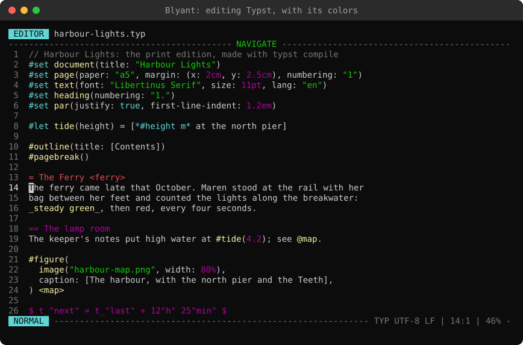

# Guide to writing with Typst


[Typst](https://typst.app) is a markup language for documents: you write plain text with a few marks in it, and the Typst compiler turns it into a PDF with fine typesetting, page numbers, a table of contents, footnotes and math. It is as easy to start with as Markdown, and it goes much further when you need it. Blyant colors Typst files, completes its marks while you write, and keeps your chapters in a project; the Typst CLI (a program run in a terminal) makes the PDF.

This guide tells how to install the Typst CLI, how to make a PDF, and how to write Typst in Blyant, with a short overview of the syntax. The full documentation is at [typst.app/docs](https://typst.app/docs).

## Install the Typst CLI
The Typst CLI is a single program named `typst`. Install it in one of these ways:

| Platform | Command |
|---|---|
| Windows | ```winget install --id Typst.Typst``` |
| macOS | ```brew install typst``` (with [Homebrew](https://brew.sh)) |
| Linux | The package of your distribution, if it has one, or ```snap install typst``` |
| With Rust installed | ```cargo install --locked typst-cli``` |

You can also download the archive for your platform from the [releases page of Typst](https://github.com/typst/typst/releases), unpack it, and put the program in a directory that is in your PATH. The package managers may be a version or two behind; `typst update` brings a downloaded `typst` up to date.

Check that it works: ```typst --version``` prints the version.

## Make a PDF
Open a terminal in the folder of your document, and run:

- ```typst compile book.typ``` Make `book.pdf` next to `book.typ`. Give a second name to put it elsewhere: ```typst compile book.typ out/book.pdf```
- ```typst watch book.typ``` Make the PDF, and make it again each time you save one of the files it uses. Press `Ctrl+C` to stop. This is the way to write: Blyant in one terminal, `typst watch` in another, and the PDF open in a viewer that reloads it when it changes (such as SumatraPDF on Windows, or Okular or Evince on Linux)
- ```typst compile book.typ --open``` (also with `watch`) Open the PDF in your default viewer when it is made
- ```typst compile book.typ page-{p}.png``` Make a picture of each page instead (PNG or SVG; `{p}` is the number of the page)
- ```typst fonts``` List the fonts Typst can use. Fonts of your own in a folder: ```typst compile --font-path fonts book.typ```
- ```typst init @preview/charged-ieee``` Start a new project from a template of [Typst Universe](https://typst.app/universe), the collection of templates and packages
- ```typst help``` and ```typst help watch``` List the commands, and tell what one of them can do

When something is wrong, Typst tells the file, the line and the column, with the text it could not use. In Blyant, `:42` goes to line 42.

## Writing Typst in Blyant
Name your files `.typ`. In the file browser, `N` makes a new file: type the whole name, `main.typ`. A name without an extension gets `.md`, unless you choose Typst in _New files and blank pages_ on the General page of Configuration: then `chapter 1` becomes `chapter 1.typ`, and a [blank page](Guide-to-start-page.md#start) is colored and completed as Typst.

- **Colors**: a `.typ` file is colored when it is opened: headings, `*strong*`, `_emphasis_`, lists, raw text, math, labels and references, comments, and the code after `#`. `:syntax typ` colors any text as Typst. See [Colors in the guide to the editor](Guide-to-editor.md#typst)
- **Completions**: type a word starting with `/` in Insert mode and press `Tab`. The cursor is put where you go on writing:

| Type | And get |
|---|---|
| `/h1` `/h2` `/h3` `/h4` | `= ` `== ` `=== ` `==== ` (headings) |
| `/bold` `/italic` | `*...*` `_..._` |
| `/list` `/numbered` `/term` | `- ` `+ ` `/ ...: ` (lists) |
| `/inline` `/code` | `` `...` `` and a block of raw text between ```` ``` ```` |
| `/imath` `/math` | `$...$` in the text, and `$ ... $` (an equation on its own line) |
| `/link` `/image` `/figure` `/table` | `#link("...")[]`, `#image("...", width: 80%)`, a figure with a caption, and a table of two columns |
| `/footnote` `/label` `/ref` | `#footnote[...]`, `<...>`, `@...` |
| `/quote` `/comment` | `#quote(block: true)[...]`, `// ...` |
| `/outline` `/pagebreak` | `#outline()` (the table of contents), `#pagebreak()` |
| `/page` `/lang` `/font` `/numbering` | Settings for the document: the paper and margins, the language (for hyphenation and quotes), the font, and numbered headings |

- `:surround /bold` puts a completion around the text you have selected: select a word, type `:surround /bold`, and it becomes `*word*`. Any completion with a place for the text works, such as `/footnote` or `/quote`
- The completions are in `completions.txt` in the data directory (`:complete edit` opens it). Add a list titled `=== My Typst (typ)` with your own, such as `/ch = #include "chapters/$0.typ"`: a list tagged `(typ)` of your own is used instead of the one built in, so copy the words you want to keep. See [Completing words](Guide-to-editor.md#completing-words)
- **A project for a book**: a folder with `main.typ`, which sets up the document and includes the chapters, and a folder of chapters. Add the folder as a [project](Guide-to-start-page.md#projects), and keep the chapters you work on in the [favorites](Guide-to-start-page.md#favorites)
- **Notes beside the text**: `:split name` shows another file at the right, read only, such as your outline or `main.typ`, and `:view` picks it in the file browser. `Tab` goes into it and back
- **Spell checking** (`:spell`) checks every word, also the names in the code (`#set`, `figure`): add the ones you use to your word list with `zg`, or move past them with `]s`

A start for `main.typ`:

```typst
#set document(title: "The Lighthouse Keeper")
#set page(paper: "a5", margin: 2cm, numbering: "1")
#set text(font: "Libertinus Serif", size: 11pt, lang: "en")
#set heading(numbering: "1.")
#set par(justify: true)

#outline()
#pagebreak()

#include "chapters/storm.typ"
#include "chapters/harbor.typ"
```

## The syntax in short
Typst has three modes. You write in **markup**, the text with its marks. `$` starts **math**, and `#` starts **code**: a function, a setting or a variable. In code, `[...]` holds markup again.

### Markup

| Write | For |
|---|---|
| `= Chapter`, `== Section`, `=== Part` | Headings (at the start of a line) |
| `*strong*` and `_emphasis_` | Bold and italic |
| `- item` and `+ item` | A list with bullets, and a numbered list |
| `/ Term: what it means` | A term list |
| `` `raw` ``, and lines between ```` ``` ```` (with a language: ```` ```python ````) | Text shown as it is written, in a fixed font |
| A blank line | A new paragraph |
| `\` at the end of a line | A line break |
| `https://example.com`, or `#link("https://example.com")[the text]` | A link |
| `<storm>` after a heading or figure, and `@storm` | A label, and a reference to it ("Section 2") |
| `// note` and `/* note */` | Comments, left out of the PDF |
| `\#`, `\*`, `\$`, `\_` | The mark itself, as text |
| `--` and `---` | An en dash and an em dash |

### Math

| Write | For |
|---|---|
| `$a^2 + b^2 = c^2$` | An equation in the text |
| `$ a^2 + b^2 = c^2 $` | An equation on its own line (with a space after the first `$` and before the last) |
| `$x_1$`, `$x^2$`, `$(a + b)/2$` | Below, above, and a fraction |
| `$sqrt(x)$`, `$sum_(i=1)^n i$`, `$alpha$`, `$->$` | Functions, sums, Greek letters and arrows by name |

### Code

| Write | For |
|---|---|
| `#image("map.png", width: 60%)` | A function: its name, and what it is given in brackets |
| `#figure(image("map.png"), caption: [The island])` | A figure with a caption, numbered |
| `#set text(size: 12pt)` | A setting for the rest of the document (or of the block it is in) |
| `#show heading: set text(blue)` | A setting for one kind of element only |
| `#let author = "Ingrid"`, then `#author` | A name for a value, used in the text |
| `#include "chapters/storm.typ"` | The text of another file, put in here |
| `#import "@preview/cetz:0.3.4": canvas` | A package from Typst Universe |
| `#if draft [Not finished] else [Final]` | Text that depends on a value |
| `2pt`, `1.5em`, `50%`, `1fr` | Lengths: points, the size of the font, a part of the page, and a share of what is left |

The [syntax reference of Typst](https://typst.app/docs/reference/syntax/) lists all of it, and the [tutorial](https://typst.app/docs/tutorial/) is a good way to learn it.

## How Blyant reads Typst
The colors come from a simple reading of the text, a line at a time, and not from the Typst compiler, so a few things are not found: `*strong*` and `_emphasis_` over two lines, and the marks in the middle of a word (Typst does not use them there either). Code is colored after `#` and in its brackets, also over several lines, and a statement (`#let`, `#set`, `#show` ...) goes on to the end of its line. Blyant does not run Typst or check the document: the errors are told by `typst compile` and `typst watch`.
