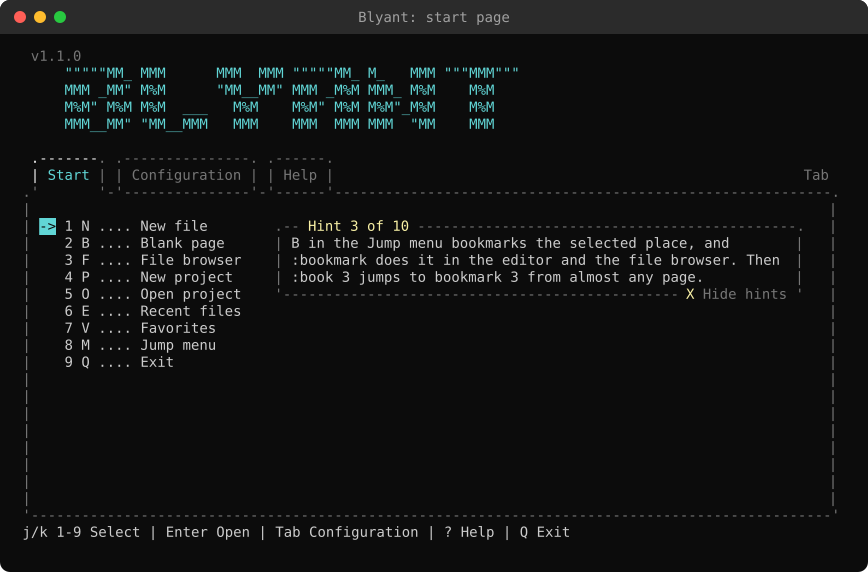
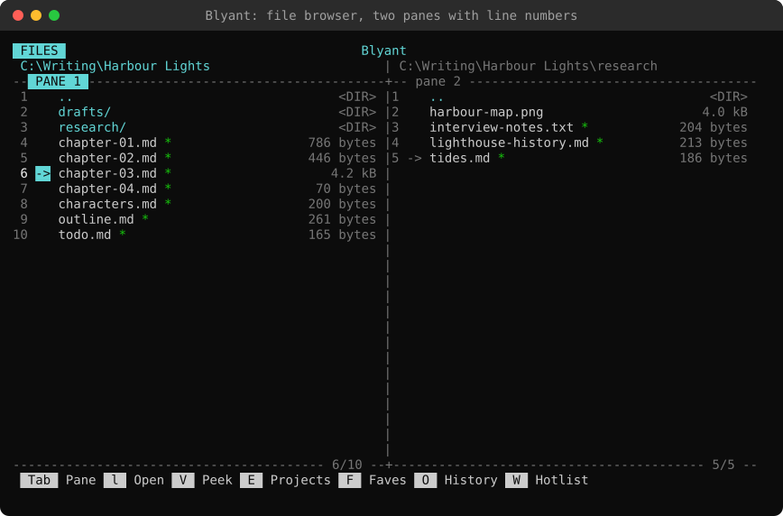
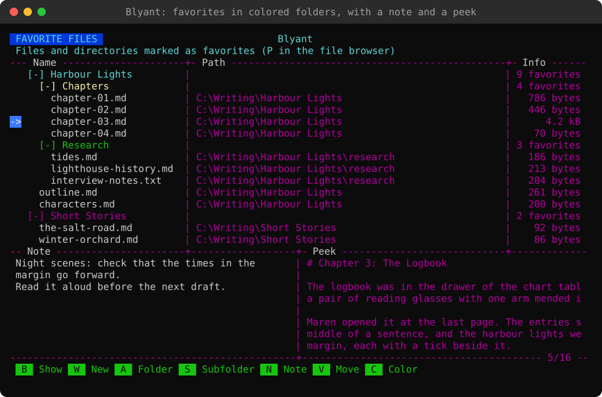
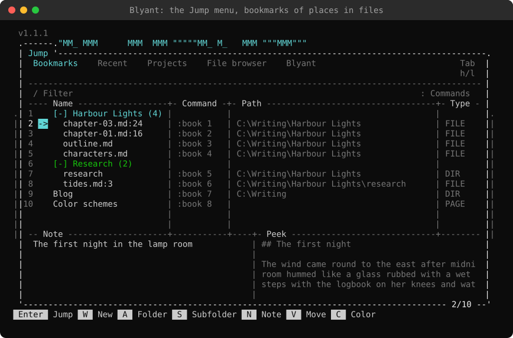
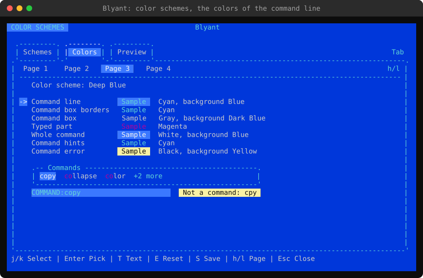
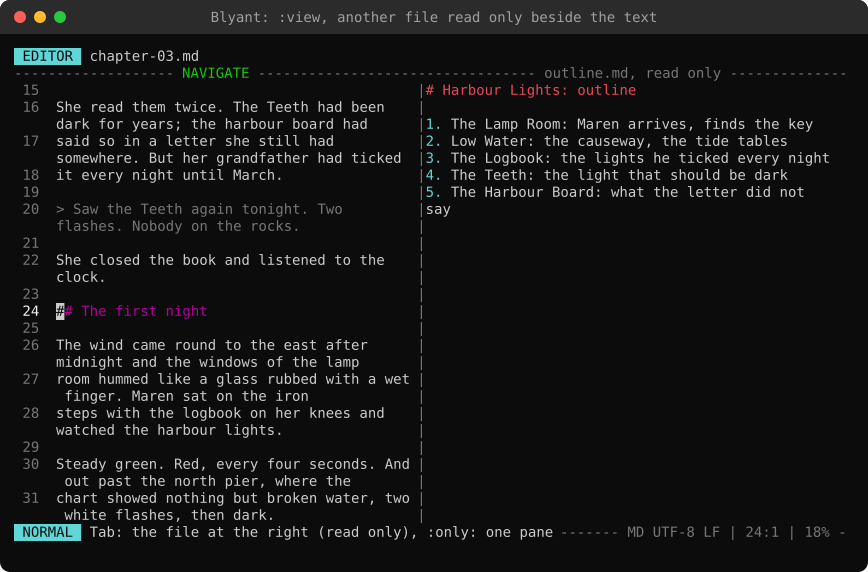
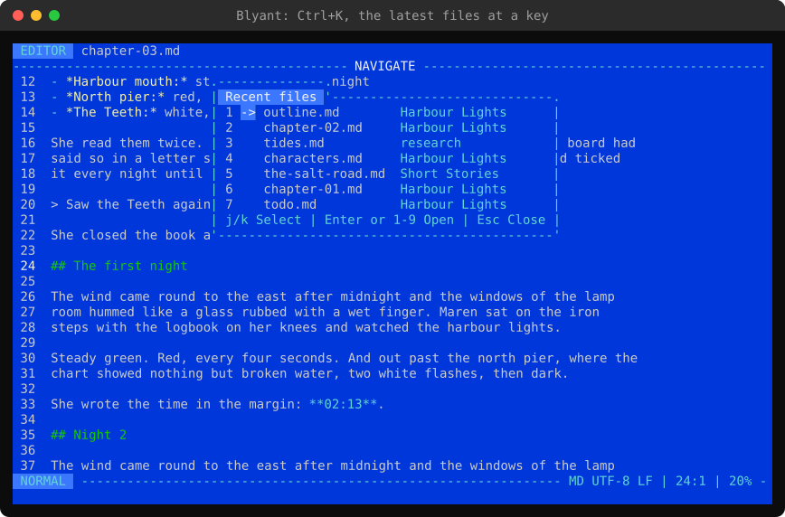

# Blyant
A free, open-source, cross-platform, Vim-style modal text editor for writing in any terminal program on Windows, Linux and macOS. _Blyant_ is Danish for _pencil_.

This project began in 2022, with the application architecture and codebase written by hand. In later versions, I’ve used agentic tools to refine, rewrite, test, and conduct code reviews. Blyant is derived from my encryption editor [Marbles](https://github.com/artstisen/marbles), but there are many differences, as Blyant is designed for writing, programming, organizing files, planning projects, etc.

Blyant has several features inspired by popular Neovim plugins for text navigation, commands, and much more. I use Blyant in my professional work, writing software and API documentation in Markdown and HTML, developing CSS and JavaScript widgets as well as .NET productivity and conversion tools, and editing JSON and XML.

**My favorite feature? – Using bookmarks to create custom jump points and open them from anywhere via the command line.**


## Key features

**Files and projects**
- The start page: New file, File browser, New project and Open project, a key each
- A project is a folder with the files of a piece of writing, kept in a folder of your choosing
- Your files are ordinary text files on your own computer, to back up, sync and open with any other program

**A Vim-style editor**
- Normal, Insert and Visual modes (also block selection), counts, text objects, registers and undo
- Split view: the same text in two panes side by side, remembered when you open it again
- Syntax highlighting for Markdown, HTML, PHP, CSS, JavaScript, JSON, XML, C#, C and C++, Rust, Python, PowerShell, shell scripts, Windows batch files, settings files (INI) and diffs ([which files](Guide-to-editor.md#colors))
- Spell checking and word completion
- Search and replace with regular expressions, file comparison (diff), snippets, and a macro recorder whose macros can be edited as text
- A command line with `Tab` completion and command history on every page

**A file manager**
- An orthodox file browser with two panes: create, rename, copy, move, delete and compare
- Favorites (with folders and colors), file history, a directory hotlist and file search by name or text
- Peek at a file without opening it, and open any file at the place you left it

**Quick to get around**
- The Jump menu (`Ctrl+O`): bookmarks, recent places, files, directories and pages in a few keys
- Use bookmarks to create custom jump points in files, folders, projects, pages, and settings, and open them from anywhere using the command `:book number`
- The same keys everywhere: `h` `j` `k` `l` to move, `/` to search, `?` for help and `:` for commands
- Built-in guides: a quick guide and short guides to each part of Blyant

**At home in any terminal**
- Pure 7-bit ASCII interface that works with any monospaced font
- Color schemes and logos, which you can edit and make your own
- English built in, and ten more languages as files that can be changed or added to
- Runs on Windows, Linux (also Raspberry Pi) and macOS, as a single file with nothing else to install

## Screenshots
The screenshots are of the real program, made with [tools/screenshots.py](tools/screenshots.py) from a made-up writing project, in the color schemes Default, Deep Blue and Tasty Bytes.

| | |
|---|---|
|  |  |
| The start page, with a hint about a feature | The file browser: two panes, line numbers and favorites (`*`) |
|  |  |
| Editing Markdown: colored text, line numbers, a search with its count | Favorites in colored folders, with a note and a peek |
|  |  |
| The Jump menu: bookmarks of places in files, `:book 1` from anywhere | `:diff`: what you changed since the file was saved |
|  |  |
| Color schemes: the colors of the command line, with a sample | Split view, and the commands listed while one is typed |
|  |  |
| `:view` (or `:split name`): another file read only beside the text | `Ctrl+K`: the latest files, to switch to one |

## Getting started
1. Download the build for your platform from the [releases page](https://github.com/artstisen/blyant/releases), and unzip it into a directory of your choice.
2. Start `Blyant` (or `Blyant.exe` on Windows) in your terminal. `blyant .` opens the file browser in the directory you are in, and `blyant chapter.md` opens the file in the editor.
3. On the start page, press `P` for a new project or `N` for a new file. Press `?` on any page to see its keys, or open the Quick guide on the Help tab of the start page.

See the [guide to installation](Guide-to-installation.md) for the builds and the details.

## Pure 7-bit ASCII TUI
The aim is to make an unbloated set of core tools. I've included functionality that I would normally have added via lightweight, functional plugins and init modifications in Neovim, without disrupting the classic terminal aesthetic.

The interface of Blyant is drawn with standard 128-character ASCII only (no extended ASCII or ANSI character sets). This makes Blyant compatible with all standard monospaced fonts, regardless of the platform. The files can contain any Unicode text.

## About Blyant
When Blyant starts, the start page offers New file, File browser, New project and Open project. A project is a folder anywhere on your computer: a new one is made in a folder you pick, and a folder you already have can be added. It is worked on in the file browser, where text files (.md, .txt, .html ...) are opened in the editor. The file browser also manages files and directories, and keeps your favorite files, the file history and a directory hotlist. Blyant can be set to start directly in the file browser.

Blyant is operated in the style of Vim: the editor has Normal, Insert and Visual modes, and the menus and lists use the same keys for moving around (`h` `j` `k` `l`), searching (`/`), help (`?`) and commands (`:`).

## Guides
- [Download and installation](Guide-to-installation.md)
- [Start page, projects and the file browser](Guide-to-start-page.md)
- [Jump menu, color schemes and logos](Guide-to-jump-menu.md)
- [Editor](Guide-to-editor.md)
- [Changes](CHANGELOG.md)

Inside Blyant, press `?` for the list of keys.

## Specifications
| | |
|---|---|
| Supported platforms | Windows, Linux and macOS |
| Requirements | None for the single-file builds (the .NET runtime is included); the portable build needs the .NET 10 runtime |
| Application type | Text mode |
| Core code base | Agnostic: no OS-specific logic, .NET handles the differences between the platforms |
| Box drawing | Classic ASCII |
| Console I/O encoding | UTF-8 |
| Languages | English built in; German, Danish, Norwegian (bokmål), Swedish, Spanish, French, Italian, Polish, Dutch and Finnish as language files that can be changed, and more can be added (the commands and keys are the same in all languages). The language files are also a pack of their own on the releases page (`Blyant-languages-1.1.1.zip`) |
| Date/time format | ISO 8601 |
| Software license | [MIT](LICENSE) |

## Building from source
Blyant has no dependencies besides .NET itself.

```
dotnet build Blyant.sln
dotnet test Blyant.sln
dotnet run --project Blyant
```

`publish.ps1` builds self-contained single file executables (with the .NET runtime included) for Windows, Linux and macOS, and the lightweight version for all platforms that needs the .NET runtime.

`AGENTS.md` has the rules for working on the code (for people and for coding agents).

## Tools used
- Written in C#, a single binary file, no dependencies, runs in the terminal you already use
- CLI tools: JetBrains Command Line Tools, .NET CLI compiler, PowerShell, and GitHub CLI
- Agentic tools: Claude Opus 5.5 (scripting/testing/code review)
- Code editor: Blyant with syntax highlighting, code completion, and code snippets
- Programming language: C# 14
- Framework: .NET 10
