# Blyant
A free, open-source, cross-platform, Vim-style modal text editor for writing in any terminal program on Windows, Linux and macOS. _Blyant_ is Danish for _pencil_.

**Website: [blyant-editor.com](https://blyant-editor.com)** – docs, downloads, screenshots, etc.

This project began in 2022, with the application architecture and codebase written by hand. In later versions, I’ve used agentic tools to refine, rewrite, test, and conduct code reviews. Blyant is derived from my encryption editor [Marbles](https://github.com/artstisen/marbles), but there are many differences, as Blyant is designed for writing, programming, organizing files, planning projects, etc. Blyant has several features inspired by popular Neovim plugins for text navigation, commands, and much more. 

**My favorite feature? – Using bookmarks to create custom jump points and open them from anywhere via the command line.**

I also like to use Blyant in Shell mode, with no TUI at all, as a purely command driven tool in the CLI, for managing and editing files (see [shell tutorial](Guide-to-shell-tutorial.md)).

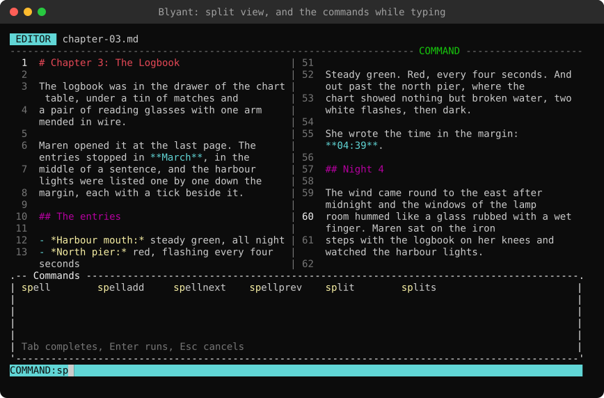


## Corkboard
Plan a book, an article or a thesis on a corkboard: chapters, research folders and loose ideas are cards that you place freely, color, and lay on top of each other. Each project has a separate corkboard, kept in the project folder, so the board goes with the project when you move, copy or sync it.

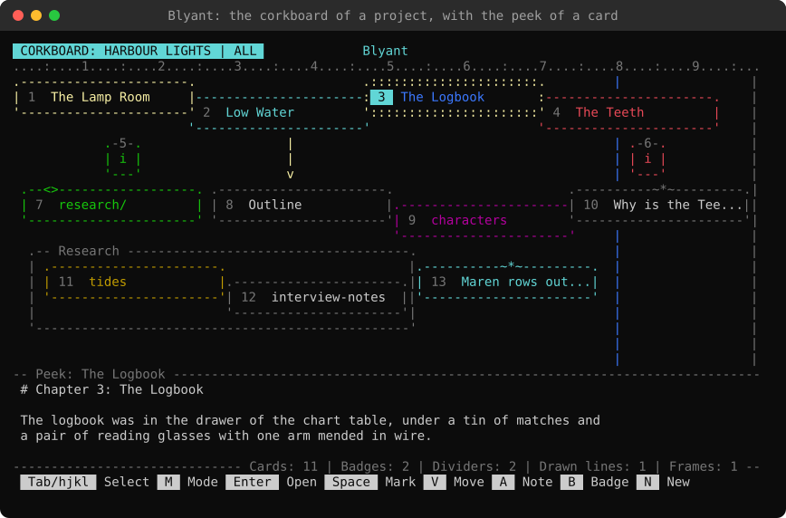

- **Cards of files, folders and notes**: `:pin` a file or folder from the editor, the file browser or the lists, or write a note card (`A`) with your own text. `Enter` opens the file in the editor, the folder in the file browser, or the note. A badge (`B`), a small round `i` with a note, marks a group of cards
- **Arrange the cards your way**: move a card with `V` and `h` `j` `k` `l`, put it on top of the others or below them, give it a color and a title, or lay out all cards in rows with `:arrange number`, `:arrange name` or `:arrange color`
- **Dividers, lines and frames**: split the board into columns, draw lines and arrows between cards, and put a frame with a title around a group
- **See without opening**: `P` shows the start of the selected card's file (or what a folder holds) below the board, and `I` gives information about the card
- **A board for each project**: `B` in the list of projects opens the board of the selected project, and its cards are shown beside the list; with `:list` you can keep more boards
- **Safe to try**: `D` takes a card off (the file stays), `:clear` takes all cards off after asking, and `u` puts them back. A card follows its file when you rename or move the file in Blyant

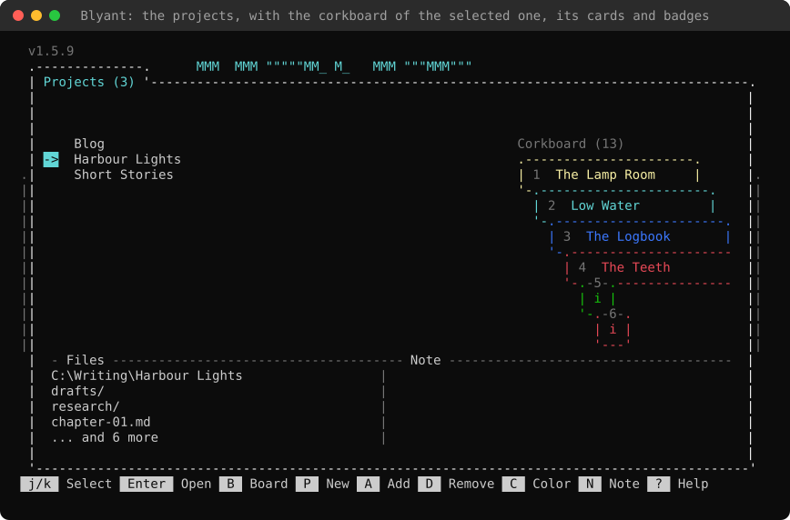

See the [guide to the corkboard](Guide-to-corkboard.md).

## Key features

**Files and projects**
- The start page: New file, File browser, New project and Open project, a key each
- A project is a folder with the files of a piece of writing, kept in a folder of your choosing
- A corkboard to plan a book or an article: files, folders and notes as cards you place, color and arrange, with a board for each project that moves with the project folder ([guide](Guide-to-corkboard.md))
- Your files are ordinary text files on your own computer, to back up, sync and open with any other program

**A Vim-style editor**
- Normal, Insert and Visual modes (also block selection), counts, text objects, registers and undo
- Split view: the same text in two panes side by side, remembered when you open it again
- Zen mode (`:zen`): only the mode and the file name above the text, and the line and column below it
- Syntax highlighting for Markdown, Typst, HTML, PHP, CSS, JavaScript, JSON, XML, C#, C and C++, Rust, Python, PowerShell, shell scripts, Windows batch files, settings files (INI) and diffs ([which files](Guide-to-editor.md#colors))
- `:format` formats HTML, CSS and XML files as [Blyant Validator](Guide-to-installation.md#blyant-validator) does ([how](Guide-to-editor.md#other-commands))
- Spell checking and word completion
- Typst: colors, completions (`/h1`, `/figure`, `/math` ...) and a [guide to writing with Typst and its CLI](Guide-to-typst.md)
- Search and replace with regular expressions, file comparison (diff), snippets, and a macro recorder whose macros can be edited as text
- An edit history (`:changes`): the latest edits in a list, to see what you did and jump back to it
- A command line with `Tab` completion and command history on every page

**A file manager**
- An orthodox file browser with two panes: create, rename, copy, move, delete and compare
- Favorites (with folders and colors), file history, a directory hotlist and file search by name or text
- Peek at a file without opening it, and open any file at the place you left it

**Quick to get around**
- The Jump menu (`Ctrl+O`): bookmarks, recent places, files, directories and pages in a few keys
- `gf` on a file name or a Markdown link in your text opens that file, so a table of contents leads to the chapters
- Use bookmarks to create custom jump points in files, folders, projects, pages, and settings, and open them from anywhere using the command `:book number`
- The same keys everywhere: `h` `j` `k` `l` to move, `/` to search, `?` for help and `:` for commands
- Built-in guides: a quick guide and short guides to each part of Blyant, and a user manual (Markdown in the download, PDF on the releases page)

**At home in any terminal**
- Pure 7-bit ASCII interface that works with any monospaced font
- Modules: turn off the projects, the corkboard or the Jump menu when you do not need them, and Blyant shows only what you use
- Color schemes and logos, which you can edit and make your own; `:colorscheme name` changes the scheme from any command line
- English built in, and ten more languages as files that can be changed or added to
- Runs on Windows, Linux (also Raspberry Pi) and macOS, as a single file with nothing else to install
- A line-based shell (`blyant --shell`): work with your files and lists through typed commands and numbered lists, for screen readers and scripts, with the full editor a command away ([tutorial](Guide-to-shell-tutorial.md))
  - Make files, and add, move, copy and change lines in them without opening an editor: `insert todo.md bottom Get pencils and paper`, `shift todo.md 4-6 Done`, `shift notes.md 12 up`, a whole section with `shift -s notes.md Ideas down`, `lines notes.md 4-6 > plan.md bottom` (`cut` moves them), `change notes.md +12 New text` (and `undo` puts it back), and copy and paste with `clip` and `$clip` ([practice](Guide-to-shell-tutorial.md#practice))
  - Read through a file with `peek` and `+` or `-` (or `j` and `k`, and `gg` and `G` for the top and the end), and search it (`peek notes.md /storm`). The lines come between two markers, so a peek stands out from the commands around it, and the markers show whether the file goes on above (`-^`) or below (`-v`). Collect lines from several files in a register (`reg notes += $peek`), keep commands in a register or file and run them as a small script (`run $tidy`), and run a command again with `!!` ([running commands](Guide-to-shell.md#running-commands))
  - Work with a file from a list: `file 2` makes row 2 of `recent` or `fav` the file you work on (`$file`), `echo $file` shows which file it is, and `path` and `name` copy the path or name of the file, as `:path` and `:name` do in the editor
  - Go back to the text you worked on last with `resume`, also the next day: it opens `$file` in the editor where you left off
  - Sort lines and change the letter case without opening an editor (`lines notes.md 3-20 sort`, `upper`, `lower`), do simple calculations with `calc` and put the result in a file (`insert budget.md bottom Total: $calc`), and see the latest files with sizes and folders (`recent -s -f`) ([calculating](Guide-to-shell.md#calculating))
  - Replace a text everywhere in a file, and see first what would change: `replace -n chapter-3.md Maren Marit`, then `replace chapter-3.md Maren Marit` (`-i`: any letter case; `undo` takes it back)
  - Change a word without typing the line again: `words notes.md 12` numbers the words of a line (`#9 want`), and `word notes.md 12 9 replace wish` changes word 9 (also `before`, `after`, `delete`, `upper`, `lower`, `title`). After a command, `@` is the file and the line it worked on: `word @ 9 replace wish`, `shift @ up`
  - Keep results in registers with `>`: a file (`file plot.md > $other`), a calculation (`calc 22 * 3500 > $words`), the files of a search (`find -t TODO > $open`), or commands you just typed as a script (`again 3-5 > $tidy`), and give a script words (`run $check $file 12`) ([registers](Guide-to-shell.md#registers))
  - Give files tags and find them again, wherever they are: `tag add chapter-3.md draft`, then `tag draft` lists the files with the tag, numbered (`open 2`). `$tag` is the tag you work with ([tags](Guide-to-shell.md#tags))
  - Find files in a large tree with short rows (`find -b storm`: the names only), see when each file was last changed (`find -d`, and `ls -d -s` with the sizes), see the last search again with `find`, and search the latest files, the history and the favorites for a text (`recent -t storm`)

## Blyant Validator
**[Blyant Validator](https://github.com/artstisen/blyant-validator)** is a companion tool, which also works as a standalone program: validate HTML, CSS, XML, Markdown and Typst, and format HTML, CSS and XML, side by side with your editor, in any terminal. It checks a file again each time it is saved, checks links to files and to places in a page, gives hints for accessible HTML with `--accessibility`, and turns a Typst document into a PDF with `:typst`.

The two work together. Set Blyant as the editor of Blyant Validator, and each problem the validator finds opens in Blyant at the line with the problem:

```
:editor "C:\path\to\Blyant.exe" +{line}
```

(On Linux and macOS, give the path of `Blyant`.) Fix the problem, then `:wq` saves and closes the file. `:exit` (or `:qa`) leaves Blyant and takes you back to Blyant Validator at once. If the file has unsaved changes, `:exit` asks about them first. See [Blyant Validator](Guide-to-installation.md#blyant-validator) in the installation guide.

## Screenshots
The screenshots are of the real program, made with [tools/screenshots.py](tools/screenshots.py) from a made-up writing project, in the color schemes Default, Deep Blue and Tasty Bytes.

| | |
|---|---|
| 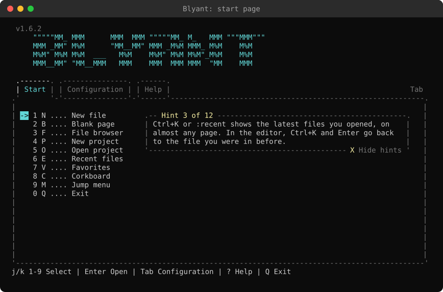 | 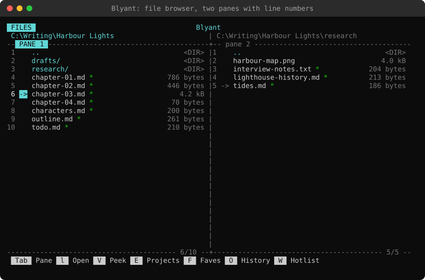 |
| The start page, with a hint about a feature | The file browser: two panes, line numbers and favorites (`*`) |
| 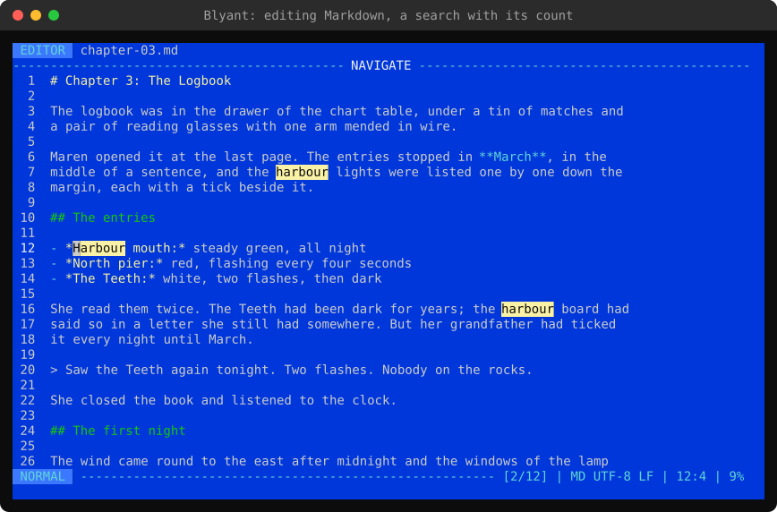 | 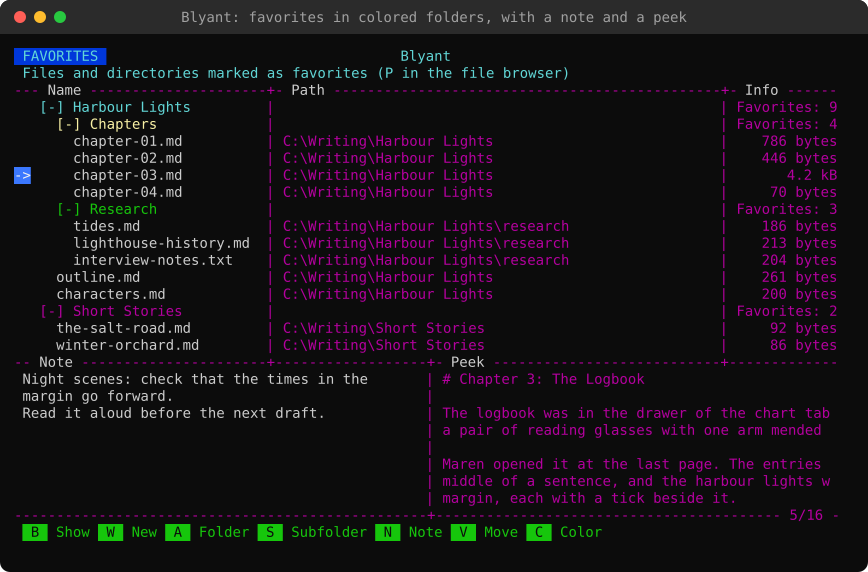 |
| Editing Markdown: colored text, line numbers, a search with the number of matches | Favorites in colored folders, with a note and a peek |
| 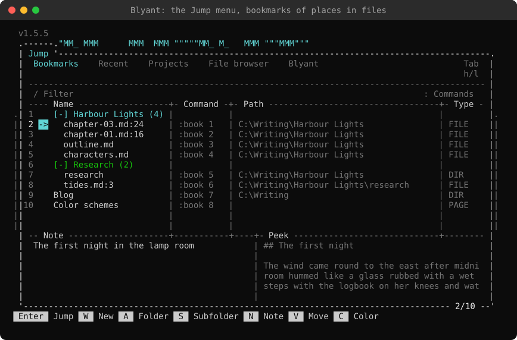 | 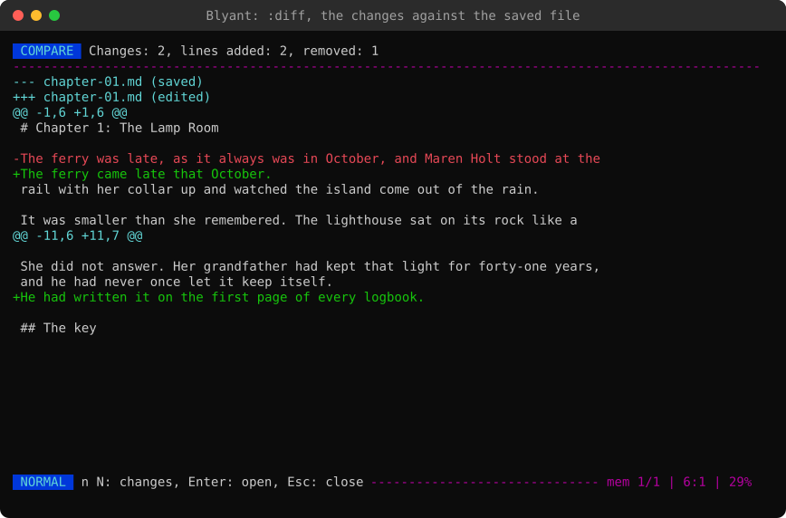 |
| The Jump menu: bookmarks of places in files, `:book 1` from anywhere | `:diff`: what you changed since the file was saved |
| 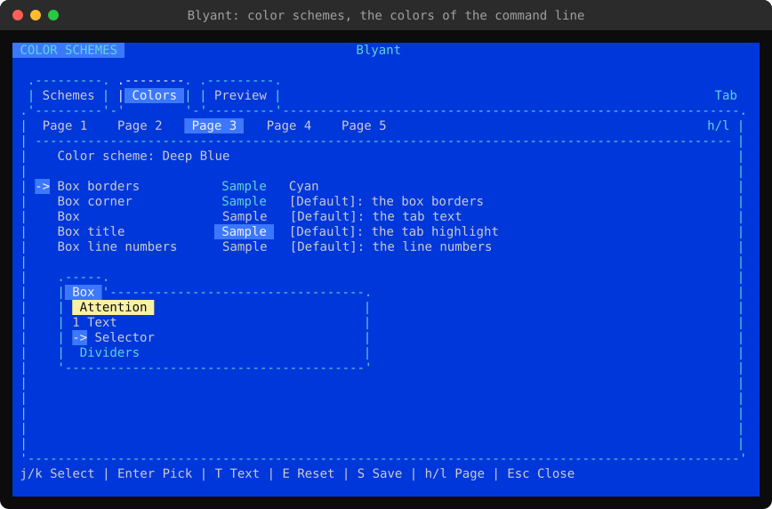 |  |
| Color schemes: the colors of the command line, with a sample | Split view, with commands listed while you type one |
| 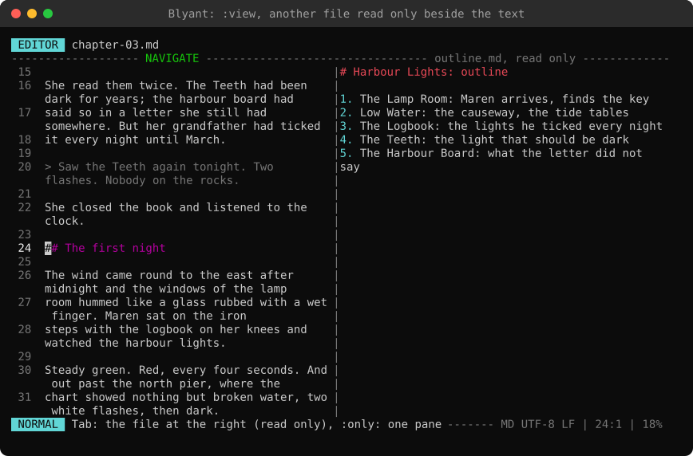 | 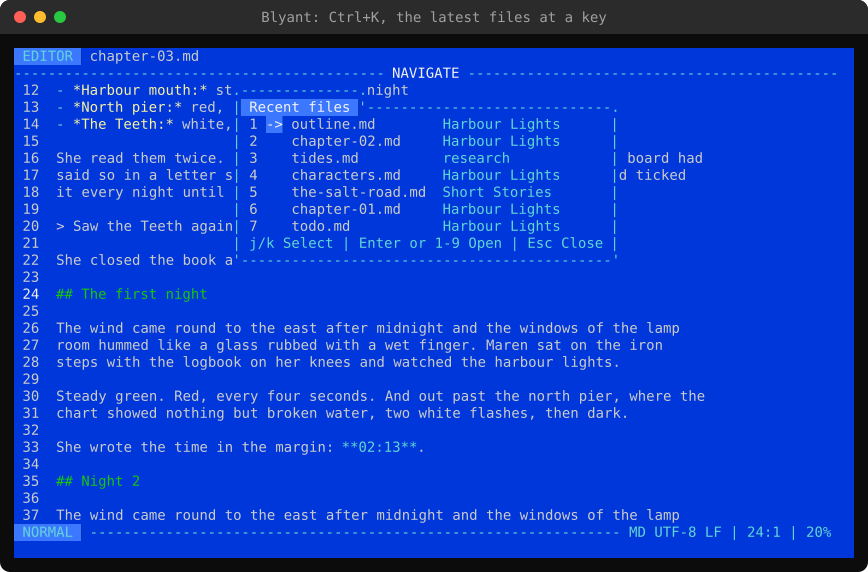 |
| `:view` (or `:split name`): another file, read only, beside the text | `Ctrl+K`: the latest files, to switch to one |
| 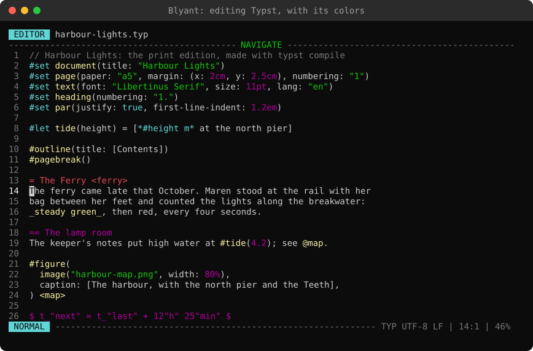 |  |
| Editing Typst: markup, math and code in color | The corkboard of a project: files, folders and notes as cards |
| 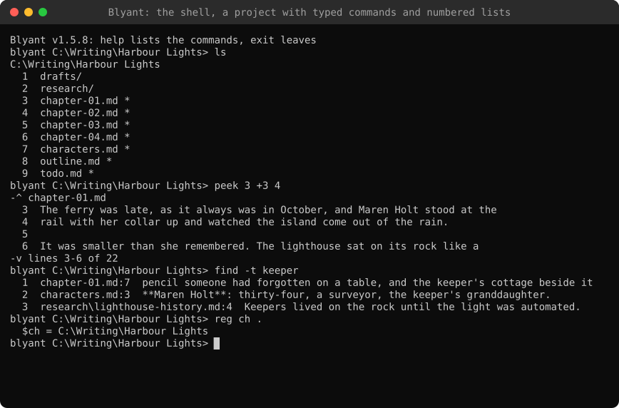 | 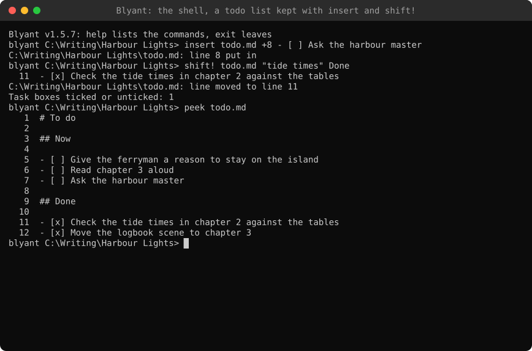 |
| The shell (`blyant --shell`): `ls`, `peek`, `find` and a register, in numbered lists | The shell: a task added with `insert`, and ticked and moved to _Done_ with `shift!` |

## Getting started
1. Download the build for your platform from the [releases page](https://github.com/artstisen/blyant/releases), and unzip it into a directory of your choice.
2. Start `Blyant` (or `Blyant.exe` on Windows) in your terminal. `blyant .` opens the file browser in the directory you are in, and `blyant chapter.md` opens the file in the editor.
3. On the start page, press `P` for a new project or `N` for a new file. Press `?` on any page to see the keys you can use there, or open the Quick guide on the Help tab of the start page.

See the [guide to installation](Guide-to-installation.md) for the builds and the details.

## Pure 7-bit ASCII TUI
The aim is to make an unbloated set of core tools. I've included functionality that I would normally have added via lightweight, functional plugins and init modifications in Neovim, without disrupting the classic terminal aesthetic.

The interface of Blyant is drawn with standard 128-character ASCII only (no extended ASCII or ANSI character sets). This makes Blyant compatible with all standard monospaced fonts, regardless of the platform. The files can contain any Unicode text.

## About Blyant
When Blyant starts, the start page offers New file, File browser, New project and Open project. A project is a folder anywhere on your computer: a new one is made in a folder you pick, and a folder you already have can be added. You work on a project in the file browser, where text files (.md, .txt, .html ...) open in the editor. The file browser also manages files and directories, and keeps your favorites, the file history and a directory hotlist. Blyant can be set to start directly in the file browser.

Blyant works in the style of Vim: the editor has Normal, Insert and Visual modes, and the menus and lists use the same keys for moving around (`h` `j` `k` `l`), searching (`/`), help (`?`) and commands (`:`).

## Guides
- [Download and installation](Guide-to-installation.md)
- [Start page, projects and the file browser](Guide-to-start-page.md)
- [Jump menu, color schemes and logos](Guide-to-jump-menu.md)
- [Corkboard](Guide-to-corkboard.md)
- [Editor](Guide-to-editor.md)
- [Writing with Typst](Guide-to-typst.md)
- [Shell](Guide-to-shell.md), and a [shell tutorial](Guide-to-shell-tutorial.md)
- [Settings file](Guide-to-settings-file.md): every setting, with its values and default
- [Changes](CHANGELOG.md)

The guides are also put together as a **user manual**, in two forms:
- **Markdown** (`Blyant-User-Manual.md`), in every release archive next to the program, to read in Blyant itself
- **PDF** (`Blyant-User-Manual-1.5.9.pdf`), made with [Typst](https://typst.app), with a contents page and page numbers: a separate download on the [releases page](https://github.com/artstisen/blyant/releases), to read or print

Inside Blyant, press `?` for the list of keys.

## Specifications
| | |
|---|---|
| Supported platforms | Windows, Linux and macOS |
| Requirements | None for the single-file builds (the .NET runtime is included); the portable build needs the .NET 10 runtime |
| Application type | Text mode |
| Core code base | Agnostic: no OS-specific logic, .NET handles the differences between the platforms |
| Box drawing | Classic ASCII |
| Console I/O encoding | UTF-8 |
| Languages | English built in; German, Danish, Norwegian (bokmål), Swedish, Spanish, French, Italian, Polish, Dutch and Finnish as language files that can be changed, and more can be added (the commands and keys are the same in all languages). The language files are also a separate download on the releases page (`Blyant-languages-1.5.9.zip`) |
| Date/time format | ISO 8601 |
| Software license | [MIT](LICENSE) |

## Building from source
Blyant has no dependencies besides .NET itself.

```
dotnet build Blyant.sln
dotnet test Blyant.sln
dotnet run --project Blyant
```

`publish.ps1` builds self-contained single file executables (with the .NET runtime included) for Windows, Linux and macOS, and the lightweight version, which runs on all platforms and needs the .NET runtime.

`AGENTS.md` has the rules for working on the code (for people and for coding agents).

## Tools used
- Written in C#, a single binary file, no dependencies, runs in the terminal you already use
- CLI tools: JetBrains Command Line Tools, .NET CLI compiler, PowerShell, and GitHub CLI
- Agentic tools: Claude Opus 5.5 (scripting/testing/code review)
- Code editor: Blyant with syntax highlighting, code completion, and code snippets
- Programming language: C# 14
- Framework: .NET 10
